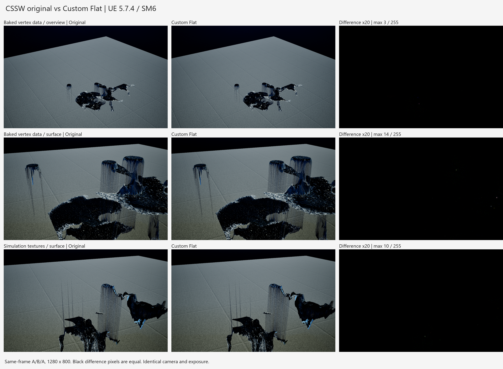

# CSSW Custom 材质副本与对比

当前最终版本为 **`M_CSSW_Surface_Custom_Flat`**。它在 Custom 重构基础上，递归展开了 41 处函数调用，覆盖 19 个项目函数和 5 个引擎函数；母材质中没有 MaterialFunctionCall、FunctionInput、FunctionOutput，也没有遗留的函数所有者引用。

所有运算现在都在同一张图中，共 432 个表达式，其中 101 个 Custom。新增的原生节点主要承担函数接口的类型转换、默认值和材质属性拆装。5 个副本实例仍然保留，其中 `MI_CSSW_River_Custom` 已改为继承 Flat，其余副本实例通过原来的继承链使用 Flat。原项目材质及关卡引用未改动。

原 `M_CSSW_Surface_Custom` 文件被另一个已报错的编辑器进程占用，无法覆盖保存，因此将展开结果保存为 `_Flat` 并更新副本实例的父材质。原 Custom 版及 `Functions` 目录保留用于追溯，Flat 材质不依赖这些函数。实测水体形状、泡沫分布、细节法线和遮罩表现相符；存在极少量像素差异，不能称为逐像素完全相同。

UE 内容浏览器中的目录为 `/PCGPlugins/ShallowWater/Material30/Custom`。开启“显示插件内容”后可搜索下列资产：

- `M_CSSW_Surface_Custom_Flat`：当前使用的完整展开母材质。
- `M_CSSW_Surface_Custom`：保留函数结构的上一个版本。
- `MI_CSSW_River_Custom`：对应原 `MI_RiverSurfaceOver`，可用于引用它的 CSSW 蓝图。
- `MI_CSSW_WaterSurface_Custom`：对应原 `MI_WaterSurface`，保留其继承层级和参数。
- `MI_CSSW_Water_3333333_Custom`、`MI_CSSW_Water_25155946_Custom`、`MI_CSSW_Water_8141441_Custom`：对应已有烘焙实例，保留各自父链与覆盖参数。

要实际试用，在测试水体上选择与原实例对应的 `_Custom` 实例。不能直接用母材质替代烘焙实例，否则会丢失该实例提供的贴图与参数。此次没有自动切换已有蓝图或关卡。

第一阶段保留函数封装时，母图由 **179 减少至 88** 个表达式：108 个表达式替换为 17 个新 Custom，原有 `CSSW_WorldToSimUV` 保留。计入 19 个项目函数，合计 **782 → 523** 个表达式，352 个表达式替换为 93 个新 Custom。现在完整展开后，母图包含全部 432 个表达式；该数量不能直接与此前仅统计母图的 88 比较。函数可能多次调用，展开同时移除了接口、重路由和未使用的计算，保留全部暴露参数。

重构将相连的数值运算合并为 HLSL，保持原运算次序、输入分量、默认常量和输出维度。每行代码的注释记录对应原节点名。主要覆盖以下计算：

- 母材质中的水色、粗糙度、透明遮罩及散射相关数值组合。
- `MF_FluidDetailWave` 及其依赖中的流向 UV、波浪采样解码、距离衰减、法线叠加和位移数值。
- `MF_FluidFoam` 及其依赖中的浅水泡沫、流动、扰动、遮罩及泡沫材质混合。
- 法线重建、导数叠加、半透明合成等工具函数中的算术。

参数节点、Static Switch、纹理采样、世界坐标与深度等上下文输入、Material Attributes、SingleLayerWater 输出仍由原生节点提供。这样可以保留实例参数接口、静态裁剪、采样器设置和引擎材质输出规则。引擎自带的法线混合、时间抖动及其嵌套函数也已经展开。每个展开节点的描述记录原函数调用路径与节点名，方便查找。

验证在 UE 5.7.4 / D3D12 SM6 下完成，保存资产后重新启动编辑器再次加载。全部函数引用、保留节点连接、Custom 边界连接、5 个实例的有效参数和父链均通过检查。Masked、SingleLayerWater、双面、世界空间法线、实例化网格支持等设置一致。87 个原 ShallowWater 资产的 SHA256 检查无变化。

渲染使用完整的 `SM_CSSW_Water_3333333` 数据，在未保存的空白测试场景中，以总览、近景、掠射角三个相机采集 1280×800 PNG。每组在同一帧连续捕获原版、Custom、再次原版，固定曝光，关闭时间抗锯齿、运动模糊与屏幕空间反射。最后一次运行共 **24 组 A/B 比较**，覆盖保存的实例参数、不同时间、关闭泡沫、关闭细节波浪、模拟贴图路径、关闭细节 WPO、关闭泡沫扰动。

24 组中，原版重复捕获的 A/A 误差全部为 0。A/B 每组整幅图的平均 RGB 绝对误差最大 **0.001927 / 255**；任一通道差值超过 2 的像素最多 **96 / 1,024,000（0.009375%）**；单通道最大差值 **14 / 255**。平均值包含背景，应结合变化像素数与最大值理解。关闭细节波浪时最大差值降为 1，提示主要残差与细节法线计算相关；浮点计算与编译优化差异是合理解释，但没有把它当作已证明的唯一原因。

这些结果支持“本次测试条件下视觉表现一致”，不代表所有参数、所有 GPU 或开启时间性渲染效果后都能逐像素一致，也不包括正在运行的 CSSW 求解器全流程测试。模拟贴图测试使用已有烘焙纹理。

图中每行依次是原版、Custom、差分；差分中的黑色表示一致。完整指标见 [pixel-metrics.json](pixel-metrics.json)，材质和实例校验见 [validation.json](validation.json)。

Custom 重构没有带来已证实的 GPU 性能提升。相对原材质，Flat 的母材质像素指令 **1124 → 1134**，烘焙实例 **1112 → 1120**；顶点指令、采样器数和纹理采样次数保持一致。相对展开前的 Custom 版，母材质仍是 1134，烘焙实例从 1121 变为 1120。母材质为 6 个采样器、顶点 4 次/像素 16 次采样，烘焙实例为顶点 0 次/像素 13 次。这里比较的是编译器指令统计，没有进行 GPU 毫秒性能基准。

另有一个保留的原材质问题：`CSSW_WorldToSimUV` 实际计算 `(WorldXY - SimCenter) / SimInvSize + 0.5`，其中名为 `SimInvSize` 的输入接的是 `CSSW_SimCenter.B`，而 C++ 写入的是独立标量 `CSSW_SimInvSize`，且将向量 B 设为 0。当前材质参数列表也没有该独立标量。`SwithSim=True` 的烘焙顶点色路径避开了这些模拟贴图采样；测试贴图路径时，两边都临时使用相同的 `CSSW_SimCenter=(1605,1785,53000,0)`，保证除数有效。副本没有单独修正这个行为，以免混入与原版不等价的改动。原 `25155946` 实例还存在丢失的模拟贴图引用，因此它仅用于参数继承检查，渲染验证使用数据完整的 `3333333`。

实现与复现脚本位于 [Scripts/CSSWCustom](../../Scripts/CSSWCustom/README.md)。资产独立可用，不依赖 Saved 目录中的检查文件。
