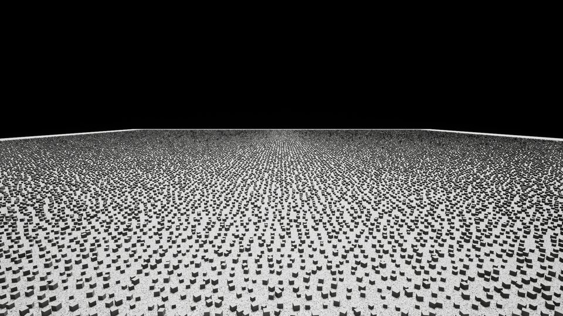
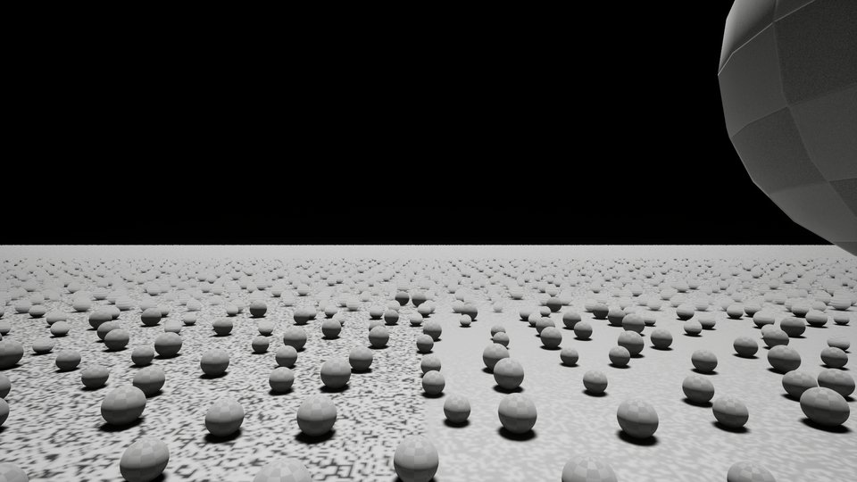

# 实例路性能与正确性基线（2026-10-02）

[InstanceCullingOptimization.md](../../InstanceCullingOptimization.md) 第一阶段（§4.1）要的那份基线：动任何剔除 / 取数逻辑**之前**，
`UCSGpuInstancedMeshComponent` 的经典剔除路、Nanite 路与引擎原生 ISM / HISM 在同一批实例、同一个机位下各花多少。
后面每一步的 A/B 都拿这份比。

数字全部来自 [RunGpuInstancedBench.ps1](../../Scripts/RunGpuInstancedBench.ps1) 的一次整套跑测，原始数据：

- [data/baseline_20261002_a.summary.json](data/baseline_20261002_a.summary.json)：全部场景、机位、列的中位数 / P95 / 均值。
- [data/baseline_20261002_a.report.md](data/baseline_20261002_a.report.md)：150 行的完整逐机位表（下面只摘要）。
- 每个机位的 CsvProfile 原始 `.csv` 与截图在 `Saved/InstanceCullOpt/Bench/baseline_20261002_a/`（不进库，376 MB）。

## 环境

| 项 | 值 |
| --- | --- |
| 机器 | `DESKTOP-SIFMVJL`，24 逻辑核，64 GB |
| 显卡 / 驱动 | NVIDIA GeForce RTX 4080（16 GB），591.86，D3D12 |
| 引擎 / 配置 | 5.7.4 源码版（`D:\UE-SourceCode-5.7.4`），`UETest574Editor Win64 Development`，`-game` 进程 |
| 分辨率 | 1920 × 1080，`r.ScreenPercentage=100`，离屏渲染（`-RenderOffscreen`） |
| 渲染设置 | 工程 `DefaultEngine.ini` 原样：Lumen GI + 反射、VSM 开且保留 CSM 回退级联、硬件光追开、Substrate 开、TSR |
| 关键 CVar | `r.Nanite=1`，`r.Shadow.Virtual.Enable=1`，`r.Shadow.Virtual.ForceOnlyVirtualShadowMaps=0`，`r.InstanceCulling.OcclusionCull=0`，`r.RayTracing=1`，`t.MaxFPS=0`，`r.VSync=0` |
| 代码 | PCGPlugins `3307d60` + 工作区未提交改动（含 09-29 的地被 Nanite 路）+ 本轮只加的分段计时与跑测工具 |

场景：一盏投影的方向光、一块地面、一片 √N × √N 的抖动网格实例（间距 1 m，实例 25–40 cm，固定种子）。画面见下，
左：`classic_cpu_100k` 的 `edge` 机位；右：`classic_cpu_100k_lod4` 的 `center` 机位。

| | |
| --- | --- |
|  |  |

## 怎么跑

```powershell
# 整套基线（30 个场景 × 5 个机位，约 12 分钟）
.\Plugins\PCGPlugins\Scripts\RunGpuInstancedBench.ps1 -Suite baseline -Frames 300 -Name <名字>

# 只跑名字里含这些词的场景
.\Plugins\PCGPlugins\Scripts\RunGpuInstancedBench.ps1 -Filter "classic_cpu_100k+nanite_gpu" -Name <名字>

# 交错 A/B：每个机位按 A B / B A / … 各量一遍，命令里的空格写成 @
.\Plugins\PCGPlugins\Scripts\RunGpuInstancedBench.ps1 -Variants "base:r.Foo@0~new:r.Foo@1" -Pairs 4 -Name <名字>
```

```bash
python Plugins/PCGPlugins/Scripts/GpuInstancedBenchReport.py <summary.json>                      # 总表
python Plugins/PCGPlugins/Scripts/GpuInstancedBenchReport.py <summary.json> --ab                 # 交错 A/B 的配对差
python Plugins/PCGPlugins/Scripts/GpuInstancedBenchReport.py <前.json> --compare <后.json>       # 两次跑测的差
```

跑测本体是 `-game` 进程里的控制台命令 `CSGpuInstanced.Bench`（`Source/ComputeShaderGenerator/Private/Bench/CSGpuInstancedBench.cpp`，
场景表、机位、口径都写在那个文件头）。它是**另一个引擎进程**：别的编辑器开着时读数会互相污染，脚本默认拒跑。

## 口径

每格是那个机位采集帧（300 帧，重场景至少 60 帧）的**中位数**，毫秒。

| 列 | 来源 |
| --- | --- |
| Frame / GT / RT / GPU | CsvProfile 的 `FrameTime` / `GameThreadTime` / `RenderThreadTime` / `GPUTime` |
| 剔除 | `GPU/CSGpuInstanced{PackPoints,ClusterCull,InstanceCull,BuildArgs}` 之和（经典路；本轮新加的分段计时） |
| 写入 | `GPU/CSGpuInstancedNaniteWrite`（Nanite 路把实例写进 GPU-Scene） |
| 预通道 / 基通道 / 阴影 | 引擎的 `GPU/Prepass`、`GPU/BasePass` + `GPU/NaniteBasePass`、`GPU/ShadowDepths` |
| 建图 (CPU) | `CSGpuInstanced/CullSetupMs`：渲染线程给全部经典代理建剔除图的毫秒 |
| 可见 | 经典路每个机位量完回读一次压缩游标（`DebugReadVisibleCountsSync`），逐 LOD |

机位：`top` 俯视全场（全部可见）、`edge` 站在场边往里看（约 76%）、`center` 站在场心平视（约 25%）、
`away` 站在场边往外看（约 0%）、`orbit` 绕场转圈（每帧固定角步长）。

**重复性**：同一套场景隔 15 分钟重跑一遍（`baseline_20261002_b_subset`），整帧与各分段的中位数差在 1% 以内，
轻场景（CPU 受限）的 `FrameTime` 偶有 2–4%。**小于 2% 的差别不能靠先后两次跑测下结论，要用交错 A/B。**

## 结果摘要

### 整帧（Frame / GPU，ms）

空场景（`away` 机位，几乎什么都不画）是 4.1–4.3 / 3.7–3.8，下表减掉它才是这条路自己的开销。

| 场景 | 实例 | `top`（全可见） | `edge`（约 76%） | 备注 |
| --- | --- | --- | --- | --- |
| `classic_cpu_100k` | 10 万 | 6.19 / 5.66 | 7.40 / 6.84 | 经典路，投影 |
| `classic_cpu_100k_noshadow` | 10 万 | 5.56 / 5.04 | 5.38 / 4.84 | 同上，不投影 |
| `ism_100k` | 10 万 | 5.87 / 5.35 | 5.66 / 5.12 | 引擎 ISM，同一张网格 |
| `hism_100k` | 10 万 | 5.51 / 4.77 | 5.59 / 4.64 | 引擎 HISM（渲染线程多约 1 ms 的树遍历） |
| `nanite_cpu_100k` | 10 万 | 4.73 / 4.01 | 4.85 / 4.27 | Nanite 路，CPU 源（不每帧写） |
| `nanite_gpu_100k` | 10 万 | 5.07 / 4.51 | 5.27 / 4.72 | Nanite 路，GPU 源（每帧写） |
| `ism_nanitemesh_100k` | 10 万 | 4.88 / 4.02 | 4.95 / 4.30 | 引擎 ISM + Nanite 网格（对照组） |
| `classic_cpu_1m` | 100 万 | 17.84 / 17.38 | 34.77 / 34.27 | 经典路，投影 |
| `ism_1m` | 100 万 | 16.76 / 16.27 | 14.82 / 14.28 | 引擎 ISM |
| `nanite_cpu_1m` | 100 万 | 6.03 / 5.53 | 6.60 / 6.06 | Nanite 路，CPU 源 |
| `nanite_gpu_1m` | 100 万 | 7.84 / 7.32 | 8.35 / 7.77 | Nanite 路，GPU 源 |
| `classic_cpu_100k_256comps` | 10 万 / 256 个组件 | 11.44 / 8.85 | 11.19 / 8.66 | 同样 10 万个实例拆成 256 个组件 |
| `ism_100k_256comps` | 10 万 / 256 个组件 | 5.40 / 4.87 | 5.38 / 4.82 | 引擎 ISM，同样拆法 |

### 剔除与写入 pass 本身（GPU，ms）

| 场景 | `top` | `edge` | `center` | `away` | 说明 |
| --- | --- | --- | --- | --- | --- |
| `classic_cpu_100k` | 0.084 | 0.071 | 0.040 | 0.017 | 两级剔除 |
| `classic_cpu_1m`（容量 150 万） | 0.692 | 0.555 | 0.299 | 0.182 | 全不可见时的 0.18 是按容量扫一遍的钱 |
| `classic_gpu_1m`（无簇表） | 0.625 | 0.479 | 0.196 | 0.124 | |
| `classic_gpu_100k` → `_cap8`（容量 80 万） | 0.084 → 0.146 | 0.072 → 0.132 | 0.039 → 0.102 | 0.018 → 0.102 | 多扫 70 万行空槽 ≈ +0.06–0.08 |
| `classic_points_100k` | 0.086 | 0.073 | 0.045 | 0.022 | 其中每帧重打包 0.012 |
| `classic_cpu_100k_256comps` | **2.18** | 2.10 | 1.86 | 1.90 | InstanceCull 1.01 + BuildArgs 1.01 + ClusterCull 0.16 |
| `nanite_gpu_100k` / `_cap8` / `nanite_gpu_1m`（写入） | 0.018 / 0.054 / 0.174 | 同左 | 同左 | 同左 | 与机位无关：按槽数整份重写 |

### 常驻显存（常驻流按描述符算的字节数，MiB）

| 场景 | 容量 × LOD | 常驻流 | 其中可见缓冲（88 B × 容量 × LOD） | 改成 4 B 源索引之后（推算） |
| --- | --- | --- | --- | --- |
| `classic_cpu_100k` | 15 万 × 1 | 24.1 | 12.6 | 12.1 |
| `classic_cpu_100k_lod4` | 15 万 × 4 | 63.2 | 50.4 | 15.1 |
| `classic_cpu_1m` | 150 万 × 1 | 240.8 | 125.9 | 120.6 |
| `classic_cpu_1m_lod4` | 150 万 × 4 | 619.8 | 503.5 | 139.2 |
| `classic_gpu_1m` | 100 万 × 1 | 83.9 | 83.9 | 3.8 |

CPU 源的容量是活跃数的 1.5 倍（`ResolveInstanceCapacity` 的增长棘轮），可见缓冲与源行都按容量预留。
GPU 源的行缓冲归生产者（76.3 MiB / 100 万），不在这张表里。

### CPU 实例数组的增删（游戏线程上一次调用，ms）

| 操作（10 万个实例） | 经典路 | Nanite 路 |
| --- | --- | --- |
| `SetInstances` | 14.7 | 12.4 |
| `AddInstance` / `RemoveInstance` / `UpdateInstanceTransform`（各一次） | 12.6–13.1（1 次阻塞刷新） | 11.0–11.7（0 次） |
| `UpdateInstanceTransform` × 8，前 7 次 `bMarkRenderStateDirty=false` | **82.5** | **81.7** |
| `AddInstances`（一批 8 个） | 12.9 | 11.1 |

1 万个实例时各约 1/10。

## 发现

按对真实场景的影响排。每条后面是它对应方案里的哪一步。

1. **开着投影时，经典路的大头是阴影，不是剔除。** 回退级联把主视图的可见集逐级联整份再画一遍：
   10 万个实例 `edge` 机位 `ShadowDepths` 2.78 ms（不投影时 0.47），100 万个时 20.5 ms，占 GPU 帧时间的六成。
   同样 100 万个实例，引擎 ISM 是 1.3 ms、Nanite 路 CPU 源是 0.64 ms（它们进 VSM，有缓存）。
   方案里没有这一项（§8 只谈了阴影视图的**正确性**）。
2. **每个组件有固定开销，拆成很多小组件时它就是全部剔除成本。** 同样 10 万个实例拆成 256 个组件：
   剔除的 GPU 时间 0.08 → 2.18 ms，另有 1.7 ms 落在 `GPU/Unaccounted` 里（清零 pass 与状态切换）；渲染线程建剔除图
   0.02 → 2.47 ms；整帧 6.2 → 11.4 ms，瓶颈从 GPU 换成了渲染线程（11.4 ms 对 GPU 8.9 ms）。
   折下来每个组件每帧约 12 µs GPU + 10 µs 建图。引擎 ISM 同样拆法没有这笔钱（5.4 ms）。
   对应方案 §6.4 的跨组件合批 —— 方案把它排在第 4 步"实测热点"，实测它就是热点。
3. **小网格的顶点阶段比引擎 ISM 贵三成。** 100 万个 48 三角的 Cube 全可见：预通道 6.60 对 5.02 ms、基通道 6.72 对 5.15 ms。
   高面数网格（1 万个 3968 三角的球）两边打平（3.42 对 3.46）。差在逐实例取数，不在逐顶点 —— 第二步改取数路径时要盯这一项。
4. **Nanite 路的 GPU 源每帧整份重写，钱不在写入 pass，在它连带作废的东西上。** 写入本身 100 万槽 0.17 ms；
   但 VSM 每帧把这批实例的缓存页作废，`ShadowDepths` 0.64 → 2.33 ms（100 万）、0.50 → 1.11 ms（10 万）。
   另外槽数取的是**容量**：`nanite_gpu_100k_cap8` 比 `nanite_gpu_100k` 整帧多 0.7 ms，几乎全在 `GPU/RayTracingScene`
   （0.14 → 0.71 ms）—— 光追场景按槽数建，藏起来的槽也算。对应方案 §7 与 §2.4。
5. **剔除 pass 自己很便宜。** 100 万个实例全可见 0.69 ms，全不可见 0.18 ms：按容量扫一遍约 0.12 ms / 百万行，
   往可见缓冲抄 88 字节约 0.5 ms / 百万个可见实例。容量是活跃数 8 倍时多花 0.06–0.08 ms。
   所以方案 §6.2（GPU 计数驱动派发）收益上限就是这零点零几毫秒；§5（只输出源索引）在 GPU 时间上的上限是 0.5 ms / 百万可见实例。
6. **可见缓冲是经典路常驻显存的大头。** 88 B × 容量 × LOD 数：100 万个实例 4 级 LOD 是 503 MiB（总共 620 MiB）。
   §5 的收益主要在这里，不在帧时间。
7. **CPU 增删每次都整份重排重传，"攒着一起传"的形态没有攒 CPU 那一半。** 10 万个实例时每次调用约 12 ms，
   其中阻塞刷新只占 1–2 ms，其余是 Morton 排序与打包；`UpdateInstanceTransform(..., bMarkRenderStateDirty=false)` 连调 8 次
   仍然重排 8 次（82 ms）。对应方案 §6.1。

## 正确性基线

自动化 `PCGPlugins` 全套 240 条（[RunPluginAutomationTests.ps1](../../Scripts/RunPluginAutomationTests.ps1)，真 RHI）：

| 用例 | 状态 | 说明 |
| --- | --- | --- |
| `GpuInstancedMesh.*`（12 条，含本轮新加的 `StableIdentity`） | 全过 | |
| `ShallowWater.Solver.Downhill` / `SourceSpread` | 既存红 | 浅水求解器往 +X+Y 漂，与实例路无关 |
| `TinyGladeHouse.Vine.StrandMatchesRecords` / `TubePath` | 既存红 | 本轮动手之前 20:42 的那次全套跑测里就是红的 |
| `NaniteCut.Extract` | 间歇红 | 全套里跑 3 次红 2 次（"追加后三角数翻倍"：第一次抽取少 13 个三角），单独跑 3 次全过；与实例路无关 |

⚠️ 无头跑测必须关掉 CEF 的 GPU 加速（脚本里那条 `-ini`）：Fab 插件启动时建的浏览器窗口在自动化测试期间一绘制就撞引擎断言，
整个进程带着没跑完的用例一起死（实测 240 条跑到第 21 条）。
