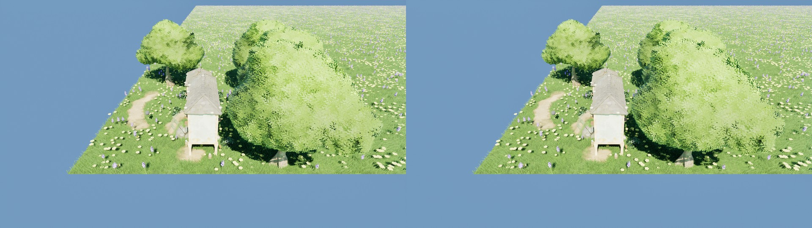

# 可见源行号布局：实现、验证与 A/B 结果（2026-10-02）

[InstanceCullingOptimization.md](../../InstanceCullingOptimization.md) 第二阶段（§5）的落地记录：经典剔除路的可见缓冲从
"每个可见槽抄一份完整属性"改成"每个可见槽只记一个源行号"。结论先行：**常驻显存 −35% ～ −95%，帧时间持平或略好，画面逐像素相同**，
默认已切到新布局，旧布局留在 `r.CSGpuInstanced.VisibleSourceIndex 0` 后面当对照。

对照的基线见 [Baseline_20261002.md](Baseline_20261002.md)；原始 A/B 表：

- [data/ab_index_20261002_a.ab.md](data/ab_index_20261002_a.ab.md)：16 个场景 × 5 个机位 × 3 对的配对差。
- [data/map_house_index_20261002.ab.md](data/map_house_index_20261002.ab.md)：真实地图 `L_HouseGroundDemo`。
- CsvProfile 原始 `.csv`、截图与 `summary.json` 在 `Saved/InstanceCullOpt/Bench/ab_index_20261002_a/`（不进库）。

## 改了什么

| | 旧布局（`VisibleSourceIndex 0`） | 新布局（默认） |
| --- | --- | --- |
| 剔除往可见槽里写 | 3 个变换行 + 原点 + lightmap + 2 个 custom data，**88 B** | 源行号，**4 B** |
| 可见缓冲（每级 LOD 各预留一整份容量） | `88 × 容量 × LOD 数` | `4 × 容量 × LOD 数` |
| 绘制读实例属性 | 读可见缓冲里那份副本 | `SV_InstanceID + 区段起点` → 源行号 → 直接读源实例行 |
| custom data | 剔除按可见槽抄一份 | 按源行号读生产者那条；生产者没给时读一行零 |
| 顶点工厂 / 着色器 | `FCSGpuInstancedMeshVertexFactory`，引擎的 `LocalVertexFactory.ush` 原样 | `FCSGpuInstancedIndexedVertexFactory`，`CSGpuInstancedIndexedVertexFactory.ush` |

LOD 分区没动（方案 §5.1：每级 LOD 仍预留容量个槽，区段起点是 CPU 侧常量），距离 / 视锥 / LOD 选择一个字没改。
同一级 LOD 的各材质段照旧共用那一级的可见结果。

布局是 `FCSGpuInstancedGpuLayout::bVisibleSourceIndex`，建常驻缓冲时按 CVar 定下来、随布局抄进代理；
运行中改 CVar，已注册的组件当场重建（每个组件一次阻塞刷新），所以同一个进程里能做交错 A/B。

### 为什么要自带一份着色器

引擎的 manual-fetch 取数写死了 `TransformBuffer[3 * i + k]` 与 `OriginBuffer[i]` 两条步长不同的流，
而源实例行是 5 个 float4 一行的 AoS（九条打包路 + 剔除 + GPU-Scene 写入共用的契约，不能为这件事改）——`3i + k` 到 `5s + k`
没有线性映射，只能把取数那一小段换掉。`CSGpuInstancedIndexedVertexFactory.ush` 是引擎 `LocalVertexFactory.ush` 的
**打补丁副本**，由 [GenerateGpuInstancedVertexFactoryShader.py](../../Scripts/GenerateGpuInstancedVertexFactoryShader.py) 生成：

| 补丁 | 位置 | 内容 |
| --- | --- | --- |
| 声明 | 文件头 | `CSInstanceRows` / `CSVisibleSourceIndices` / `CSCustomDataIndexMask` 与 `CSResolveSourceIndex` |
| 实例变换与原点 | `ManualFetchInstanceInput` | 经源行号读 `CSInstanceRows[5 × 行 + 0..3]` |
| custom data（顶点着色器） | `Result.InstanceId` / `InstanceOffset` | 下标换成源行号 |
| custom data（像素着色器） | `PerInstanceParams.w` | 同上 |
| lightmap | 取数处 | 恒零（这条路没有烘焙光照） |

每个补丁都断言**恰好匹配一次**，匹配不上就是引擎那份变了、脚本直接失败。生成的文件头记着源文件的 SHA-1。

## 约束

- **引擎升级后要重新生成着色器。** `python Scripts/GenerateGpuInstancedVertexFactoryShader.py`（`--check` 只比不写）。
  编辑器里第一次建新布局的代理时会核一遍 SHA-1，对不上报一次 Error（不拦渲染：多半仍编得过，但引擎改过的地方没跟上）。
- **一个视图族的渲染期间，生产者不许改写 packed 行与 custom data。** 新布局下剔除之后的每个 pass 都拿着行号回来读源行；
  剔除之后、绘制之前把行原地重散，画出来的是"上一批的行号 + 这一批的行"。在渲染命令里改（与视图族渲染是先后两条命令）是安全的，
  现有生产者全是这样；点云源不受约束（它的行是剔除前现打进常驻流的快照）。契约写在 `FCSGpuInstanceSourceGPU` 的注释里。
- **两个工厂并存期间，实例化材质多编一套着色器。** 两种布局是两个顶点工厂类型，勾了 `Used with Instanced Static Meshes`
  的材质两套都编。旧布局确定不再需要对照时，退役旧工厂的类型注册（`IMPLEMENT_VERTEX_FACTORY_TYPE`）才能收回这一套。

## 验证

### 自动化（`PCGPlugins.ComputeShaderGenerator.GpuInstancedMesh.*`）

| 用例 | 守什么 |
| --- | --- |
| `VisibleSourceIndex.Picture` | CPU 源、三级 LOD、带簇、一圈实例在视锥外。新布局的深度图对 GPU 回读的"每个可见槽指向哪一行、落在哪一级"逐实例对；旧布局逐像素对新布局；Morton 重排后可见的**稳定槽**集合不变；按句柄删一个实例后别的一个不动；剔除建图方式来回切 |
| `VisibleSourceIndex.Attributes` | packed GPU 源（每三行藏一行，带 / 不带 custom data）、CPU 源、点云源各走一遍：逐实例随机数、custom data 的顶点着色器路径（WPO）与像素着色器路径（BaseColor） |
| `Streams` / `StreamResize` | 两种布局各声明哪些常驻流、尺寸与格式；新布局每可见槽恰好 4 B |

判据是场景捕获的深度图与 BaseColor：没有时域效果，同一个场景拍两次逐像素相同（用例里先验这一条）。

故意改错着色器，确认用例会红：

| 改错的地方 | 红的用例 |
| --- | --- |
| 可见槽直接当源行号（跳过间接） | `Picture`、`Attributes` |
| 各级 LOD 都读第 0 级的区段 | `Picture`、`Attributes` |
| 像素着色器的 custom data 按可见槽取 | `Attributes`（BaseColor） |
| 顶点着色器的 custom data 按可见槽取 | `Attributes`（深度） |
| 逐实例随机数取自行里另一个 float4 | `Attributes`（BaseColor） |

全套 `PCGPlugins` 244 条在新布局（默认）与 `-CVars "r.CSGpuInstanced.VisibleSourceIndex=0"` 下各跑一遍：
红的只有四条既存红（浅水求解器两条、藤蔓两条），两边相同。

### 跑测截图

多个变体时跑测在固定机位的头两对里每一步都留图，[GpuInstancedBenchImageDiff.py](../../Scripts/GpuInstancedBenchImageDiff.py)
拿"同一个变体两次拍的差"当噪声底、"同一对里两个变体的差"当信号。16 个场景 64 组、真实地图 5 组，没有一组信号超过噪声底。
这是粗筛（整帧有 TSR、Lumen、自动曝光，不受开关影响的 ISM / Nanite 场景自己就有 1–2% 的像素差出 8 个灰阶）；
逐实例的判据在上面的自动化用例里。

真实地图的 `look` 机位，左旧布局、右新布局（树冠的差是风）：



## 结果

环境同基线（RTX 4080，1920 × 1080，`UETest574Editor Win64 Development` 的 `-game` 进程）。

### 常驻显存（常驻流字节数，MiB）

| 场景 | 容量 × LOD | 旧布局 | 新布局 | 差 |
| --- | --- | --- | --- | --- |
| `classic_cpu_100k` | 15 万 × 1 | 24.1 | 12.1 | −50% |
| `classic_cpu_1m` | 150 万 × 1 | 240.8 | 120.6 | −50% |
| `classic_cpu_100k_lod4` | 15 万 × 4 | 63.2 | 15.2 | −76% |
| `classic_cpu_1m_lod4` | 150 万 × 4 | 619.8 | 139.2 | −78% |
| `classic_cpu_100k_2sections` | 15 万 × 2 | 38.0 | 13.9 | −63% |
| `classic_gpu_100k` / `_cap8` | 10 万 / 80 万 × 1 | 8.4 / 67.1 | 0.4 / 3.1 | −95% |
| `classic_gpu_1m` | 100 万 × 1 | 83.9 | 3.8 | −95% |
| `classic_points_100k` | 10 万 × 1 | 16.0 | 8.0 | −50% |
| `classic_cpu_10k_highpoly` | 1.5 万 × 1 | 3.5 | 2.3 | −35% |
| 地图 `L_HouseGroundDemo`（32 个实例组件，150 万个实例） | — | 40.0 | 2.5 | −94% |

CPU 源剩下的那一半是源行本身（80 B × 容量）；GPU 源的行归生产者，不在这张表里。

### 时间（新 − 旧，3 对配对差的平均，ms；括号里是与平均差同号的对数）

| 场景 | 机位 | Frame | 剔除 pass | 预通道 | 基通道 | 阴影 |
| --- | --- | --- | --- | --- | --- | --- |
| `classic_cpu_100k` | `top` | −0.002 (2/3) | −0.014 −16% (3/3) | +0.002 | +0.001 | +0.012 |
| `classic_cpu_1m` | `top` | −0.134 −1% (3/3) | −0.168 −24% (3/3) | +0.008 | +0.011 | −0.001 |
| `classic_cpu_1m` | `edge` | −0.104 (3/3) | −0.129 −23% (3/3) | +0.006 | +0.006 | +0.016 |
| `classic_gpu_1m` | `top` | −0.123 −1% (3/3) | −0.176 −26% (3/3) | +0.016 | +0.016 | −0.000 |
| `classic_gpu_1m` | `edge` | +0.024 (1/3) | −0.124 −24% (3/3) | +0.023 | +0.018 | +0.085 (3/3) |
| `classic_cpu_1m_lod4` | `top` | −0.076 (3/3) | −0.166 −24% (3/3) | +0.031 | +0.042 | +0.000 |
| `classic_cpu_10k_highpoly` | `top` | −0.038 (2/3) | −0.001 | −0.006 | −0.006 | −0.014 |
| `classic_cpu_100k_256comps` | `top` | −0.446 −4% (3/3) | −0.066 −3% (3/3) | +0.002 | +0.006 | +0.009 |
| `ism_100k`（对照，不受影响） | `top` | +0.012 | — | −0.000 | −0.000 | −0.000 |
| 地图 `L_HouseGroundDemo` | `look` | −0.017 (2/3) | −0.009 −4% (3/3) | −0.000 | −0.000 | +0.006 |

读法：

- **剔除 pass 快四分之一**（每个可见实例少写 84 B），100 万个可见实例约 −0.13 ～ −0.18 ms。
- **绘制那一侧多一次间接读**，100 万个可见实例时预通道 / 基通道 / 阴影各多 0.01–0.08 ms（各对同号），小于剔除省下的。
  高顶点数网格（1 万个 3968 三角的球）没有量出代价 —— 方案 §5.3 验收里担心的"带宽收益被顶点阶段的间接读取抵消"没有发生。
- **阴影最重的那一格是唯一量到回退的地方**：`classic_cpu_1m_lod4` 的 `edge`（100 万个实例、4 级 LOD、阴影 23.7 ms）。这一轮是
  −0.017 ms（1/3，不成立），之后三个开关一起切的累计对照里是 **+0.10 ms（+0.3%，3/3）**：阴影 pass 多读一次间接 +0.19 ms，
  超过剔除省下的 0.13 ms（[Step3_20261002.md](Step3_20261002.md) §6）。
- **组件多的场景渲染线程也省了**（256 个组件 −0.45 ms）：新布局每个代理少登记两条常驻流。
- 100 万个实例 `top` 机位整帧 −0.13 ms（17.8 ms 里的 1%），其余场景在 ±0.03 ms 的噪声里。这一步的收益是显存，不是帧时间，与基线的预计一致。
- `classic_points_100k` 的 `top` 机位量到 −0.29 ms（三对同号，预通道 / 基通道 / 阴影各 −0.09），没有解释，不计入结论。

## 怎么复现

```powershell
# 交错 A/B（经典路全部场景 + 两个不受影响的对照；约 20 分钟）
.\Plugins\PCGPlugins\Scripts\RunGpuInstancedBench.ps1 -Suite baseline -Frames 200 -Pairs 3 -NoCpuOps `
    -Filter "classic+ism_100k!+nanite_cpu_100k!" `
    -Variants "legacy:r.CSGpuInstanced.VisibleSourceIndex@0~index:r.CSGpuInstanced.VisibleSourceIndex@1" -Name <名字>

# 真实地图（-LookAt 的坐标从 bench.log 里逐组件的列表抄）
.\Plugins\PCGPlugins\Scripts\RunGpuInstancedBench.ps1 -Suite map -Map /PCGPlugins/HouseTest/L_HouseGroundDemo -Delay 20 `
    -LookAt "891,1586,300" -LookDistance 3000 -Pairs 3 -NoCpuOps `
    -Variants "legacy:r.CSGpuInstanced.VisibleSourceIndex@0~index:r.CSGpuInstanced.VisibleSourceIndex@1" -Name <名字>

# 自动化：默认布局一遍，旧布局一遍
.\Plugins\PCGPlugins\Scripts\RunPluginAutomationTests.ps1 -Name <名字>
.\Plugins\PCGPlugins\Scripts\RunPluginAutomationTests.ps1 -CVars "r.CSGpuInstanced.VisibleSourceIndex=0" -Name <名字>
```

```bash
python Plugins/PCGPlugins/Scripts/GpuInstancedBenchReport.py <summary.json> --ab      # 配对差 + 常驻流字节数
python Plugins/PCGPlugins/Scripts/GpuInstancedBenchImageDiff.py <跑测目录> --base legacy   # 截图：信号对噪声底
```

## 没做的

- **紧凑 LOD 区段**（方案 §5.3）：索引缓冲仍是 `4 × 容量 × LOD 数`。100 万个实例 4 级 LOD 是 22.9 MiB（常驻流 139 MiB 里的 16%，
  其余是源行），再压到 `4 × 容量` 只省 17 MiB，要多几个 pass 和 GPU 决定的区段起点 —— 不划算，除非出现 LOD 级数很多的大族。
- **阴影成本**：经典路开投影时的大头（基线发现 1）这一步没有碰，回退级联仍然把可见集逐级联再画一遍。
