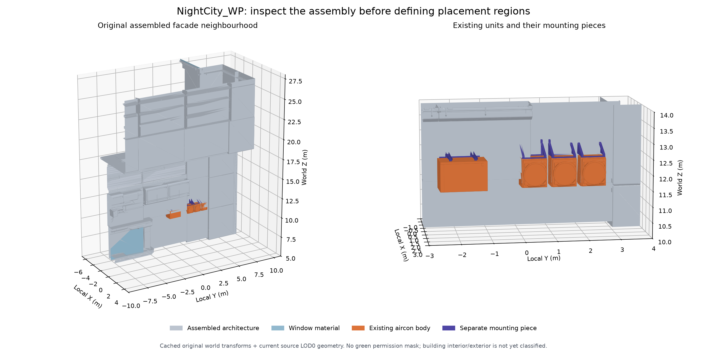

# 从夜之城成品建筑提取外部安装区域

日期：2026-11-06。状态：已复核一段原场景拼装立面与现有空调关系；本文确定新的分析入口和内面排除条件，完整建筑分割、内外分类器及最终区域生成器尚未实现。

## 1. 方向修正

用户明确选择“夜之城原场景中已经拼好的建筑”，并要求“要避免可放置面在内面产生”。后续以成品建筑及邻接环境为分析单位，先判断建筑内外，再提取连续外立面安装区域。单个源 Mesh 的平面提取只作为几何先验或缓存，不能直接成为最终可放置面。

上一批 24 个模块的结果存在层级不足：模型独立时露出的背面、封口面、模块端面，拼装后可能位于房屋内部或墙体夹层；逐模块退边还会把本可连续使用的立面切碎。序列化、绕序和指纹检查通过，只证明数据在这些方面一致，没有证明建筑上的安装位置正确。

[Batch01](NightCity_Placement_Batch01.md) 保留为模块几何实验和对照材料。本轮没有重写它的资产或默认关联；其现有 `Ready` 是旧流程的几何状态，不能用作新流程的 `ExteriorVerified`。新放置器必须额外要求建筑级外表面判定通过，不得直接消费这些默认区域。

## 2. 原场景中的具体样本

本轮找到了一段 Charter Hill 附近的成品立面，范围为 UE 世界坐标（cm）：

```text
Min = (-193000, 19000, 500)
Max = (-191800, 21100, 2800)
```

这是约 12 × 21 × 23 m 的分析窗口，包含立面及相邻构件，不是已经确认归属的完整单栋楼。原场景按源网格组织 HISM，一个 Actor 的实例会跨楼分布，不能用 Actor 当作建筑身份。

本窗口涉及 19 种源 Mesh、51 个实例：43 个建筑构件、4 个空调主机、4 个独立安装件。涉及的建筑构件同时包含 Charter Hill、Corporate Plaza、技术外壳与商铺构件；按照单一 Kit 名称分组会遗漏实际参与拼装的部分。



图中橙色是原场景中的空调主机，紫色是独立安装件，蓝色是源材质元数据识别出的窗面，灰色为其他建筑几何。没有绘制绿色“允许安装”区域；当前尚未完成整栋楼的内外判定。

这次具体观察到：

- 三台 `airconditioner_exterior_d` 沿墙并排，实例位置间距分别为 96.24 cm、95.73 cm；它们使用相同旋转与缩放，因此这是同一基准点的可比间距，不是按机身包围盒猜出的距离。
- 三个 `airconditioner_exterior_f_mounting` 与上述主机朝向一致；主机轴心在对应安装件局部坐标中约为 `(-9.27, 0, 0)` cm。
- 一台 `airconditioner_exterior_e` 与 `airconditioner_exterior_h_mounting` 对应，主机轴心在安装件局部坐标中约为 `(-22.96, 0, 0)` cm。
- 安装件与主机的配对来自空间位置、相同朝向及图形复核，是推断关系。当前导入数据没有提供原制作工程里的父子关系，不能宣称已经恢复原始连接图。

这支持把“建筑表面 → 安装件 → 主机”作为组合候选来分析。墙面需要验证的是安装件的真实接触脚印，机身需要验证的是空间占用和净空。不能把机身轴心当成墙面接触锚点，也不能让主机与自己的支架互相排斥。

重复的 0.96 m 排列只是这一局部的正例，不能上升为所有房屋的统一间距。未摆空调的墙面是未标注样本，不是负例；已有设备也不能证明附近整块矩形都可安装。

### 数据来源和限制

当前在线 MCP 服务未响应。本轮使用此前通过 UE `get_instance_transform(world_space=True)` 导出的原场景实例缓存，保留平移、完整四元数和缩放；另外启动只读 Python commandlet，从当前资产重新读取这 19 种源 Mesh 的 SourceModel LOD0。没有重新枚举当前编辑器里的 NightCity 实例，也没有修改场景。

19 个源 Mesh 当前 Bounds 与缓存 Bounds 的最大差值为 0 cm。这仅核对范围一致性，不能证明缓存采集之后场景没有编辑，也不能证明旧源几何逐顶点完全没变。

原缓存路径、文件指纹、选中的实例、源路径及当前几何指纹保存在 [context.json](NightCity/AssembledExample01/context.json)，测量结果在 [review.json](NightCity/AssembledExample01/review.json)。实例 ID 是本次快照内的定位键，不能作为重排 HISM 后的持久 ID。

复现时，在 UE Python commandlet 执行 [ExportAssembledExampleSources.py](../Scripts/NightCity/ExportAssembledExampleSources.py) 导出源几何到 `Saved/CodexNightCityAssembled/geometry.json`，再用工作站 Python 运行 [ReviewAssembledExample.py](../Scripts/NightCity/ReviewAssembledExample.py) 重画。后者依赖 NumPy、SciPy、Matplotlib。上述脚本只读源资产并写分析文件，不创建新的可放置面。

## 3. 内面排除是生成前置条件

最终区域只能来自 **已确认属于建筑外壳、面向外部空间的真实表面**。不能先把所有平面输出，再期望设备碰撞把内面全部过滤掉。

以下方法单独使用都不足够：

- 使用源三角形法线：内墙也有法线，双层墙皮、反向导入或镜像实例会使方向判断更复杂。
- 沿法线发一条射线：在空房间里可能完全碰不到东西；看到窗外也不代表这块面属于外立面。
- 与建筑中心比较方向：凹形建筑、退台、中庭、连廊没有一个中心能正确代表所有表面的内外。
- 只从场景边缘 flood fill 空空间：打开的门窗、漏缝会让“外部可达”传播进房间。
- 给每个 Mesh 各自做封闭或内外检测：无法识别拼接后形成的夹层、内隔墙和隐藏端面。

应按下面的顺序建立判断。

### 3.1 先取得建筑整体和邻接上下文

从空间范围取回墙、窗、门、楼板、屋顶、柱、转角、裙房与邻楼，并保留每个实例的来源。范围选择只是第一步；需确认单栋、共享裙房和邻楼的归属。不能仅用包围盒相交连通分组，否则连廊和街区建筑可能连成一大团。

只截取一小段立面时，截断边界附近及依赖缺失楼体才能判定的面标为 `Unknown`。本次分析窗口还不具备直接生成“整栋外壳”的条件。

### 3.2 建立用于分类的闭合建筑包络

从完整拼装后的墙体边界、楼层/屋顶结构与门窗语义建立闭合的建筑包络。包络用于把建筑内部空间和外部空间分开，不等同于渲染网格、碰撞网格或一个实心 AABB。

门窗等明确属于围护边界的开口，在**内外分类代理**中加入虚拟封口，使室内不会因开窗而被 flood fill 成室外；在真实支撑和碰撞查询中仍保留原来的开口。虚拟封口本身绝不能被输出为可放置面。

微小拼接缝可在受控容差内修补。缺失整面墙、归属不明的大洞和采样窗口边缘不能用任意封口蒙混过去，应标记分类不可靠。不能用凸包抹掉凹角、内院和架空层；内院、开放连廊需保留独立空间类别，首版未经确认的不开放安装。

### 3.3 外部连通性与真实表面联合验证

可用稀疏体素/八叉树对闭合代理分类，从范围外部播种得到 `Exterior`，建筑包络内为 `Interior`，缺失或分辨率不足的位置为 `Unknown`。这是建议的实现路径，尚未作为当前插件的新分类器实现。

对于一个候选表面点及其待确认外向方向，要求：

1. 它位于已验证建筑包络的外边界附近。
2. 外侧采样进入 `Exterior`，内侧采样进入该建筑的包络内部。
3. 从已确认的外部一侧对真实拼装几何做局部精查，候选是这一位置的外层表面；不能越过外层墙皮或玻璃命中后面的内面。
4. 它属于真实、允许支撑的几何，而非分类用虚拟封口、窗面、门扇或未知材质区域。

这几个条件共同排除内隔墙、内表皮、墙夹层和拼接端面。仅满足体素分类仍不够：细墙或双层墙皮可能落进同一体素，需要 BVH/三角形精查与更细采样；无法消除歧义时拒绝输出。

不能只检查大三角形中心。跨越开口、内外边界或未知区域的三角形要分割，并对剩余区域做覆盖检查。采样距离与体素精度需要误差预算，不能取一个足以跨过整面薄墙的大偏移来强行得到“内外不同”。

首版先支持建筑外墙。双面可见的遮棚、栏杆、独立招牌支架等薄片需要各自的宿主规则，不能为了支持它们而放松外墙的内外约束。

### 3.4 通过外表面判定后，才生成区域 Mesh

在已确认的外表面上合并共面连续区域，扣除窗口、入口、开启范围、檐口、转角禁区及既有占用。可以跨源 Mesh 边界合并，但不能跨真实结构缝、开口或不同用途的区域。只有通过的部分才三角化为最终辅助 Mesh。

随后按具体支架/设备的完整接触脚印、实体、维护净空求可行位置。区域缩放使用真实实例尺寸，设备尺寸不随墙自动拉伸。邻楼和附属物组合的空间占用在这个阶段共同裁决。

推荐的产出条件是：

```text
允许输出区域 = 已确认外表面
             ∩ 真实可支撑几何
             ∩ 用途许可
             − 门窗/结构禁区
             − 已占用区域

Interior 或 Unknown -> 不输出可放置区域
几何先验 Ready       -> 不等于 ExteriorVerified
```

## 4. 区域应该归属什么

源 Mesh 可缓存原始表面片、材质类别、安装件接口和几何加速结构。最终区域由**建筑实例/立面分段的分析结果**持有，保存建筑局部空间中的辅助 Mesh，以及所依赖的源实例集合、门窗/邻接信息和输入版本。

同一源 Mesh 放在两栋楼里，可以有完全不同的有效区域；因此不能把这一结果反写成该源 Mesh 对所有实例都适用的默认许可。跨两块墙的区域也不应强行归给其中一块墙。

建议的关系为：

```text
原场景建筑实例集合 + 邻接环境
    -> 建筑分组、包络与门窗分类
    -> 外表面验证
    -> BuildingPlacementResult（最终区域 Mesh，建筑局部空间）
    -> 安装件候选
    -> 主机/招牌组合及连接端口
    -> 跨楼互斥与提交
```

`BuildingPlacementResult` 是设计中的新结果层，当前 `UCSCityPlacementProfile` 仍是单源 Mesh 的类型，本轮没有把它改造成建筑结果类型。需要记录完整输入依赖；邻楼或门窗变化也会使结果失效，不能只比较一个源模型的哈希。

附属物一侧另设 [UCSCityAttachmentProfile](NightCity_Attachment_Anchor_Assets.md)，保存源模型局部连接锚点、接口族、角色和容量。已实现接口配对与刚性候选姿态，并用本例的两类空调/支架制作四个待审核资产；它们不会赋予墙面安装许可，也不包含场景实例的连接占用。

复用 Tiny Glade 时，可以借鉴“宿主—安装件—主机”的显式连接和接触许可；组合内部的约定接触不作为互斥冲突，对外占用则作为整体参与裁决。网络可以学习这些原场景正例的排列与偏好，但预测结果同样必须经过外表面硬约束，不能覆盖 `Interior/Unknown` 拒绝结果。

## 5. 下一步实现的验收条件

内外筛选器至少需要覆盖：封闭房间内墙、内外双层墙皮、模块端面相互拼接、开窗看到外部、门洞连通室内、漏缝/缺失墙、凹形建筑、内院、邻楼遮挡，以及裁剪窗口截断建筑。预期是不确定时不生成，不以增加候选面积为成功指标。

验收应显示“确认外部 / 内部拒绝 / 未知”三类诊断，再叠加最终区域；重点逐例检查被拒绝的内面。已有空调与支架是正例参考，不能取代对所有输出区域的分类检查。

本轮完成的是原场景局部复核、可复现证据和方向修正。尚未得到完整楼栋分组或可靠闭合包络，因此没有重新批量产出最终安装面，也没有宣称已自动解决所有内面识别。
