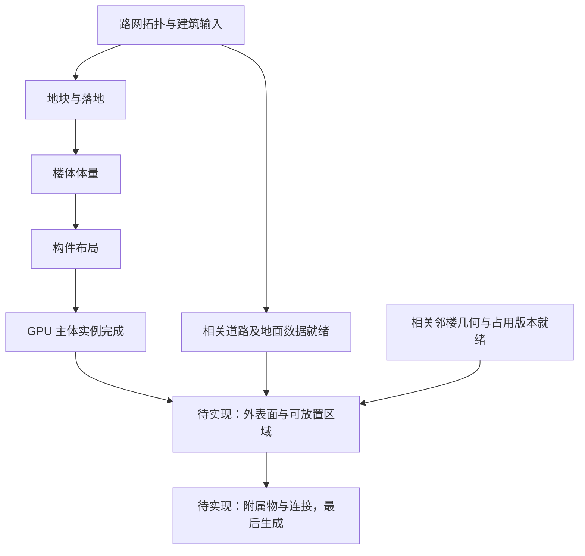

# 附属物连接锚点 Data Asset

日期：2026-11-06。用户要求在建筑可放置区域之外，用另一个 Data Asset 规定附属物体的连接锚点。已新增 `UCSCityAttachmentProfile`、结构校验、接口配对及刚性连接候选姿态计算；建筑外表面筛选器、场景连接图和放置提交器仍未实现。

## 1. 两种数据分别负责什么

**建筑实例的可放置区域**回答“这栋拼好的建筑，哪一块真实外表面允许安装”。最终区域依赖完整建筑、门窗、邻楼和已有占用；`Interior`、`Unknown` 必须拒绝。详见[成品建筑分析](NightCity_AssembledBuilding_Placement.md)。旧的单源 `UCSCityPlacementProfile` 只能作几何先验，不能代替最终外表面许可。

**附属物的 `UCSCityAttachmentProfile`**回答“这个设备有哪些连接接口，各自在模型哪里、朝向哪里”。它独立引用 `SourceMesh`，一个源模型的多个场景实例共享这个资产；没有反写源模型，也没有改动原有 PlacementBinding。

例如组合关系为：

```text
建筑实例的 ExteriorVerified 区域
  -> 支架 SurfaceMount + 真实接触脚印（待标定、待实现求解）
  -> 支架 Socket [AirConditioner.D_F]
  <-> 主机 Plug [AirConditioner.D_F]
```

连接锚点不是一个安装面，也不证明碰撞、承重或维护净空合格。即使接口匹配、姿态已求出，也只是一个候选；不得绕过建筑外表面检查或跨楼互斥。

## 2. 当前资产字段

定义位于 [CSCityAttachmentProfile.h](../Source/CSRoadNet/Public/CSCityAttachmentProfile.h)，实现位于 [CSCityAttachmentProfile.cpp](../Source/CSRoadNet/Private/CSCityAttachmentProfile.cpp)。在 UE 中新建 Data Asset，选择 `CSCityAttachmentProfile` 即可编辑。

Profile 保存：

- `ProfileId`：稳定身份；编辑位置或调整数组顺序时保留。
- `SchemaVersion`、`DataRevision`：格式版本与内容版本；修改已有数据时由作者提升内容版本。
- `SourceMesh`、`SourceGeometryHash`：源模型软引用及其建成后 SourceModel LOD0 的指纹，导出规则复用 `ExportPlacementSources.read_source`。重导入后必须重新核验；当前 C++ 配对函数不自动加载模型重算指纹。
- `State`：`PendingReview / Ready / Disabled`。默认待审核；连接 API 拒绝待审核和禁用状态。
- `ReviewNotes`：测量来源、限制、待审核事项。
- `Anchors`：该模型的多个连接锚点。

每个 `FCSCityAttachmentAnchor` 保存：

- `AnchorId` 与唯一 `Label`：稳定 GUID 用于引用，名称用于编辑识别。数组下标不是持久身份。
- `LocalFrame`：源模型建成后的局部坐标，单位 cm，缩放为 1。`+X` 指向连接对方，`+Z` 为约定上方向。
- `InterfaceType`：精确匹配的接口族，例如 `AirConditioner.D_F`；采用 UE `FName` 比较，不做模糊前缀匹配。不同机械尺寸应使用不同接口族。
- `Role`：`Plug` 与 `Socket` 配对；`Peer` 与 `Peer` 对等配对；`SurfaceMount` 专用于建筑表面安装，不参与物体间直接配对。
- `MaxConnections`：每个实例的这个锚点允许几条连接，默认 1。资产只声明容量，当前 API 不负责占用计数。

`ValidateData` 检查版本、有效且唯一的身份、源引用与哈希格式、名称、接口、正容量、合法枚举、有限坐标、单位旋转与单位缩放。它不判断锚点是否位于真实螺孔，也不证明来源模型当前仍匹配哈希。

首版不接受镜像或缩放后的设备连接姿态。需要尺寸变体时另行标定对应模型；建筑面有多宽不应改变空调的物理尺寸。

## 3. 可执行接口与对齐约定

`UCSCityAttachmentLibrary::AreAnchorsCompatible` 按 Profile 与 AnchorId 找端点，要求两份资产结构合法、都为 Ready、接口相同、角色可配对。一个 Profile 可以连接另一个使用同一 Profile 的实例；是否错误地连接自身实例，应由场景图判断。

`ComputeConnectedTransform` 在上述条件通过后计算 GuestWorld，要求：

1. 两个锚点的世界位置重合。
2. 两个锚点的世界 `+X` 反向。
3. 两个锚点的世界 `+Z` 同向。

UE 的变换乘法先应用左侧，因此计算为：

```cpp
GuestWorld = GuestLocalAnchor.Inverse()
           * Flip180AroundLocalZ
           * HostLocalAnchor
           * HostWorld;
```

这里的 180° 使用精确四元数 `(0, 0, 1, 0)`。失败时输出恢复 Identity 并返回错误。输入 Profile 仍须由调用端完成源版本核验。

该函数只处理刚性装配。线缆、管道等可以使用同一端点数据约定，但两端之间的路径、长度、弯曲与碰撞需由另一个连接生成器处理，不能调用刚性对齐函数来假装完成柔性连接。

后续放置器需要执行：外表面与支撑检查 → 接口和源版本检查 → 计算组合候选姿态 → 接触脚印、实体与净空检查 → 全局占用裁决 → 原子提交实例和连接。当前没有实现这条完整流水线。

## 4. 四个原场景样例

资产在 `/PCGPlugins/NightCity/AttachmentBatch01`：

- `DA_Attachment_AC_D_F_Body`：`airconditioner_exterior_d`，源 `SM_003AB0AD89462FF2`。
- `DA_Attachment_AC_D_F_Mount`：`airconditioner_exterior_f_mounting`，源 `SM_821A5A78007995E0`。
- `DA_Attachment_AC_E_H_Body`：`airconditioner_exterior_e`，源 `SM_5A0D3C272B46876B`。
- `DA_Attachment_AC_E_H_Mount`：`airconditioner_exterior_h_mounting`，源 `SM_AF22004CD50D1C7A`。

依据是 [AssembledExample01/review.json](NightCity/AssembledExample01/review.json) 中原场景的三组 D/F 和一组 E/H 推断配对。四个资产均为 **PendingReview**，各含一个 `AssemblyMate` 锚点，容量 1。

安装件的参考帧放在其源模型原点，主机参考帧由平均相对姿态反推。对齐后主机原点在安装件局部坐标中分别约为 `(-9.26909, 0.00318, 0)` cm 和 `(-22.96394, -0.00144, 0)` cm，旋转一致。D/F 三个观测的偏移残差小于 0.01 cm；这只说明这个快照中的相对姿态一致。

这些是**装配参考帧**，不是从螺孔、螺栓或支撑脚几何测出的物理接触点。锚点不必落在渲染表面，但要准确表达连接姿态和接口语义。样例尚未声明墙面 `SurfaceMount`，以免把模型原点误当真实墙面接触点。脚印、许可接触范围和净空仍需标定。

[MakeAttachmentExamples.py](../Scripts/NightCity/MakeAttachmentExamples.py) 在创建前重新读取四个源模型，要求指纹与分析证据匹配；固定生成 ProfileId / AnchorId；只创建缺失资产，遇到已有资产不一致直接停止，不覆盖作者编辑。`--validate-only` 可在另一个 Python commandlet 进程重新加载校验。带参数的 `-script` 路径使用正斜杠，避免 UE Python 对反斜杠转义。

## 5. 与 Tiny Glade 的连接协议衔接

可借鉴 Tiny Glade 的稳定身份、锚点作为权威数据、姿态作为派生数据，以及双端共享连接记录。`FCSWallAnchor` 的墙边索引属于房屋实例，不适合直接塞进可复用设备资产；这里保存设备局部锚点。

未来连接记录应引用 `(AttachmentInstanceId, AnchorId)`，并具有独立 `LinkId`。连接占用数量、已连对方、宿主建筑、占用体、失效依赖都属于场景实例图，不能写进共享 Data Asset。两栋楼之间可能有多条连接，不能仅用两个 ProfileId 当唯一连接键。

提交前要同时检查并预留两端容量与跨楼占用；成功后只由一个所有者生成连接产物。删除、移动或失效时释放两端并更新受影响范围。这部分是下一阶段协议，当前未实现。

装配内部只豁免已约定的真实接触范围，不能简单跳过整对物体的所有碰撞。组合对外仍统一参与邻楼、其他附属物和维护净空的互斥裁决。

## 6. 验证范围

原生自动化测试位于 [CSCityAttachmentTests.cpp](../Source/CSRoadNet/Private/Tests/CSCityAttachmentTests.cpp)，覆盖数据结构、状态/角色/接口拒绝，以及带非零锚点偏移和三轴旋转的世界姿态、反向连接、缩放拒绝与失败输出清理。

验证记录在项目 `Saved/CodexNightCityAttachment/`。资产脚本额外核验源指纹、四个资产的稳定身份、保存后的锚点内容、待审核拒绝，以及两个组合相对姿态；计算姿态时只把临时副本设为 Ready，磁盘资产始终待审核。

2026-11-06 实测：沿用 Rider 选中的 `UETest574_2` 配置，因未标明活动子配置而取首项 `Development_Editor / x64`，对应 `UETest574_2Editor Win64 Development`。增量编译与链接通过，没有引擎重编译；`Attachment.Validation / Compatibility / Pose` 三项自动化测试全部通过。另一个 commandlet 进程重载四个资产、重新读取四个源指纹，两个组合姿态验证通过。D/F 的最大观测位置残差为 `0.00942809 cm`。本次启动的校验进程已退出，未保存 NightCity 场景或修改源模型。

## 7. 城市生成顺序：附属物位于最后的几何生成阶段

2026-11-06 用户要求：“我的gpu城市生成现在有多少阶段？我认为附属物的生成应该排在最后面”。确定后续将附属物作为主体环境完成后的末端生成层。这里记录调度约束，尚未改变现有生成器的调度代码。

当前没有统一的城市阶段枚举。按建筑生成主线的职责，可以归纳为 **5 个逻辑阶段**，其中前四段主要在 CPU；单独手工建筑会跳过沿街地块分配：

1. **输入与约束准备**：道路样条转成拓扑、曲线与路宽；收集建筑轮廓、Kit、种子和保留地块。`BuildRoads` 中先 `GatherSplines / AddGarageRoads / BuildSplineNetwork`。
2. **地块与落地**：先 `UpdateStreets`，再 `BuildBatchBuildings`；通过 `LayoutLots` 做退让和地块分配，批量楼避让沿街楼带及特殊建筑；`SeatLot` 等逻辑确定水平楼底与坡地关系。
3. **楼体体量**：`MassFacade` 确定开间掩码、楼层、L/U/T/天井、裙房、退台和悬挑。
4. **构件布局**：`LayoutFacade` 把体量边界变成 runs，安排墙窗门、转角、屋顶、女儿墙、柱、底座、平台与台阶。体量与布局是嵌套调用，按职责分段不代表已有两个独立调度任务。
5. **GPU 实例生成与交接**：`WriteFacade` 上传数据，`FacadeCS` 写实例变换和计数器，完成后交给 `UCSGpuInstancedMeshComponent`。

依据：[路网调用入口](../Source/CSRoadNet/Private/CSRoadNetworkActor.cpp)、[地块算法](../Source/CSRoadNet/Private/CSCityLayout.cpp)、[体量/布局/GPU 写入](../Source/CSRoadNet/Private/CSCityFacade.cpp)。

**逻辑阶段数与 GPU 派发次数不同。** 当前立面有 17 个槽位，`SlotsPerPass = 5`，每次 `WriteFacade` 最多分 4 组派发（5/5/5/2），空组跳过；这是同一个构件实例写入阶段的分组，不是四层生成依赖，也不含清零等辅助 pass。路网 tile 任务另有 `Detect → Batch → Write → Done` 状态机，属于道路局部更新，不能当成整座城市的阶段数。

后续建议在这 5 段之后增加：

6. **可放置区域求解**：针对已拼好建筑和邻接环境，做内外分类、真实外表面精查，扣除门窗和禁区，生成区域 Mesh；`Interior / Unknown` 拒绝。
7. **附属物生成**：支架/主机/招牌候选 → 锚点配对与组合姿态 → 实体和净空检查 → 跨楼互斥与双端容量裁决 → 提交实例及连接产物。管线等连接产物在本阶段内依赖两端设备的位置。阶段 6、7 均尚未接入城市生成流水线。



特别注意当前调用顺序：`BuildRoads` 先调用 `UpdateStreets / BuildBatchBuildings`，之后才进入道路网格构建。建筑 GPU 写入还会异步落地。因此不能简单在 `WriteFacade()` 返回后立刻运行附属物；必须检查所依赖的主体、邻楼以及道路/地面查询数据已经对应同一版有效输入。程序化楼体可以保留体量和构件语义帮助分类，但候选仍需对应真实外层支撑面，不能把外轮廓直接当最终许可。

“最后”应在受影响建筑或 tile 及其必要邻域内成立，不需要等待整座城市重建完毕。邻域大小由设备净空、最大连接距离和分类所需建筑完整性决定。建议记录依赖版本，任务期间上游变化则丢弃旧候选；只改附属物配置时复用未失效的区域与主体。Nanite/HLOD 烘焙和流送等输出工作可以在其后独立安排。
