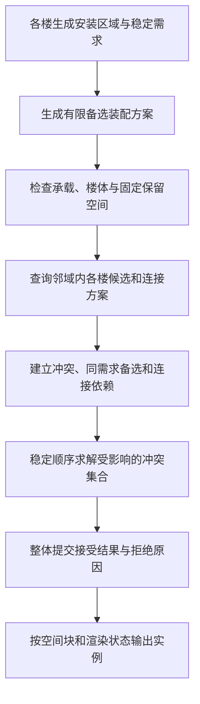

# 夜之城附属物：放置、跨楼互斥与连接

日期：2026-11-05  
状态：设计提案，尚未实现。基于当前 PCGPlugins 源码核对；本文的城市类型名为建议名称。  
关联：[建筑程序化生成与分块](NightCity_ProceduralBuildings_Partitioning.md)。

后续评估：[模块锚点与生成后 GPU 搜索](NightCity_Attachment_Placement_Evaluation.md)；包含实际模块复用统计、安装模板的数据归属、代码/网络执行流程，以及两种方案的成本与适用范围。本文的“锚点”在实现时应细化为安装区域和有限候选，而非全城共享的几个固定点。

## 1. 设计结论

空调、招牌等附属物采用 **“构件提供安装位置 → 附属物提出占用需求 → 邻域统一裁决 → 输出实例及宿主适配”** 的流程。

建筑负责提供墙面、楼层、门窗、店铺、屋顶及设备平台的语义；附属物负责描述自己需要什么安装条件、占用多少空间。不同楼房的候选一起参加邻域裁决，避免每栋楼各自通过、合到一起却相交。

涉及两个宿主的连桥、管线、悬挂招牌等，采用 Tiny Glade 已有的共享关系思路：**两端共持关系，关系决定产物，产物只生成一份**。沿用变更通知与生命周期协议，但要扩展当前“一对房子最多一条接触”的限制。

这可以拆成三项独立能力：

1. **放置语义**：什么位置适合什么附属物。
2. **空间裁决**：候选能否与本楼、邻楼及其他附属物共存。
3. **连接求解**：哪些端点可以连接，连接后双方需要怎样适配。

## 2. 从现有 Tiny Glade 复用什么

### 2.1 锚点由构件产生，规划统一处理

[`CSHouseDecor.h`](../Source/ComputeShaderGenerator/Public/CSHouseDecor.h) 与 [`CSHouseDecor.cpp`](../Source/ComputeShaderGenerator/Private/CSHouseDecor.cpp) 把锚点生产和 `BuildPlan` 分开：门、墙脚、檐口、屋脊等生产者提供位置、朝向和身份，规划层共用选择与间距规则。`IdentityHash` 使用家族、锚点身份、salt 和 seed，不用 GPU 输出槽位作随机源。

城市附属物沿用这一分工，增加店面招牌带、窗间实墙、设备平台、服务立面和屋顶设备区等生产者。锚点的“家族”描述来源，资产的“类别”描述放什么，两者不能混为一个枚举。

当前 `BuildPlan` 的排斥逻辑是：按输入锚点顺序遍历，与本次已经接受的位置做 `MinSpacing` 球距离检查。`ACSHouseActor::RebuildDecor` 按单栋房调用它。这能处理小规模单栋摆件间距，**没有实现本文要求的跨楼实体和净空互斥**。不能直接给它增大一个距离参数，就认为解决了城市附属物避让。

文件头中有关窗标记尚未落地的文字存在历史滞后；当前 `ACSWindowMarker` 已有实现。这里只按实际 `BuildAnchors` / `BuildPlan` 分支说明可复用能力，不把旧进度注释当成当前状态。

### 2.2 需求可以被拒绝，但不能因此丢掉输入

[`CSHouseFeatureMarker.cpp`](../Source/ComputeShaderGenerator/Private/CSHouseFeatureMarker.cpp) 的 `RegisterAnchor` 将需求交给宿主谓词，登记后回写裁决；被拒的有效宿主需求仍保留，网格按裁决隐藏。宿主改变后可以再次接受它。

城市附属物可以采用相同区分：

- **输入需求**仍存在，例如某个店铺要求一个招牌。
- **本轮输出**可以是已放置、换到候选位置、被阻挡或待解析。
- 不可行时保存拒绝原因和阻挡对象 ID，不能把需求删掉后再靠随机重生。

单宿主对象使用局部锚点；宿主平移旋转时变换随之更新，改变立面形状时重新求值锚点。数据化实例无需每件都使用 Actor，但应保持这一输入与派生结果的分工。

### 2.3 双方关系与一次产物

[`CSHouseContact.h`](../Source/ComputeShaderGenerator/Public/CSHouseContact.h) 的 `FCSHouseContact` 由两端共持同一个 `TSharedPtr`，记录规范化的两端 ID、弱引用、类型和派生输入。`Owner()` 决定唯一的出砖方。

[`CSHouseActor.cpp`](../Source/ComputeShaderGenerator/Private/CSHouseActor.cpp) 中：

- `UpdateContacts`：变化方重求值，旧对端也参与通知；不再接触时发送空记录。
- `ReceiveContactFrom`：替换相关记录，只标脏，不同步重求值、不反发。
- `CanCommitSeams`：拖动期间暂缓正式提交，结束后提交；有拖动超时兜底。
- `DetachContacts`：销毁或退出时处理关系，避免另一端留着旧产物。

这些协议很适合城市连接物。接缝几何、`CanBuildSeamBricks` 与房体相交判据则属于原用途，不应直接套在跨街管线或连桥上。

### 2.4 连接物与宿主适配来自同一份解

[`CSStairsConnection.h`](../Source/ComputeShaderGenerator/Public/CSStairsConnection.h) / [实现](../Source/ComputeShaderGenerator/Private/CSStairsConnection.cpp) 的 `CSStairs_ConnectTerrace` 同时产出楼梯落点与露台围边入口，检查高度、距离、接近方向和边长。原始样条不改写，移开后派生适配可以撤销。

城市连桥也应从同一份连接解导出桥面端点、门洞、栏杆缺口和占用范围，避免桥说接上了，楼体却没留入口。

## 3. 空调与招牌具体放在哪里

### 3.1 建筑先提供少量可安装区域

初版不需要给每个三角形分类。建筑描述只需提供：

- 立面边 / 楼层 / 开间及局部坐标系。
- 实墙、门窗、檐口、阳台、结构柱和可安装表面。
- 临街、背街、服务侧、店铺范围与入口。
- 屋顶、设备平台及可到达的维护区域。
- 明确禁止占用的通道、开窗范围和其他保留空间。

从这些区域生成有限候选槽位，资产上另行标记固定支架点、允许旋转、安装脚印和所需空间。只靠 mesh pivot 或向墙打一条射线，只能找到接触位置，不能说明那里适合安装。

### 3.2 空调：从所服务的空间和设备位置长出来

住宅窗附近、阳台设备位、服务立面的实墙带，以及屋顶 / 裙房设备平台都是合理的候选来源。以楼层和开间形成竖向重复，能比全墙均匀散点更容易形成可信的设备布置。

一个小型外机需求可尝试：本开间的侧墙槽位、窗下明确允许安装的槽位、同层服务侧槽位；较大的集中设备使用设备平台候选。不同建筑类型决定可用集合，而不是所有楼共享同一顺序。

每个候选至少检查：

1. 支架是否落在允许承载的安装区域，机身方向是否正确。
2. 机身、支架及连接件是否穿入邻楼、窗框、栏杆或屋檐。
3. 进排风方向和检修面是否保留配置要求的空间。
4. 是否侵入门口、行走区域、可开启窗扇的运动范围。

空间尺寸来自资产与项目规则，不在此指定统一安装规范。游戏美术上的合理性需求与真实工程合规是不同任务。

空调、支架和必要的短连接管作为一个**装配方案**共同接受或拒绝，防止机身没放成却留下支架。大型共享管线再使用独立连接关系。

### 3.3 招牌：从店铺与面向的街道长出来

把招牌需求绑定到店铺 / 入口 / 楼体标识用途：

- **贴墙店招**：优先使用本店门窗上方的招牌带；长度受店面范围和可安装面限制。
- **垂直挑出招牌**：优先使用入口侧边、转角柱或预留支架位；朝向主要行人来向，重点检查巷道中的突出空间。
- **高层楼体标识 / 屋顶广告**：使用预留的大块立面或屋顶结构位；不把店招规则无条件放大。

身体碰撞和通行净空是硬条件。朝向街道、从街道采样位置可见、与相邻招牌不过度争抢视觉空间是评分条件；除非标注为关键标识，不必因部分遮挡就禁止生成。

可视评分基于稳定的街道 / 入口采样点，避免随编辑器或玩家相机转动重新布置招牌。对同店铺的多个备选位置，最终最多接受一个主招牌需求的方案；不要误生成所有候选。

## 4. 互斥需要描述四种空间

每个附属物方案都可以有以下描述，缺少的种类可以为空：

1. **安装脚印**：占用宿主哪一段墙、哪个支架槽或哪块平台。用于同一立面的二维排斥及承载检查。
2. **实体体积**：机身、灯箱、支架和管道的真实占用近似。初版用一个或多个 OBB；细长管线用分段胶囊或分段盒，不能只检查中心点。
3. **必要净空**：门窗运动范围、检修侧、通行范围，以及项目要求的进排风空间。净空具有类型和方向。
4. **视觉区域**：招牌的主要可视方向或需要保留的局部立面区域。默认影响评分，不一律禁止空间重叠。

相交规则应按类型决定：

- 实体与实体相交：默认禁止。
- 实体侵入通行 / 开启 / 必要检修空间：禁止，具体兼容性由规则表定义。
- 两个检修空间重叠：不必自动禁止；若允许分时检修可以共享，若要求同时使用则排斥。
- 两个可视区域重叠：通常只是评分变化。
- 与宿主墙的安装接触：只豁免明确的支架或安装脚印范围；不能把“自己的整栋楼”从碰撞检查中忽略，否则会穿进自己的屋檐和阳台。

因此不同楼的外机可以在 XY 投影上重叠、在 Z 上错开；相对的两块挑招则可能安装点相距很远，实际灯箱却在巷子中央相撞。二维距离或统一球半径都不足以表达这两种情况。

## 5. 跨楼候选如何得到一致结果

### 5.1 在实例化前作统一裁决



不让楼 A 先生成后通过物理碰撞“挤掉”楼 B。那样接受结果取决于加载和遍历顺序，而且移走 A 后，B 已被删除的候选未必恢复。

邻域索引存放的是描述及派生的空间代理，不只是当前可见的渲染实例。空间索引可以附属于现有城市生成上下文，是可重建的查询缓存；这里不要求新增一个持有全部业务状态的 World Subsystem。

### 5.2 固定条件优先，候选之间按稳定顺序求解

先对候选检查已确认的楼体、门口和通行保留区。这些是固定约束，不靠“谁先放”争胜。

剩余候选按明确的规则优先级与稳定需求 ID 排序。例如：设计者锁定的方案优先于自动装饰，同类自动需求再以稳定 ID 排序；每个需求内部按固定规则评分和候选 ID 尝试备选。两个锁定对象若互相冲突，应报告矛盾，不能悄悄删掉其中之一。必需设备找不到合法位置时也要报告未满足需求，不能伪装成成功。

初版使用固定顺序的贪心接受即可，不必先做全局最优化：只与已经接受的方案比较，有冲突就尝试同一需求的下一个备选，全部失败则保留拒绝结果。这保证同一组输入下结果可复现，但不保证放得最多。

裁决还必须跨三栋楼一致。比如 A 的设备与 B 的挑招冲突，B 又与 C 的设备冲突：不能每对楼各选一个赢家，最后拼成矛盾结果。应将相关候选作为同一个冲突集合求解。

### 5.3 “有限影响范围”与“冲突传播范围”不同

空间查询先按旧、新安装位置的实体和净空包围盒寻找直接邻居，粗筛用 AABB / 空间哈希，再用相应 OBB、胶囊和表面脚印细判。

但是贪心结果会沿 A–B–C 的冲突链传播：A 改变可能让 B 恢复，B 恢复又可能使 C 失效。**固定宽度 halo 只能保证直接相交查询完整，不能保证冲突结果只变化一圈。**

正确性基线是重算受影响的冲突连通部分，包括同一需求的备选位置及装配依赖；超预算时分帧处理，保留上一份一致的正式结果，完成后整体提交。之后可以优化为沿结果变化传播，但必须与基线比较。不能为缩小更新范围，任意截断冲突链。

净空规则应尽量局部，避免把所有软可视区域都作为硬冲突边，形成一个横跨全城的冲突集合。

### 5.4 裁决与加载分块解耦

同一份需求和输入快照，在不同 tile 尺寸、不同 Actor 加载顺序下应得到相同结果。生成块可以读取邻块描述，只写自己拥有的结果；同一个需求不能因为跨格而复制两份。

邻楼暂时未加载时，不能把它当作不存在。可使用烘焙描述 / 空间代理参与裁决；必要描述缺失时保留待解析状态，不临时生成已知可能冲突的方案。楼体永久删除、暂时卸载和当前不可见必须是不同事件。

## 6. 连接物怎样沿用 Tiny Glade

### 6.1 将单宿主附属与双端连接分开

贴墙空调、店招各自属于一个宿主；一根跨楼管线、一座连桥或两楼间的悬挂招牌属于一条连接关系。连接可以引用建筑安装锚点，也可以引用设备上明确导出的连接端口。

不要为了复用，把所有附属物都做成两栋房之间的 Contact；也不能把两栋楼仅仅靠得近当作允许连接。连接规则必须检查端口类型、朝向、长度、高差、承载条件和沿途净空。

### 6.2 一对楼允许多条连接

现有 `FCSHouseContact` 是“一对房子最多一条接触”。城市里同一对楼可能同时有两根不同管线、不同高度的连桥和一块招牌，直接复用这个键会让它们相互覆盖。

建议关系身份包含：

```text
规范化后的端点对：BuildingId + AnchorId / PortId
ConnectionKind
连接槽 ID，或设计者创建的 LinkId
```

两端次序规范化只用于去重和稳定身份；有方向的供回水、供电等关系仍保存端口角色，不能因 GUID 排序翻转方向。同一对建筑管理一组链接记录，按链接身份替换与撤销，不再按对端直接清掉所有链接。

几何变化更新关系的输入版本与派生解，不依靠世界坐标或数组下标重新定义身份。

### 6.3 关系只决定一份正式产物

建议的关系记录包含：两端稳定 ID 与局部锚点、连接类型、输入版本、求解快照、路径 / 参数、双方适配需求、占用代理及输出归属。

沿用 Tiny Glade 的规则：

- 一方变化，重算受影响关系；另一方只接收结果并标脏，不在通知回调里递归计算。
- 拖动期间做预览，正式关系与占用在提交时一起切换；不要用新端点位置搭配旧路径。
- 路径和端部适配由同一份输入快照生成，避免桥体、洞口、栏杆各取不同版本。
- 删除或解连时，桥体 / 管线、两端支架、洞口 / 围栏缺口和空间占用一起撤回。

输出者只负责实现关系已经求出的结果，不让“当前哪一栋恰好已加载”决定赢家或输出归属。编辑时可由规范序确定输出责任；烘焙或流送时再映射到稳定的输出块。关系可拆成多个渲染片段，但逻辑身份仍是一条。

### 6.4 链接应当参与互斥，不能绕过互斥

连接方案的整个沿途体积都参加裁决，包括垂落电缆或曲线管线的分段体积。只检查两个端点会漏掉中途穿楼、穿招牌和侵入另一条桥的情况。

“双方同意连接”只允许明确的端点接合，例如支架与墙面、桥面与门槛；它不豁免沿途碰撞。另一方的一个普通空调也可能挡住桥，裁决必须按规则决定迁移空调、换路径或拒绝连接。

连接体、端部支架和两端洞口 / 栏杆适配作为一个方案提交。只有完整方案通过，才应用宿主改变。已有墙上不允许开洞、另一端拒绝或中途净空不足时，不能留下单边洞口。

手工输入、固定连接意图等作者数据可以保存；自动发现的关系、占用索引和派生几何可由输入重建。这延续 Tiny Glade 的派生记录思路，不要求把所有缓存序列化。短暂卸载只是暂停实例化 / 解析，不能等同于作者删除链接。

## 7. 最小数据与实现分界

初版建议围绕以下五类数据实现；名称为提案：

- `AttachmentSite`：宿主与表面 ID、局部框架、安装区域、语义标签、固定保留空间。
- `AttachmentRequest`：稳定需求 ID、来源构件、类型、规则优先级、seed，以及有限备选装配方案。
- `PlacementClaim`：选定方案的安装脚印、实体、必要净空、可视评分信息与明确的接合例外。
- `AttachmentLink`：两个端点、关系身份、输入版本、连接求解及双方适配需求。
- `PlacementDecision`：接受的方案或拒绝原因、阻挡对象 ID、输入版本与派生实例清单。

语义生产者可分别读取店铺、楼层、屋顶；空间判定和仲裁必须统一。GPU 实例组件接收最终决定后的实例清单，不承担业务规则，不把输出顺序当作候选身份。

固定形态的支架、外机、短管优先作为一个装配方案。一般的“附属物长出附属物”初版限制为有向无环的有限层级，避免管线产出支架、支架又产出管线的递归。两个已存在端口之间的连接用关系记录表达，不混成父子生成循环。

UE PCG 的 Bounds Modifier、Point From Mesh 与 Self Pruning 能辅助处理点边界和重叠筛选，但本方案中的用途语义、必要净空、需求备选与双端适配仍需显式实现；单个重叠筛选节点不覆盖这套协议。[Epic：PCG Node Reference](https://dev.epicgames.com/documentation/en-us/unreal-engine/procedural-content-generation-framework-node-reference-in-unreal-engine)

## 8. 先做一个能暴露问题的样板

先用两栋相对的楼和一条可调宽度的巷子，只支持壁挂空调、贴墙招牌、挑出招牌三类，再加一条跨楼连接。预览同时显示安装面、实体和必要净空，以及被拒原因。

最先验证以下行为：

1. 两侧挑招在巷子中相撞时，只接受符合稳定裁决的方案；改变生成顺序和 tile 尺寸，结果不变。
2. 不同楼层的设备，XY 重叠而实际体积和净空不冲突时可以共存。
3. 空调避开本楼的窗扇运动空间、邻楼实体和明确保留的通道；不能因属于宿主就豁免整栋碰撞。
4. 移开阻挡物后，之前被拒的需求可以恢复；三栋楼构成的冲突链也能正确更新。
5. 同一对楼的两条连接同时存在，删除其中一条不会撤掉另一条。
6. 连接被拒时不留下单边洞口；解连后双方适配恢复；任何连接只生成一份。
7. 拖动预览、最终提交、撤销 / 重做和重载保持一致；过期输入版本的异步结果不能覆盖新结果。
8. 邻楼卸载再加载不导致永久改位或重复链接；永久删除才能撤掉其需求。

以上是后续实现的验收清单，本次没有运行这些测试。当前交付为放置、互斥和连接的设计补充。
