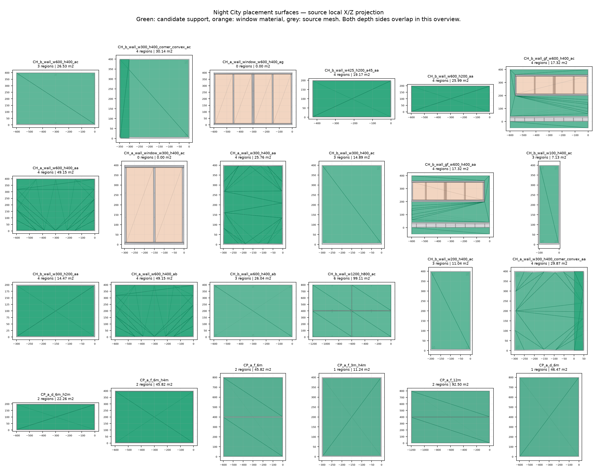

# 夜之城常用模型：第一批可放置区域

日期：2026-11-05。状态：资产已生成、源 Mesh 默认关联已保存、独立进程重载验证通过。

本批处理了 24 个建筑模块：18 个 Charter Hill 墙体、带窗墙和转角变体，以及 6 个 Corporate Plaza 面板。生成了 24 份 `UCSCityPlacementProfile`，其中 22 份含有效几何候选区域、2 份为 `PendingReview`；合计 71 个区域、352 个三角形。每个源 `UStaticMesh` 通过 `UCSCityPlacementBinding : UAssetUserData` 引用默认 Profile，区域在源 Mesh 局部空间中保存，单位为 cm。

这批数据解决“模型上哪里存在几何安装机会”。区域类别暂为 `WallMountedCandidate`；尚未接入空调、招牌的具体放置器、跨楼互斥或 Tiny Glade 连接求解器。

## 1. 从哪里查看

在内容浏览器启用插件内容，打开：

```text
/PCGPlugins/NightCity/PlacementBatch01/
    Profiles/DA_PL_<源模型哈希>       24 份 Profile
    Preview/SM_PL_<源模型哈希>        22 个区域预览 StaticMesh
    M_PlacementPreview               绿色预览材质
    L_PlacementBatch01_Review         并排对照关卡
```

对照关卡包含 24 个源模型 Actor 和 22 个区域 Actor。每对模型使用相同旋转和缩放；为了并排观察，区域 Actor 相对源 Actor 沿 X 平移 1500 cm。预览资产内部的顶点仍是原始局部坐标，没有额外偏移。选中相应 Actor 后按 F 聚焦即可检查。

正式使用区域时应直接复用源实例的最终变换，不带这个展示偏移。此关卡只用于检查，不是对 `NightCity_WP` 场景的修改。



绿色为候选区域，橙色为窗材质，灰色为源几何。这是局部 X/Z 投影，前后表面会重叠，不能用这张图判断深度方向。完整三维几何可在对照关卡或各预览 Mesh 中检查。图中面积是多个表面的总和，不是建筑正立面面积。

## 2. 如何选择这批模型

以此前通过 MCP 获取的 `NightCity_WP` 已加载组件快照为频率依据，再覆盖不同宽高、带窗、斜向和凸转角变体。24 种模型在该快照中合计出现 97,278 次；这是当时加载范围的统计，不代表整个 World Partition 的总量。选择清单和原始 Depot 名称已固化到 [PlacementBatch01.sources.json](../Scripts/NightCity/PlacementBatch01.sources.json)，重新执行不依赖临时名称缓存。

例如 `SM_C351A38A42B01B7D` 对应 `wbr_cha_building_b_wall_w600_h400_ac.mesh`，快照中使用 6,229 次。该模型现在有 3 个独立候选面，所有实例可以共享同一份 Profile，不需要为每个实例新建区域组件。

以下两个模型保留了默认关联，但 Profile 为空且状态为 `PendingReview`：

- `SM_5674B1687D5C13A5`：`wbr_cha_building_a_wall_window_w600_h400_ag.mesh`。
- `SM_C462863AFD826788`：`wbr_cha_building_a_wall_window_w300_h400_ac.mesh`。

它们的主要面是窗内景材质；余下边框没有通过本批的平面、面积和宽度阈值。空区域表示待人工复核，不表示可以退回到整块包围盒上摆物体，也不表示永远禁止安装。

全部 24 个模型的源路径、原名、频次、区域数量、面积及版本指纹见 [manifest.json](NightCity/PlacementBatch01/manifest.json)。对应 `SM_*.json` 保存区域几何、边界、孔洞、法线、来源与检查记录；同名 OBJ 可在 DCC 中检查，两个空区域模型的 OBJ 只有说明行。

## 3. 区域提取规则

[ExportPlacementSources.py](../Scripts/NightCity/ExportPlacementSources.py) 从真实源资产读取 SourceModel LOD0，并应用构建设置和 BuildScale，不使用 Nanite fallback 或 Bounds 猜测外形。导出顶点、三角形、材质分组、顶点法线和源材质元数据。

[BuildPlacementBatch.py](../Scripts/NightCity/BuildPlacementBatch.py) 对这些数据执行以下规则：

1. 只有源 shader 为 `multilayered.mt` 的不透明面能成为支撑候选。`window_parallax_interior.mt`、贴花等不能成为安装面。这里检查恢复的 `SourceShader` 元数据，不依赖导入后哈希化的材质名称。
2. 本批只处理近似竖直平面：法线 Z 分量绝对值不超过 0.02；几何外向法线与平均导入法线点积须大于 0.95。倾斜屋顶、曲面和法线不可靠的面不纳入首批。
3. 同向共面的源三角形合并为多边形，平面距离容差为 0.05 cm；保留凹边界和孔洞。
4. 沿每个候选面自己的法线，投影源模型中位于它前方超过 0.15 cm 的几何并扣除。窗也会遮挡后面的支撑面；贴花不参与遮挡。这个检查只针对该源模型自身，尚不包含组装后的其他模块。
5. 对剩余边界向内退让 2 cm；每片面积至少 0.2 m²，最小旋转包围矩形的短边至少 20 cm。短边阈值只用于删除明显细碎区域，不能证明某个设备脚印能放进去。
6. 三角化后检查覆盖误差、越出源支撑面的面积和与遮挡投影的交叠。所有接受区域的后两项误差均小于 0.01 cm²；无法可靠三角化的区域直接跳过并记录。

源 Mesh 的导入三角形使用 UE 绘制绕序。Profile 明确定义为数学 `cross(B-A, C-A)` 指向 `OutwardNormal`；构建预览 StaticMesh 时交换后两个索引。已通过实际源法线和预览重载检查确认，不依赖先前 Kit 对整类模型的统一朝向假设。

多层墙皮、背面和端面可能各自留下一个候选区域。这是模型级结果；生成整栋房屋后，仍须按建筑内外语义和其他模块遮挡进一步裁剪。`multilayered.mt` 也不能证明表面能够承重或允许安装空调。

## 4. 资产和代码关系

原生类型位于 [CSCityPlacementProfile.h](../Source/CSRoadNet/Public/CSCityPlacementProfile.h)，实现在 [CSCityPlacementProfile.cpp](../Source/CSRoadNet/Private/CSCityPlacementProfile.cpp)，属于运行时 `CSRoadNet` 模块。

- `UCSCityPlacementProfile`：保存 `ProfileId`、格式及数据版本、源 Mesh 软引用、源几何指纹、状态、说明和区域数组。
- `FCSCityPlacementRegion`：保存独立 `RegionId`、顶点、三角形、外向法线、切向向上方向和允许类别。每个区域单独拥有拓扑，没有引用源三角形索引。
- `UCSCityPlacementBinding`：源 StaticMesh 内的轻量子对象，硬引用默认 Profile；不复制几何。
- `UCSCityPlacementLibrary::GetDefaultProfile`：查询关联，可从 C++、蓝图和 Python 调用。它也会返回待复核或禁用的 Profile，调用者必须检查状态。
- `SetDefaultProfile`：编辑器内验证源资产归属和数据后写入关联并标脏，不自动保存包。
- `ValidateData`：检查身份、版本、指纹格式、状态与空几何、重复区域 ID、有限数值、法线和切向、共面性、索引范围、退化三角形及绕序。

本批 `Ready` 的含义是候选几何已构建并检查，并不等于任何空调或招牌都可直接摆放。消耗数据前，必须检查状态、源版本、设备类别、完整接触脚印、检修净空、建筑用途与场景占用。`PendingReview` 和 `Disabled` 应跳过，不能因为有默认关联就生成物体。

本批制作流程的权威输入是 `SM_*.json`；Profile 是导入后的可序列化运行数据，预览 StaticMesh 和 OBJ 都是派生显示结果。直接改预览 Mesh 不会更新 Profile。手工调整若要经受再次导入，需要回写 JSON；再次运行导入器会重建本批 Profile 与预览，不合并人工编辑。

Profile 和 Region 的 GUID 对同一批相同输入可重复生成。后续源几何拆分、排序变化或重新制作区域时，需要明确迁移 ID；本批的几何派生 ID 不是任意拓扑修改下自动稳定的身份协议。

## 5. 保存范围与恢复依据

导入器 [ImportPlacementBatch.py](../Scripts/NightCity/ImportPlacementBatch.py) 先核对全部源指纹，拒绝使用过期区域；然后备份源包，再保存本批 Profile、24 个源 Mesh 的默认关联、预览和对照关卡。已有非本批 Profile 或预览资产不会被覆盖，已有其他默认 Profile 的源模型也会拒绝改绑。

源文件位于工程 `Content/BuildingGenerator/Cyberpunk2077/Meshes/<哈希前两位>/SM_<哈希>.uasset`。这些包增加了关联，所以二进制文件会变化；保存前后导出的 LOD0 顶点、拓扑、法线、材质引用与元数据指纹一致。

原包备份在工程 `Saved/CodexNightCityPlacement/OriginalAssets/`，其中 `manifest.json` 记录原路径、备份路径及原始 SHA-256。重跑不会覆盖已登记的原包备份。需要恢复时，在关闭该工程编辑器后按清单逐个复制原包；这会撤销相应源包此后所有变化，恢复前应核对期间是否有其他编辑。

插件内容与源码保存在插件目录，但默认关联位于上述 24 个工程源资产中。迁移或提交这批成果时，需要一并携带源包修改；只复制插件不能让其他工程中的同名源模型自动获得关联。

## 6. 验证结果

- 编译、链接通过。先读取 Rider RunManager：选中 `C/C++ Project.UETest574_2`，无明确活动子配置，因此按第一个子配置推断为 `Development_Editor / x64`；使用其 vcxproj 和 UECommon.props 中的 Engine、Editor target、Win64、Development、工程及 x64 架构。事先导出的构建计划为 10 个增量动作，没有 Engine 编译；未使用模块限定参数。已有 `CSCityFacade.cpp:479` 的 `Cell` 潜在未初始化警告不属于本次改动。
- 保存后在独立 commandlet 进程中重载 24 份 Profile，全部通过原生校验；源 Mesh 默认关联全部读回正确。
- 对相同 JSON 再执行一次导入并重新启动进程验证，结果一致，24 份 Profile 的 `DataRevision` 保持为 1；重复运行未新增重复资产。
- 24 个源模型 LOD0 的几何、法线及材质指纹与处理前一致，24 份备份的文件 SHA-256 通过检查。
- Profile 的 GUID、状态、类别、法线、切向、顶点和拓扑逐项与 JSON 一致。22 个预览网格的三角形、绕序和局部位置与 Profile 一致，预览浮点位置误差容差为 0.001 cm。
- 重新打开对照关卡，包含预期的 24 个源模型 Actor 和 22 个区域 Actor。
- 几何合成测试 7/7 通过：普通墙退边、真实窗洞、前方窗遮挡、后方窗不遮挡、贴花不遮挡、全窗模块保持待复核、错误法线拒绝。脚本见 [TestPlacementGeometry.py](../Scripts/NightCity/TestPlacementGeometry.py)，结果见 [geometry_tests.json](NightCity/PlacementBatch01/geometry_tests.json)。
- 原生负例 9/9 通过：Ready 空区域、重复区域 ID、越界索引、反绕序、非平面、非有限值、无效法线、错误指纹、错误源归属；最后一项同时确认失败不改变已有绑定。

完整重载检查脚本为 [ValidatePlacementBatch.py](../Scripts/NightCity/ValidatePlacementBatch.py)，结果见 [validation.json](NightCity/PlacementBatch01/validation.json)。构建与 commandlet 日志在工程 `Saved/CodexNightCityAnalysis/placement_*.log`；导入清单在 `Saved/CodexNightCityPlacement/import_result.json`。

本次通过 NullRHI 后台编辑器完成保存与数据验证，并查看了源几何投影图；没有把对照关卡的实时光照画面、设备实际放置、非均匀缩放后的安装约束或打包发布当作已验收内容。

## 7. 重建流程与后续接口

先编译本次原生类型，再依次执行：

1. 在 UE Python commandlet 中运行 `ExportPlacementSources.py`，从当前源资产导出到 `Saved/CodexNightCityPlacement/`。
2. 使用工作站 Python 运行 `TestPlacementGeometry.py` 和 `BuildPlacementBatch.py`。依赖为 NumPy、Shapely、Matplotlib；本机 Shapely 装在 `Saved/CodexNightCityPlacement/pydeps`，脚本会优先使用此目录。
3. 检查生成的区域 JSON、OBJ 和概览图，然后在 UE Python commandlet 中运行 `ImportPlacementBatch.py`。
4. 退出后另起进程运行 `ValidatePlacementBatch.py`。验证脚本当前固定核对首批 24 个模型及初始版本 1；以后有意更新数据版本时应同步更新其期望值。

本机 commandlet 的调用形式如下；改变 `-script` 可运行导出、导入或验证。PowerShell 中整个 IPv4 参数需要加引号：

```powershell
& 'D:\UnrealEngine-5.7.4-release\Engine\Binaries\Win64\UnrealEditor-Cmd.exe' `
  'D:\MyProject\UnrealProject\UETest574_2\UETest574_2.uproject' `
  -run=pythonscript `
  '-script=D:\MyProject\UnrealProject\UETest574_2\Plugins\PCGPlugins\Scripts\NightCity\ValidatePlacementBatch.py' `
  -unattended -NullRHI -nosound -nosplash '-NoZenAutoLaunch=127.0.0.1:8558'
```

下一层可以读取 `GetDefaultProfile(SourceMesh)`，将共享区域数据和源实例最终变换交给 CPU/GPU 候选器。Kit 的 Inherit/Override/Disabled、重导入自动失效通知、区域 GPU 缓冲、设备脚印求解及跨楼占用/连接协议仍待实现。当前导入器检查源指纹，尚无运行时或重导入回调自动更新状态；源模型变更后必须重新导出、审核和构建，不能沿用旧 `Ready`。

设计背景见 [可放置区域与源 Mesh 的资产关系](NightCity_Placement_Surface_Assets.md) 和 [附属物放置方案评估](NightCity_Attachment_Placement_Evaluation.md)。
