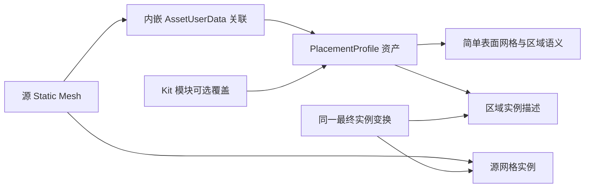

# 可放置区域网格与源 Mesh 的资产关系

日期：2026-11-05。状态：Profile、AssetUserData 默认关联和首批 24 个源模型资产已落地，详见 [第一批可放置区域](NightCity_Placement_Batch01.md)。Kit 覆盖、重导入自动失效、GPU 区域输出与附属物求解仍属设计。前置：[附属物放置方案评估](NightCity_Attachment_Placement_Evaluation.md)。

## 1. 推荐关系

把可放置区域定义为**源 Mesh 局部空间中的辅助表面网格**。它具有自己的顶点、三角形和区域语义，与源 Mesh 共享实例变换，不要求共享顶点、拓扑或 LOD。

建议区分数据存储与关联入口：

- **区域数据存储**：独立 `PlacementProfile` 数据资产，包含简单区域网格与语义，可以独立编辑、版本管理。
- **源资产关联**：源 `UStaticMesh` 上挂一个轻量 `UAssetUserData`，只引用默认 Profile，不复制区域数据。
- **使用场景覆盖**：Kit 的模块槽位可指定一个 Profile 覆盖；未指定时使用源 Mesh 默认值。
- **实例层**：只保存宿主身份、已解析的 Profile/区域引用、源 Mesh 的最终实例变换和输入版本。



这里实际是“源 Mesh 资产 + Profile 资产”两份资源；`AssetUserData` 是源资产内的子对象，不是第三份独立文件。一个源 Mesh 可以有不同用途的 Profile；每次使用只解析出一份有效配置。几何内容只有 Profile 这一处权威数据，默认关联与 Kit 覆盖都是引用。

这使“拿到一个源 Mesh 就能查询默认区域”成立，又允许同一源网格在不同建筑语义下使用不同区域。它比只把配置放在 Kit 中多了源资产自描述能力。

## 2. 简单 Mesh 应该保存什么

可放置区域本身可以是开放的三角形薄片，不必做成有厚度的封闭体：

```text
PlacementProfile
    ProfileId, DataRevision, SchemaVersion
    ReferenceSourceMesh, ReviewedSourceFingerprint
    Positions[]                 # 源 Mesh 局部空间，cm
    Triangles[]                 # 自己的拓扑
    TriangleRegionIndex[]       # 指向区域表，不引用源 Mesh 三角形
    Regions[]
        PersistentRegionId
        AllowedAttachmentCategories
        OutwardDirection / SidePolicy
        PreferredTangent / InstallationFrame
        ScalePolicy, RuleParameters
```

例如一块带窗墙的安装网格，可以由窗左、窗右、窗下三块面组成；玻璃和开窗位置不铺三角形。多个不相连的片可以放在同一 Profile 中，同一片也可以允许多种附属物。支撑区域决定“哪里允许接触”，不能用它代替实体墙碰撞或检修净空。

边界与孔洞应在拓扑中真实保留，不能把允许区域的 AABB 当成安装面。法线确定贴哪一面；切向或安装框架解决“朝上、沿墙、招牌朝街”等旋转约束。仅有三角形位置和法线仍不够。

`TriangleRegionIndex` 是当前数据版本的索引，`PersistentRegionId` 才是持久身份。重新三角化不应使整个区域身份改变。三角形编号、GPU 压缩后的输出序号、渲染 Section 下标都不适合作为跨会话连接键。

第一版建议 Profile 使用**轻量顶点/索引数组**表达这个 Mesh；不是要求它必须再成为一个用于绘制的 `UStaticMesh`。这不影响把它上传成 GPU 网格，也不影响编辑器显示它。

为了利用现有 DCC 或 UE 建模工具，可以先制作一个独立的低面数 `SM_Wall_Placement`，由编辑器构建器读取并转换成 Profile。必须明确此时独立 SM 是制作源，Profile 的运行数据是派生结果；不允许两边都作为可随意修改的权威数据。另一条制作路径是直接编辑 Profile 的区域几何，临时生成预览 Mesh。

实现应为每个 Profile 固定一种制作模式，记录来源与构建版本。运行时只读已经构建、可随包发布的数据，不依赖编辑器 `MeshDescription`，也不临时回读源模型的渲染顶点。

## 3. 为什么采用辅助几何，而不是塞入源模型的渲染结构

| 形式 | 适用性与代价 |
| --- | --- |
| 源 Mesh 的额外 LOD | LOD 表达不同渲染精度，不表达安装语义；区域不应参与 LOD 切换 |
| 源 Mesh 的隐藏 Section | 绑定到渲染拓扑与材质组织；重建、合并、重导入更容易影响区域；还要管理绘制与相关构建行为 |
| 复用碰撞 Mesh | 碰撞表达阻挡实体，可安装面往往只是外墙的一小部分，窗与设备禁区也不等同于碰撞孔洞 |
| 每个实例附一个隐藏组件 | 编辑预览直观，但大量实例下增加组件、状态同步与生命周期成本 |
| 顶点色/UV 标记 | 可以辅助提取初稿，但受源网格密度和拓扑限制；独立区域边界未必沿源三角形边 |
| 独立区域数据 + 源 Mesh 引用 | 区域可独立制作与缓存，实例只复用变换；代价是要实现关联解析和编辑工具 |

本方案选择最后一项。若只讨论存储，直接把区域数组全部内嵌在 `UAssetUserData` 中也可行，且资产文件少一份；但区域编辑会改动源 Mesh 包，同源网格的多套用途配置也较难独立组织。夜之城已有大量导入资产，独立 Profile 更便于分别维护。

独立 Profile 不意味着完全免改源资产：安装默认关联时仍需保存源 Mesh 包。如果某批导入资产暂时不准备改，先在当前 Kit 中显式引用 Profile 即可。无需扫描全目录按同名文件猜关联，也无需先增加一个全局业务状态容器。

## 4. 坐标关系必须严格共用

默认约定：区域顶点已经在源 Mesh 的局部空间中，轴心、单位和轴向与源 Mesh 一致；所以区域变换就是源网格最终实例变换。

用列向量记法表示：

```text
p_world = T_source_instance × p_region_local
```

若多个源 Mesh 确实可以共用一份规范化区域几何，才增加经过验证的 `ProfileToSource` 映射：

```text
p_world = T_source_instance × ProfileToSource × p_profile
```

该公式是数学记法，实际 C++/HLSL 须按项目矩阵约定实现，不直接照搬乘法顺序。几何相似或同尺寸不自动证明映射成立；开洞不同的两个网格不能仅靠比例缩放共用区域。

当前 [`CSCityFacade.usf`](../Shaders/Private/CSRoad/CSCityFacade.usf) 按源 Mesh 的 Bounds、`QuarterTurns`、开间拉伸与轴心偏移求出最终变换。**区域必须复用这份结果，不能再根据自己的 Bounds 单独执行一次 Fit。** 比如安装面只有窗左侧一条窄带，按自己的包围盒铺满开间就会错误覆盖整面墙。

共享最终变换也意味着不能对区域重复应用 `QuarterTurns`。非均匀缩放下法线使用逆转置，安装框架重新正交化；设备自身物理尺寸另行处理。区域跟墙伸长，不代表空调也伸长。

如果区域形状包含“距窗边固定 20 cm”这类制作规则，仅缩放顶点不能保持世界距离；这类配置应在模块实例尺寸确定后重新构建/裁剪可行区域。区域 Mesh 是规则的几何输出，不要求它在所有缩放下永远不变。

## 5. 运行时只实例化描述，共享几何缓冲

```text
共享 GPU 数据：Profile 顶点、索引、Region 表、可选边界/加速结构
每个区域实例：HostId、ProfileHandle、最终变换、输入版本、用途上下文
每个候选结果：RequestId、RegionId、姿态、占用、评分与裁决
```

同一种墙摆 6,229 次，不需要复制 6,229 份区域三角形，也不需要 6,229 个区域组件。可以在规范局部空间做查询，或由 GPU 按需变换区域；调试时才叠加绘制区域。

源实例的变换应来自生成描述或与源网格同步产出的描述缓冲，不能依赖不可稳定复现的渲染输出槽号。槽号可作当前帧访问句柄，持久身份另存。区域几何缓存按 Profile 与数据版本复用，宿主上下文和占用保持在实例层。

若按面积采样，非均匀缩放后必须使用实际表面面积权重；一般不能把所有实例都套同一份局部面积概率表。脚印与边缘间距也须使用实际尺度，除非缓存键明确包含相关尺度参数。

区域网格不进入正式绘制、物理阻挡、导航或距离场构建路径；可在调试视图中显示。它是允许安装的语义几何，不是新的一层墙体。

## 6. 默认、覆盖、禁用与失效处理

建议模块配置使用明确的三态，而非让空指针同时表示“继承”和“禁止”：

```text
PlacementMode = Inherit | Override | Disabled
Resolve:
    Disabled -> 明确不生成安装区域
    Override -> 使用指定 Profile；缺失或不兼容则报配置错误
    Inherit  -> 查询源 Mesh 的 AssetUserData 默认关联
    默认关联缺失 -> NoProfile，按上层策略进入表面提取回退或待配置
```

`NoProfile` 与“这个模块已明确禁止安装”必须不同。否则用户禁用了某面，自动提取路径又会把它恢复。覆盖采用整份 Profile 替换作为第一版语义，不做隐式叠加，以免默认和覆盖区域生成两遍。

源 Mesh 重导入、轴心/单位改变、开洞改变时，需比较已审查的源几何指纹或明确的构建版本。失配时将 Profile 标为待重验证，不能继续默认为有效。仅改材质不一定改变几何，但如果修改了玻璃/实墙等安装语义，也需要相应语义版本失效。

重新三角化但区域边界不变时可以保留 RegionId；区域拆分、删除或语义改变时，要更新引用并使相关连接重求值。Profile 更新应使相关实例和候选重新计算，带版本提交，避免旧 GPU 查询结果覆盖新几何。

重导入是否保留自定义 `AssetUserData` 取决于具体导入/替换路径，需要测试；不承诺所有导入器都会自动保留。Profile 独立保存有利于恢复关联，但仍要验证新源几何与旧区域是否匹配。

部署时 Profile、绑定类和需要运行的区域数组必须属于运行时模块并正确序列化。默认/覆盖引用优先使用明确的资产引用，确认从实际关卡或生成器入口可达；若使用软引用，需要显式配置加载和 cook 可达性。不能仅在编辑器中找到 Profile，就认为打包后一定存在。

## 7. 当前代码依据与最小落点

本地 UE 5.7.4 的 `UStaticMesh` 已实现 `IInterface_AssetUserData`，提供 `AddAssetUserData`、`GetAssetUserDataOfClass`；`UAssetUserData` 用于在资产上存自定义数据。官方 API 也列出该机制。[Epic：UStaticMesh](https://dev.epicgames.com/documentation/en-us/unreal-engine/API/Runtime/Engine/UStaticMesh)

插件已有 [`UCSClothSplitBakeData`](../Source/ComputeShaderGenerator/Public/CSClothSplitActor.h)，继承 `UAssetUserData` 并把烘焙绑定数据挂在 Static Mesh 上，可以参考其附加与读取方式。不要复用它依赖源顶点编号的绑定语义；安装区域采用自己的拓扑和区域身份。

本设计的最小落点及当前状态是：

1. 已实现运行时 `UCSCityPlacementProfile`，每个 Region 独立保存顶点与三角形；这是上文扁平数组设计的等价最小实现。
2. 已实现 `UCSCityPlacementBinding : UAssetUserData`，保存默认 Profile 引用。
3. [`FCSCityFacadeModule`](../Source/CSRoadNet/Public/CSCityFacadeKit.h) 的三态模式及覆盖引用尚未实现。
4. 已实现 `GetDefaultProfile` 查询和编辑器 `SetDefaultProfile` 绑定；统一的 Kit 覆盖解析尚未实现。
5. 已实现首批区域离线构建、导入和预览工具；GPU 区域描述输出尚未接入。

首批已完成 24 份 Profile 的保存/重载、源默认关联、源几何指纹及预览局部坐标一致性检查；22 个模型有候选区域，2 个窗模块保持待复核。拉伸后的实际安装约束、Kit 覆盖/禁用、重导入自动失效、打包可用及 GPU 实例共享仍需后续验证。具体范围和复现方式以 [首批处理记录](NightCity_Placement_Batch01.md) 为准。
