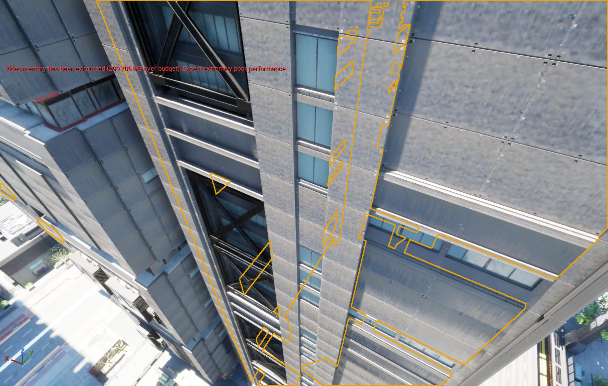
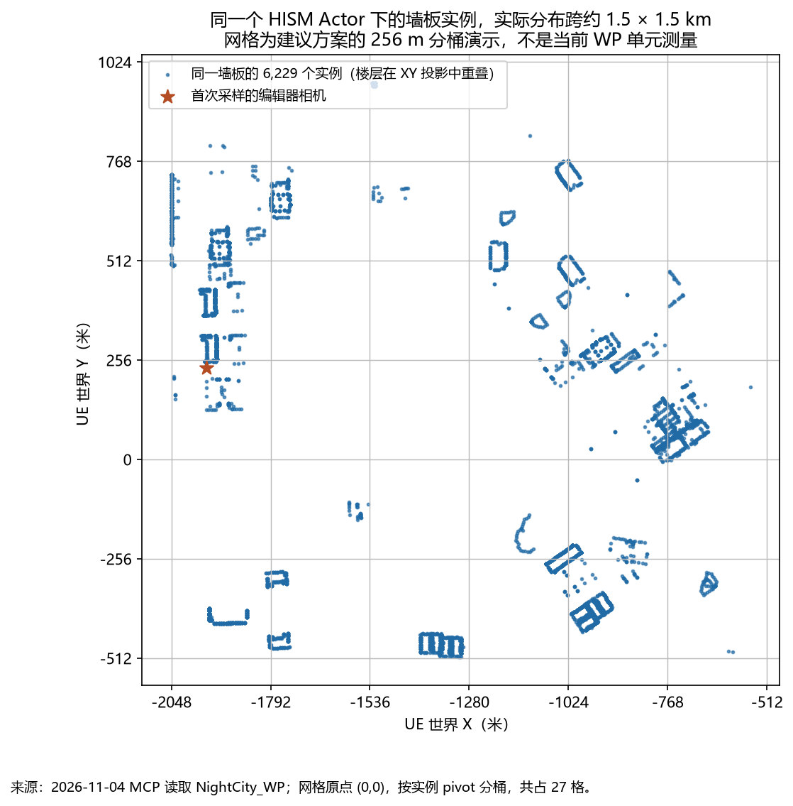

# 夜之城建筑的程序化生成与分块方案

日期：2026-11-04  
对象：`UETest574_2` 当前编辑器中的 `/Game/BuildingGenerator/Cyberpunk2077/Maps/NightCity_WP`  
状态：基于 MCP 实测的设计建议；尚未改动生成代码或重组场景。

2026-11-05 补充：[附属物放置、跨楼互斥与连接](NightCity_Attachments_And_Links.md)，结合当前 Tiny Glade 的锚点、共享接触和楼梯接合实现。

## 1. 结论与建议起点

这份夜之城场景适合采用 **“街区与地块约束 → 建筑体块组合 → 楼层与立面语法 → 模块实例 → 空间分块输出”** 的生成方式。

最先做的应当是：选取当前看到的 Charter Hill 建筑系列，做一个能生成裙房、塔楼、退台和屋顶的单栋原型；用已有 6 m × 4 m 墙板及配套转角、窗板、檐口完成外皮；再将若干建筑放进一个 256 m 见方的试验区域，验证局部重生成与独立加载。

“分块”需要有独立的三套边界：

1. **生成边界**：街区、地块、单栋建筑、裙房或塔楼、立面分段。决定规则、稳定 ID 和更新依赖。
2. **渲染边界**：空间相近、网格与材质等渲染状态相同的实例批次。决定组件数量、剔除和更新成本。
3. **加载边界**：World Partition 能独立装载的 Actor / Cell。决定内存、流送与远景替身。

三者有关联，但不要求一一对应。一个建筑可以生成多个渲染块；一个加载单元可以包含数栋楼的局部渲染块。不要把整个城市的同种墙板集中到一个拥有全部实例的 Actor，也不要为了加载而把每块墙板变成独立 Actor。

## 2. 这次实际读到了什么

### 2.1 采样口径

本次通过项目本地 `mcp-unreal.exe` 的 MCP stdio 工具连接当前编辑器。连接端口以当前 `Config/DefaultEngine.ini` 为准：**8092**；文件中的早期注释仍提到 8091，不能照旧使用。通过 `status`、`level_ops`、`execute_script`、`capture_viewport` 核实项目、关卡、对象及视口。

`get_property` 包装器对对象返回值有 schema 校验错误，因此 World Partition 的部分属性又通过同一编辑器的 Remote Control **只读访问**核对。未执行编译、重建 HLOD、加载其他区域或修改场景实例。本次数字是**当时已加载编辑器世界的快照**，不能直接当作原游戏全城总量，也不是运行时性能测量。

快照包含：

- 13,337 个 Actor，其中 13,331 个是承载导入网格的普通 Actor。
- 20,978 个 HISM 组件，合计 **1,854,671 个实例**。
- 13,331 种不同 Static Mesh。
- 由原始 depot 路径分类，建筑目录下有 3,413 种网格、758,491 个实例；该目录也包括室内构件及部分附属物，不能把这个数理解成楼栋数量。
- 这些实例目前组织为以 `HISM_SM_<hash>` 命名的 Actor，同一种网格的材质变体分在不同组件中。



视口当时提示显存预算超出约 291 MB。这是需要关注流送粒度的现场信号，但不能据此认定 HISM 聚合是唯一原因；本次没有测量纹理、Nanite、Lumen、阴影等各项显存占用。

### 2.2 一个直接说明问题的墙板样本

首次采样时选中的 Actor 是 `HISM_SM_C351A38A42B01B7D`。资产元数据 `SourceDepotPath` 指向：

```text
base\environment\architecture\westbrook\charter_hill\wbr_cha_building_b_wall_w600_h400_ac.mesh
```

实测本地网格 AABB 为 **6.000 m 宽 × 0.502 m 厚 × 4.000 m 高**。它并非一栋楼，而是一块可反复使用的墙面模块。

该 Actor 下有 4 个材质组合对应的 HISM 组件，实例数分别为 6,128、3、24、74，总计 **6,229**。其中 5,139 个实例的采样缩放为 `(1,1,1)`，约占 82.5%；另有 414 个为 `(2,1,1)`。说明该导入场景确实以标准模块重复为主，也存在拉伸适配；不能要求所有原始实例都严格落在一个固定模数上。

这些实例 pivot 的实际空间范围为：

- X：−2049.14 … −554.41 m。
- Y：−507.97 … 968.91 m。
- Z：−25.74 … 250.34 m。

水平跨度约 **1.495 km × 1.477 km**。这一结果来自实例变换，独立于 Actor 包围盒。原 Actor 包围盒更大，组件和根节点的位置可能进一步扩大它；仅凭包围盒会高估实际分布。



为了比较输出粒度，按 UE 世界原点 `(0,0)`、实例 pivot 的 XY 坐标做离线方格分桶，负坐标使用 floor：

- 64 m：占 128 个桶，单桶最多 461 个该墙板实例。
- 128 m：占 60 个桶，单桶最多 592 个。
- 256 m：占 27 个桶，单桶最多 1,102 个。
- 512 m：占 10 个桶，单桶最多 1,261 个。

这是**同一类墙板**的分桶演示，不是整城每块的负载，也不是 cook 后 World Partition 的实际 Cell 数。材质组合拆分后组件数还会增加。它说明空间分桶可以把目前跨街区的所有权收回到局部，但最终尺寸必须用整块内容实测。

### 2.3 场景里已有可利用的建筑模块体系

除上述墙板外，当前加载网格中还存在以下明确样本；尺寸是未施加实例缩放的本地包围盒近似值：

- Corporate Plaza：`cct_cpz_building_a_f_6m`，6 m 宽、8 m 高，11,809 个实例。
- 同系列 `_6m_h4m`：6 m 宽、4 m 高，12,049 个实例。
- 同系列 `_3m_h4m`：3 m 宽、4 m 高，9,168 个实例。
- 同系列 `_12m`：12 m 宽、8 m 高，6,508 个实例。
- Charter Hill：`wbr_cha_building_b_wall_w300_h400_corner_convex_ac`，约 3.5 m × 3.5 m × 4 m 的凸角件，4,941 个实例。
- 同系列 `roof_cornice_w_600_aa`：约 6 m 长的檐口件，5,963 个实例。
- `wbr_cha_building_a_floor_w600_aa`：约 6 m × 6 m × 0.22 m 的楼板，4,911 个实例。
- 同系列带窗墙板 `wall_window_w600_h400_ag`：约 6 m 宽、4 m 高，3,957 个实例。

因此可以从**建筑系列与模块接口**入手，而不是把现有网格统一视作可随意散布的物体。这里只能证实导入结果的复用结构，不能据此断言原游戏具体用了哪种程序化工具或完整生成流程。

## 3. 建筑如何程序化生成

### 3.1 先定义建筑类型，再决定体量

地块输入至少包含：边界、临街边、出入口、高程、退界、最大高度、邻楼关系和确定性随机种子。地块高度应来自实际街道或平台的接入口，不应仅由地形采样决定。

建议先支持三种建筑语法：

- **沿街连续建筑**：临街商业基座、上部重复楼层、屋顶；背面有服务入口和设备。
- **裙房加塔楼**：占地较大的公共基座，上面有一个或多个塔楼及退台。裙房和塔楼各有自己的轮廓、楼层节奏及立面系列。
- **工业或基础设施建筑**：大跨度主体、附属盒体、外露结构、管线和连接廊道。

地标建筑及特殊轮廓可以使用人工制作的体块或整栋资产，在明确的接口上连接程序化立面与附属物。现有 `Recovery/BuildingShells` 资产可作为候选，但要逐件确认其用途、碰撞、尺度和缺失面，不能仅凭目录名自动归类为完整可用楼体。

### 3.2 体块层保留轮廓和层级

一个建筑描述由若干体块组成：裙房、塔楼、侧翼、退台、设备层和屋顶。每个体块携带底面多边形、起始高度、层高、层数、立面风格及与其他体块的连接关系。

初版可限制轮廓为矩形和矩形组合，但数据结构应保留后续凹角、孔洞与不同楼层轮廓的能力。现有代码的凸包和外包矩形会抹掉 L 形凹口、中庭等信息；夜之城建筑的空间层次不能一直通过一个包围盒表达。

先求出体块之间哪些面露在外部，再生成外皮。裙房与塔楼的接触面、贴邻建筑的共墙可以省去被完全遮挡的装饰面，但碰撞和室内封闭需求仍应单独处理。

### 3.3 立面使用“边 × 楼层带 × 开间”规则

对体块的每一条外露边，依次处理：转角占位、开间分配、楼层带、门窗、收边。每条立面分段可以描述为：

```text
建筑 ID / 体块 ID / 立面边 ID
起点与朝向
楼层起止、层高
开间宽度序列
模块系列、材质变体、边界连接类型
```

Charter Hill 原型可采用 **6 m 开间、4 m 层高**作为起点，配合 3 m 半开间与专用转角；Corporate Plaza 的样本则支持 3 / 6 / 12 m 宽度、2 / 4 / 8 m 高度组合。它们是不同系列的局部语法，不能推广为全城统一标准。

长度分配建议：先占用有真实接口尺寸的两端转角，再用标准宽度铺满中段；余量进入经过标注的窄条、盲墙或收口模块。曲面、斜墙与 45° 转角进入对应系列。厚度、凸出装饰和转角重叠不能当作沿墙有效长度，不能仅靠网格 AABB 自动推断连接接口。

窗户、门框、柱列使用标准尺寸；允许变形的盲墙和收口段才吸收剩余长度。原场景存在拉伸不代表所有模块都适合任意拉伸。

### 3.4 立面节奏先成组，再作局部变化

建议先固定竖向柱带、窗带和重复楼层组，再加入少量断开、退台和设备层。随机选择应有作用范围：

- 街区层选择风格与高度分布。
- 建筑层选择主体材料、开间节奏及轮廓变体。
- 立面段选择窗带、阳台、遮阳或维修变体。
- 小构件层选择少量污渍、设备和灯光状态。

这样能保留建筑设计的一致性。逐格独立随机选墙板容易让整栋楼缺少结构规律。

### 3.5 附属物依附明确的接口

空调和招牌的候选位置、实体与净空互斥、跨楼连接及增量裁决详见 [附属物专题](NightCity_Attachments_And_Links.md)。以下保留总体接口要求。

空调、管线、灯箱、栏杆和楼梯应从立面或屋顶的挂点生成，挂点包含朝向、允许体积、检修距离和禁入区域。连桥、裙房平台、高架下空间需要记录连接双方与高度，不能被当作普通地面散点。

门口、车道、消防通道及平台连接处先作为保留区参与体块和立面求解。之后再填充细节，避免用碰撞排除不断修补已经堵住的入口。

建筑与地面衔接可沿用 [GroundJoin_Plan.md](../GroundJoin_Plan.md) 的整平区、自带区和挖空区思路。该文对夜之城道路、人行道和地面板的测量是前一天的独立样本，本次没有重复验证，不能作为当前所有建筑的统一高度。

## 4. 具体应该怎样分块

### 4.1 生成分块：沿建筑结构切

建议的更新层级为：**街区 → 地块 → 建筑 → 体块 → 立面段 → 楼层组 → 模块实例**。

街区边界跟随主路、小巷、河道和明显功能分界。建筑内部优先沿裙房 / 塔楼连接线、退台、伸缩缝、设备层和立面转折切分。楼层组先取数层为一个更新单元，具体层数由改动范围和组件负载决定。

改一扇窗只需更新对应立面段；改塔楼层数更新塔楼外皮、屋顶和相连附属物；改裙房轮廓才向相邻地面、入口和地块占用传播。一个楼层组是更新单位，不意味着它必然独立加载。

### 4.2 渲染分块：空间优先，再按状态合批

建议批次键包含：

```text
空间块 ID
内容层 / 渲染表示类型
StaticMesh
完整材质覆盖组合
碰撞、阴影、移动性等不兼容的组件状态
```

同一格中的同类墙板可合批；相距数百米甚至公里的同类墙板应分开。材质槽、每实例自定义数据及源 ID 必须随实例保留。6,229 个墙板的 4 种材质组合就是不能只按 Mesh 合并的实际例子。

建议先对比 **128 m 与 256 m** 两种局部输出尺度；细节特别密集的街角再尝试 64 m。不要一开始把所有模块都切到 16 m 或更小，因为 Actor、组件和调度的固定成本会迅速增加。

普通小建筑可以保持完整，只有超大裙房、长立面或多塔综合体需要继续分段。空间块用于装箱与管理，不是强制把网格几何沿格线切开。单个模块跨界时只保存一次，并让其实际 bounds 正确反映越界部分。

### 4.3 加载分块：输出必须有独立所有者

World Partition 的距离流送作用于空间化 Actor 组织出来的单元。HISM 内部的层级剔除可以减少可见实例工作，但它不等于把同一组件内的远处实例数据独立卸载。Actor 间硬引用也可能导致成组加载，需控制跨块依赖。[Epic：World Partition](https://dev.epicgames.com/documentation/en-us/unreal-engine/world-partition-in-unreal-engine?application_version=5.7)

如果最终使用原生 WP 管理烘焙内容，输出应是多个可保存、空间局部的 Actor，Actor 的实际组件 bounds 也必须局部。仅把一个全城 Actor 下的组件命名为不同 tile，不会自动获得独立 Actor 流送。

**256 m 可作为主加载尺度的起始实验值，不能视为本场景已经证明的最佳值。** 128 m 的输出 Actor 可以再由 WP 组织进更大的加载单元；普通建筑跨边界时允许其进入适当单元，不为凑整齐网格重复实例。

当前关卡使用 `WorldPartitionRuntimeHashSet`，已确认 `bEnableStreaming=true`。本次没有可靠读出其主分区 CellSize、LoadingRange 或二维 / 三维模式；下面的建议值不代表现有配置。不要把读取到的 HLOD Layer 尺寸当成主分区尺寸。

### 4.4 垂直分层：先区分功能，再决定是否独立流送

夜之城具有街面、裙房平台、高架、连桥、塔楼和室内等重叠空间。仅按 XY 归属不能表达全部连接和遮挡关系，但每层楼都设置独立 WP Actor 也未必合算。

建议外壳保持较粗粒度，以维持远处轮廓；可进入的室内、设备细节、灯光和交互内容使用各自的加载策略。室内可按楼层组或空间连通区域组织，入口、电梯或任务区域控制预加载。只有实际配置并验证了相应三维划分或加载源策略，Z 分组才具有独立流送效果。

高架、天桥和地下入口应通过显式高度与连接关系参与生成。不要仅凭二维重叠把上层平台当作地面遮挡，或让地面建筑避让一条远在头顶的道路。

### 4.5 远景：轮廓代理与小零件分开

近处保留墙板、窗框和设备；中距离首先移除不影响外轮廓的小件；远处使用按建筑或建筑组制作的合并 / 简化代理，保留天际线、主体色块与主要发光图案。

Instancing HLOD 主要适合重复网格实例化；Merged / Simplified 类型用于生成更粗的代理。它们解决的问题不同，应通过对照场景验证。[Epic：World Partition HLOD](https://dev.epicgames.com/documentation/unreal-engine/world-partition---hierarchical-level-of-detail-in-unreal-engine)

本次读取到的现有资源为：

- `NightCity_WP_HLODLayer_Instanced`：Instancing，CellSize 256 m，LoadingRange 768 m，父层为 Merged，空间加载开启。
- `NightCity_WP_HLODLayer_Merged`：Mesh Merge，存储的 CellSize 256 m、LoadingRange 512 m，但 **空间加载关闭**。

父层不参与空间加载时，不能把其 512 m 存储值解释成正在生效的远景卸载半径。更不能仅凭资源存在认定代理已构建完成或切换正确。本次未运行 HLOD 构建或运行时切换验证。

## 5. 边界、稳定 ID 与增量更新

生成器应维护可重建的描述数据，实例只是输出结果。建议保留：

```text
BuildingId
  MassId
    FacadeId
      FloorBandId
        BayId / Role
          InstanceId
```

ID 来自持久标识、规则位置与角色，避免依赖本次数组顺序或加载顺序。随机数由建筑、立面段等稳定 ID 和 seed 派生。修改隔壁建筑时，未受影响建筑应保持相同外观。

块边界的处理原则：

1. 查询范围包含邻域。邻域半径由退界、模块最大伸出、连桥等规则的影响范围推导，不能随意固定为一个小数值。
2. 输出只由一个确定所有者负责。初版可按建筑 / 体块锚点归属，超大体块先拆成稳定立面段，再分别归属。离线统计中的 pivot 分桶只是比较工具。
3. 跨界依赖保存稳定 ID 和必要描述，不让所有块相互持有强 Actor 引用。
4. 输入变化同时使旧占用范围和新占用范围失效，清掉旧输出并生成新输出。
5. 单独重生成一个块与连续区域整体生成，应在该块的有效输出范围得到一致结果。

高架连桥等跨栋对象可以有独立所有者和两个连接端点，不强行归入任意一栋的随机附件。

## 6. 如何接入现有 PCGPlugins

### 6.1 可以直接复用的部分

- [`CSCityLayout.h`](../Source/CSRoadNet/Private/CSCityLayout.h) 已有道路、保留地块、地块生成、稳定地块 ID，以及 `AnchorReach`、`RoadReach`、`ReservedReach` 等局部依赖范围逻辑。
- [`CSCityBuildingActor.h`](../Source/CSRoadNet/Public/CSCityBuildingActor.h) 已有手工轮廓、Height、Setback、StoreyHeight 和车库入口参数，可作为建筑编辑入口。
- [`CSRoadNetworkActor.h`](../Source/CSRoadNet/Public/CSRoadNetworkActor.h) 已有默认 256 m 的 TileSize、建筑 tile 状态和局部重建统计。

这些能力适合作为街道到地块、地块到建筑描述的基础。继续使用现有 C++ 数据流即可，不必为了使用“PCG”这个名字重写成一张庞大的节点图。

### 6.2 需要新增的能力

现有 `CSCity::AssembleBlock` 是每层放一个拉伸模块（2026-11-05 已换成按开间拼墙、窗、门、转角、女儿墙、屋面的 GPU 立面套件，见 [`NightCity_BuildingKit.md`](../NightCity_BuildingKit.md) 第 4 节，但仍只拼一个矩形盒子）；`ACSCityBuildingActor::Rebuild` 将轮廓凸包交给 `HullBlock` 求外包矩形。它们还不能表达上述裙房、多个塔楼、凹角、中庭和立面语法。

建议新增三个相互独立的层；下列名称只是提案：

- **建筑描述与规则层**：从地块生成体块、楼层带、立面段与连接关系。
- **模块实例求解层**：输出 Mesh、Transform、材质覆盖、InstanceId、角色、bounds 和归属信息。
- **输出适配层**：将同一份实例描述写入编辑器预览、局部 GPU 渲染块或可保存的 WP Actor。

网格库应有明确的模数、安装锚点、接口、可缩放轴和适用角色。保留源资产路径与来源坐标转换，尤其注意当前导入约定 `RED metres (x,y,z) → UE centimetres (100x,-100y,100z)`。不要把原游戏的米坐标直接用于 UE 的厘米分桶，也不要重复翻转 Y。

### 6.3 现有 tile 与 WP 的关键差别

[`CSRoadNetworkActor.cpp`](../Source/CSRoadNet/Private/CSRoadNetworkActor.cpp) 的 `WriteBuildingTile` 将 `UCSGpuInstancedMeshComponent` 创建在共同的 `Content` Actor 下，并设置 `RF_Transient | RF_DuplicateTransient`。`FCSCityBuildingTile::Instances` 也是 Transient。

因此当前 tile 主要提供**局部求解、局部输出与局部更新**，尚不能当作已经实现了持久化 WP 分区。后续有两种明确方向：

1. **编辑器生成并烘焙**：把结果写成局部原生 Static Mesh / ISM / HISM Actor，再验证保存、cook、WP 与 HLOD。适合作为首个可验证版本。
2. **运行时自定义生成**：保留 `UCSGpuInstancedMeshComponent`，由独立块对象和管理器负责生成、释放、碰撞、代理与预算。此时需要明确实现加载生命周期，不能假设原生 HLOD 构建器会自动处理自定义组件。

这两种输出可以共享建筑描述与模块求解。建议先把结果与输出所有权分开，再比较哪条路径适合目标运行方式。

如果后续引入 UE PCG Graph，Partitioned / Hierarchical Generation 可以用于不同尺度的生成调度，但仍需解决语义规则、稳定 ID 和输出所有者，不能替代这些设计。[Epic：PCG Generation Modes](https://dev.epicgames.com/documentation/en-us/unreal-engine/using-pcg-generation-modes-in-unreal-engine)

## 7. 推荐的最小实施顺序

### 第一步：整理一个完整模块系列

先整理 Charter Hill 当前建筑系列中的实体墙、带窗墙、门口、凸角、凹角、半开间、楼板、檐口与屋顶收边。将负 pivot、朝向、连接宽度、厚度、材质覆盖和允许缩放轴显式记录。

验收：拼出一层闭合建筑；直边、凸角、凹角和屋顶连接无明显穿插与漏缝。资产不足处明确标记缺项，不用随机缩放其他模块掩盖。

### 第二步：完成一栋“裙房 + 塔楼”

提供轮廓、层数、退台层、入口边和风格种子。用同一份建筑描述产生稳定实例 ID。初版允许只生成外壳，室内范围需单独定义。

验收：改层数、改局部开间、改裙房轮廓，输出只在依赖范围内变化；入口不被填墙，退台顶部闭合，转角正确。

### 第三步：做一个 256 m 试验区域

布置若干不同高度和朝向的建筑，包含跨格裙房、普通临街楼、平台和一处高架关系。比较 128 m 与 256 m 的输出组织；只对局部最密区域补测 64 m。

先保持相同建筑内容与相同观察路线，记录可比较的结果：局部重建耗时、组件和 Actor 数、实例上传量、CPU / GPU 帧时间、显存和内存峰值、加载耗时与卡顿。采样器、视距、纹理配置和渲染设置应一致；不要用一次编辑器视口卡顿代表稳定运行时表现。

### 第四步：验证真实卸载与远景

对原生输出检查 cook 后的空间单元和 HLOD；对自定义输出检查块生命周期及 GPU 数据释放。沿街道、屋顶和快速移动路线分别验证。

验收重点：离开区域后源内容确实卸载；远处仍有完整建筑轮廓；跨界构件不重复；室内与平台没有错误开口；重入区域结果一致。

### 第五步：扩展建筑类型和近景细节

先扩展沿街建筑、工业建筑与复杂裙房，再增加设备、招牌、灯光与室内。将这些内容与建筑外壳分别设置生成及加载预算，避免第一版同时承担全城、多类型、完整室内和复杂运行时生成。

## 8. 本次边界与留存证据

本次交付是分析和实施提案。没有改变建筑实例、材质、HLOD、World Partition 配置或现有生成代码；没有运行编译和性能基准。

随本文留存：

- [实测摘要与模块证据](NightCity/evidence-2026-11-04.json)。
- [首次视口截图](NightCity/viewport-2026-11-04.png)。
- [墙板实例空间分布](NightCity/wall-module-distribution.png)。

完整采样脚本、原始 Actor / 组件快照和实例变换保存在项目 `Saved/CodexNightCityAnalysis/` 下。depot 名称来自本地既有映射，并对关键墙板与 Corporate Plaza 模块用当前资产元数据交叉核对。所有建议尺寸都应与样板区域测量结果一起调整，不能把分析用方格直接当作现有引擎分区。
