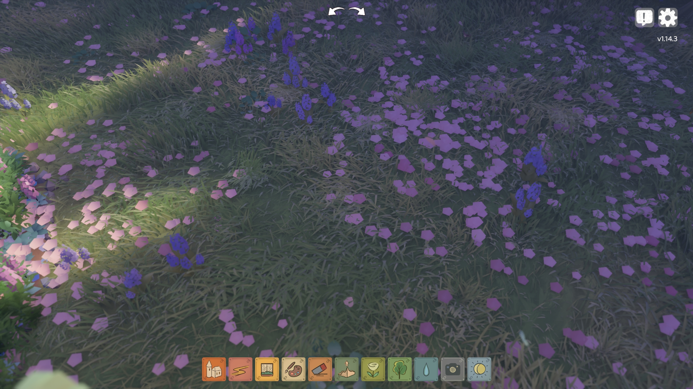
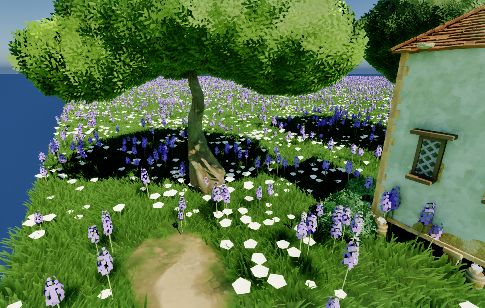
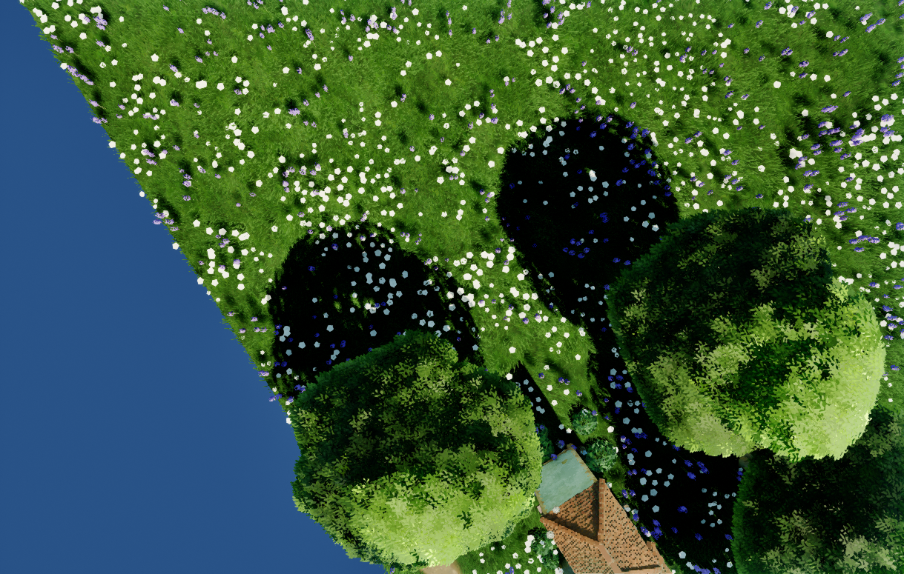
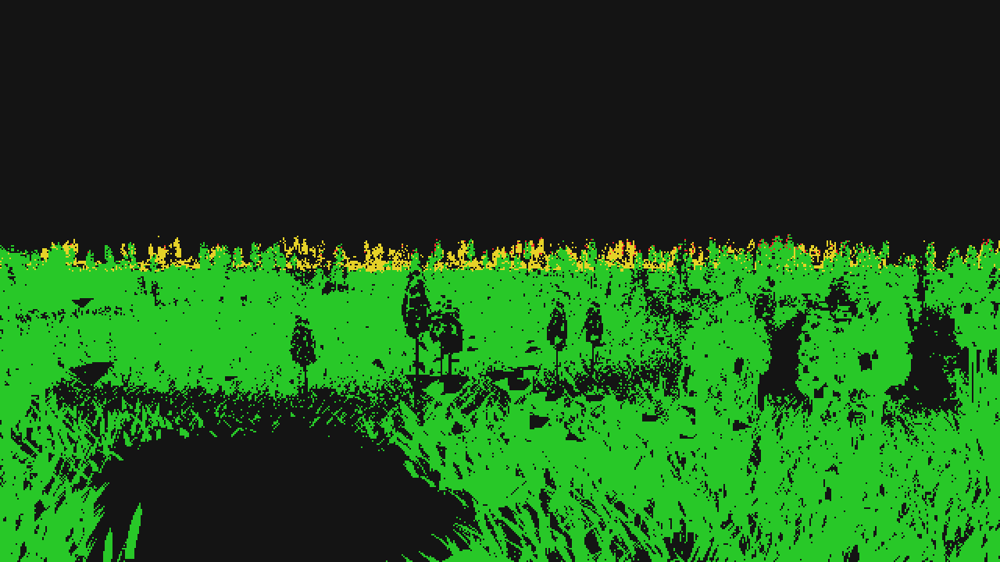

# 地被：Nanite、WPO 距离淡出与花的聚散

地被（草 + 花）在 2026-09-29 的三处改动：全部改走 Nanite；WPO 在草的近 / 远交界前淡出、交界之外不求 WPO，只剩法线风动；花的分布加一道「聚散」。同日白花从纯白改成淡黄（见「白花的颜色」）。
散布本身（抖动网格、簇朝向、近 / 远两档、地面遮罩）见源码注释 `CSGroundCover.h` / `CSGroundCover.usf` / `FCSGroundCoverLOD`；默认值的调参记录见 [`Ground_Tuning.md`](Ground_Tuning.md)。

## 用户参考



用户原话：「让花草都设置为随着屏幕远离 WPO 降低，直至交界处时彻底消失，并且 disable WPO。只留下法线变化。让这些内容均使用 nanite」「让花的分布有一些聚散」。追问后定的两条：WPO 只在最后一段减弱；花走 Nanite，但影子仍留在 CSM。

## 现状速查

| 项 | 现在 | 在哪 |
| --- | --- | --- |
| 渲染路 | 四张网格开了 Nanite（`SM_TG_GrassBlade` / `SM_TG_GrassClump` / `lowpoly_flower` / `garden_flower_01_lavender`），组件按资产开关自动走 Nanite 替身 | `UCSGpuInstancedMeshComponent::IsNaniteRenderPath` |
| 近 / 远交界 | Nanite 路在 GPU-Scene 写入 pass 里按逐实例随机数抖动（与经典路同一条带），引擎只拿硬边兜底 | `CSGpuInstancedNaniteWriter.usf` |
| WPO | `[交界 − CoverWPOFadeLength, 交界]` 里材质淡到 0（默认最后 20 m），交界之外引擎不求 WPO | `M_TG_Grass`、`InstanceWPODisableDistance` |
| 法线 | WPO 淡出多少、法线风接过多少；交界处与远处组合草逐位同式 | `M_TG_Grass` 的 `TG Near Normal Wind` |
| 花的影子 | Nanite 替身不投影，另挂只投影的经典实例代理，影子仍进 CSM | `bClassicShadowOnNanitePath` |
| 花的聚散 | 保留概率随位置成片变化（三层值噪声 → 分位数） | `FCSGroundCoverSpecies::Patch*`、`CSGroundCover.usf`「2.6) 聚散」 |
| 白花颜色 | 淡黄：关了 `UseVertexColor`，颜色由 `GrassColor` = (0.826, 0.744, 0.165) 给，花心自然暗 22% | `MI_TG_LowpolyFlower`（母材质没动） |

## Nanite 路

组件的选路规则没变：资产开了 Nanite 就走 Nanite 替身（`UCSGpuInstancedNaniteComponent`），实例由 `CSGpuInstancedNaniteWriter.usf` 写进 GPU-Scene。这一轮给这条路补了三样经典路原本才有的东西。

### 距离带

引擎的 Nanite 距离剔除是一个图元一对 min / max 的**硬边**，没有逐实例过渡带；近处单根草与远处组合草在交界处会出一道圈。所以带内的抖动在写入 pass 里做，判据与经典路 `InstanceCullCS` 逐字相同：

```hlsl
Pull = CullFade * saturate(Origin.w);                          // 逐实例随机数把边界往里收
Hidden = (End > 0 && Dist > End - Pull) || (Start > 0 && Dist < Start - Pull);
```

- 视点只有一个（不是逐视图）：组件的 `SetDistanceCullViewOverride` > 上一帧画过这个世界的透视视点里离上次最近的那个 > 上次用过的。阴影与主视图因此用同一个判定。
- GPU 实例源本来每帧重写，带跟着相机走；CPU 实例源开着带时视点挪过 10 cm 才重写。
- 引擎的硬边放在带的最外沿：近处 End = 边界，远处 Min = `Start − Fade`（End 填一个大数，否则引擎不认 Min）。硬边恒在抖动边界之外，永远不会切掉写入 pass 留下的实例；拿不到视点时两档只在带里重叠，不会露出一圈空地。
- 出图脚本用场景捕获时要钉视点：`ACSGroundActor::SetGroundCoverViewOverride` 已经顺手推给了每个地被组件。

### WPO 关闭距离

组件新属性 `InstanceWPODisableDistance` 交给引擎 Nanite 的逐实例 WPO 关闭距离：远于它的实例不求 WPO，并退回固定功能光栅。这是硬切，看不出切点靠材质先淡到 0（下一节）。经典路不认这一条。

### 花的影子：只投影的经典副本

GPU 实例只有非 Nanite 路才进 CSM（经典路的顶点工厂进不了 VSM，见 `UCSGpuInstancedMeshComponent` 构造函数的注释）；花一旦 Nanite 就回到 VSM 的硬影子。`bClassicShadowOnNanitePath` 开着时：

- Nanite 替身只画主通道、`CastShadow = false`；
- 本组件照经典路建常驻网格与剔除，代理在 `GetViewRelevance` 里关掉主通道 / 深度 / 自定义深度 / 速度，只留阴影 —— 影子逐位是切 Nanite 之前那一份；
- 基础网格读的是资产的**回退 LOD**，所以两张花网格的回退网格设成全精度、保留 Allow CPU Access（打包版要读顶点）。

`ACSGroundActor` 按物种的 `bCastShadow` 写这一条：花开、草不开（草本来不投影）。代价是花的实例多剔除一趟、多一份常驻网格；可见实例集仍按主视锥压，视锥外的花不投影（与切换前相同）。

## WPO 距离淡出

交界 = 草的近 / 远边界（近处窗口真正画到的距离，窗口被预算收小时跟着收；草没分两档时取 `Grass.LOD.NearDistance`）。草与每一种花共用这一条交界。

```cpp
// ACSGroundActor::EnsureCoverComponents 写进每个地被组件
CPD[CoverWPOFadeStartIndex = 0] = 交界 - CoverWPOFadeLength;   // 默认 2000 cm：只在最后 20 m 减弱
CPD[CoverWPOFadeEndIndex   = 1] = 交界;
InstanceWPODisableDistance      = ceil(交界);                   // 远处组合草三项都写 0（它没有 WPO）
```

`M_TG_Grass`（草与三种花 MI 共用的母材质）由 `TinyGladeSetupCoverNanite.py` 加了两个 Custom 节点：

```hlsl
// TG WPO Distance Fade：WPO 乘它；E <= 0（组件没给 CPD）= 不淡出，别处直接挂这张材质的网格照旧
Fade = 1 - saturate((length(P - Cam) - S) / max(E - S, 1));
// TG Near Normal Wind：接到 Normal；与 M_TG_GrassFar 的 TG Far Normal Wind 同一条式子
// TGWindBend 经 VertexInterpolator 进像素着色器（见下面的 ⚠️）
N' = normalize(N + WindDirection * (TGWindBend * NormalWindStrength * (1 - Fade)));
```

⚠️ **风场只能在顶点着色器里算，进 Normal 要走 VertexInterpolator**。`TG Wind Bend` 在花的分支（MI 开 `HeightAsBladeT`）
读 `PreSkinnedPosition`，那只在顶点着色器里有。第一版把它直接接进 Normal（像素着色器），草（走 UV 那一支）编译正常，
两个花 MI 却编译失败、被引擎**静默换成默认材质** —— 花整片灰白，日志里是
`(Node PreSkinnedPosition) External code identifier 'PreSkinnedPosition' is not available in the EMaterialShaderFrequency::Pixel shader`。
现在风场经 `VertexInterpolator` 送到像素着色器（Nanite 5.7 支持顶点插值器），三个花 MI 都能编（VS 375 / PS 196）。
改这张材质之后要看日志里有没有 `Failed to compile Material Instance with Base M_TG_Grass`。组件的诊断
`GetMaterialUndrawableReason`（地面的 `GetGroundCoverUndrawableReason` 就是它）当时只查用途开关、查不出这一条；
09-29 晚补了"按实际画的那张 MI 问编译错误"（下一次编译后生效）。

- 贴着相机（`Fade = 1`）与改动前一样，只有 WPO；淡到交界（`Fade = 0`）时近处的法线与远处组合草逐位相同，交界之外"只留下法线变化"。
- 相机位置在阴影通道里仍是主相机的（`FProjectedShadowInfo::ModifyViewForShadow` 只改视图矩阵），影子里的风与主通道一致。
- `MaxWorldPositionOffsetDisplacement = 60`：Nanite 按它放宽簇包围盒，不设的话风一吹画面边缘的簇会被错剔。

## 花的聚散

抖动网格本身均匀不成簇（草要的正是这个）。开了聚散之后，每一格的**保留概率**随位置成片变化，位置仍是抖动网格：片内是"均匀地密"，不会扎成一坨穿模。

```cpp
UPROPERTY() float PatchSize = 0.0f;           // 片的特征尺寸（cm），三层值噪声的底格；0 = 关（草默认关）
UPROPERTY() float PatchCoverage = 0.35f;      // 片内区域占地面的比例
UPROPERTY() float PatchSoftness = 0.3f;       // 片边过渡在分位数上的宽度，0 = 一刀切
UPROPERTY() float PatchSparseDensity = 0.1f;  // 片外相对片内的密度
```

- 噪声 → 分位数用正态 CDF 的 logistic 近似（`CSCOVER_PATCH_SIGMA = 0.1403`，200 万点离线实测）。覆盖比例 0.1 / 0.2 / 0.35 / 0.5 / 0.7 实测 0.105 / 0.222 / 0.368 / 0.499 / 0.677。改了噪声层数或权重就得重测这个数。
- 抽签用格身份（通道盐 59），重扫不闪；噪声带物种盐，每种花各有各的片。
- 平均保留比例 = `Sparse + (1 − Sparse) × Coverage`。`TinyGladeSetupFlowerPatches.py` 把原密度除以它，总株数与均匀散布时差不多、只是重新分布；它只在这一行花还没开聚散时才除，重跑不会越除越密。

| 花 | PatchSize | Coverage | Softness | Sparse | 意图 |
| --- | --- | --- | --- | --- | --- |
| `lowpoly_flower` | 350 cm | 0.35 | 0.35 | 0.12 | 参考图里低矮的粉花：一片 2–4 m，片间零星几朵 |
| `garden_flower_01_lavender` | 120 cm | 0.10 | 0.15 | 0.02 | 参考图里的风信子：三五株一丛，片外几乎没有 |

## 白花的颜色

用户原话：「调整 `MI_TG_LowpolyFlower` 和对应的 instance 数值，让它拥有淡黄色，不要那么跳脱」。

最终花色与聚散效果见文末 2026-09-29 的同机位和俯视验收截图。

**为什么是纯白**：MI 开着 `UseVertexColor`，母材质那一支直接接顶点色（09-14 用户重做 `M_TG_Grass` 时删了 sqrt 与 sRGB 开关，**别加回去**）。
`lowpoly_flower` 的顶点色是按 sRGB 写的 (250, 240, 175)，现在被当线性读 ⇒ 反照率 (0.98, 0.94, 0.69)，日光下直接顶到色调映射的肩部，屏幕上就是纯白；
树荫里被天光照成蓝白，衬着近黑的草反差更大。

**改法（只动这个 MI，母材质没动）**：关 `UseVertexColor`，走母材质原有的 `GrassColor` 通路
`Lerp(0.8·C, C, t²) × Lerp(0.7, 1.1, t) × 0.55`，`t = z / 45`（`HeightAsBladeT`）。花头是个锥：花心 z = 30（t = 0.667）、
花瓣边缘 z = 45（t = 1） ⇒ **边缘有效反照率 = `GrassColor` × 0.605、花心 × 0.473**，花心自然暗 22%。
取 `GrassColor = (0.826, 0.744, 0.165)` ⇒ 边缘反照率 (0.50, 0.45, 0.10)。`GrassColor` 这个名字是给草起的，对花就是「花色」；
`lowpoly_flower` 的顶点色这条路不再读，网格自带的 `MI_TG_VertexColor` 仍读它。

⚠️ **调色要点**：日光下的花落在色调映射的肩部，饱和度被吃掉很多 —— 反照率 B/R = 0.36 时屏幕上 B/R 仍有 0.84，读成米色 / 卡其；
要读成「黄」得把 B/R 压到 ≈ 0.2、G/R ≈ 0.9，亮度靠整体缩放 `GrassColor` 调。候选（近景机位，花像素亮部 p90）：

| 档 | `GrassColor` | 边缘反照率 | 日光下显示 sRGB | 观感 |
| --- | --- | --- | --- | --- |
| 改前 | —（顶点色） | (0.98, 0.94, 0.69) | (243, 242, 234) | 纯白，树荫里发蓝白 |
| c2 | (0.959, 0.825, 0.345) | (0.58, 0.50, 0.21) | (229, 224, 192) | 奶油 / 米色 |
| c3 | (0.760, 0.654, 0.274) | (0.46, 0.40, 0.17) | (222, 216, 180) | 米色偏卡其 |
| y1 | (0.992, 0.893, 0.198) | (0.60, 0.54, 0.12) | (231, 228, 178) | 淡黄，偏亮 |
| **y2（采用）** | (0.826, 0.744, 0.165) | (0.50, 0.45, 0.10) | (226, 223, 168) | 淡黄，树荫里融进草 |
| y3 | (0.661, 0.595, 0.132) | (0.40, 0.36, 0.08) | (217, 213, 151) | 奶黄，偏暗 |

出图方法：在用户开着的编辑器里用 **transient** 生成的 SceneCapture2D 离屏拍（`spawn_actor_from_class(..., transient=True)` 不弄脏关卡，
实测脏包列表不变），机位同 `TinyGladeCoverNaniteQA.py`，每档预热 64 帧。

TG 原版的花色不是常数：`_garden_lowpoly_flower` 的 PS 按世界坐标（`xz × 0.1 + 缩放 + 0.8`）采一张 `albedo_map`，花色随位置成片变；
具体绑哪张图从 shader 里读不出来（通用绑定名），没复刻。

## 脚本

在用户开着的编辑器里跑（MCPUnreal `execute_script`，本项目编辑器钉在 :8091），不另起无头进程：两份编辑器抢同一个包的文件锁会存盘失败。

| 脚本 | 做什么 | 幂等 |
| --- | --- | --- |
| `TinyGladeSetupCoverNanite.py` | 四张网格开 Nanite（花回退网格全精度）、`M_TG_Grass` 加淡出与近处法线风 + MaxWPO + Nanite 用途、`M_TG_GrassFar` 加 Nanite 用途 | 是（节点已在就不再加） |
| `TinyGladeSetupFlowerPatches.py` | 只补花的聚散四参数并按保留比例抬密度；改 `BP_TinyGladeGround` CDO 与两张演示关卡，**保存关卡** | 是 |
| `TinyGladeSetupGroundCover.py` | 整套地被配置（含同一张聚散表）；⚠️ 会冲掉关卡里手调的值，只在从头配时用 | — |
| `TinyGladeMakeGrassClump.py` | 重建组合草与远处材质；2026-09-29 起顺带开 Nanite，并认得近处 Normal 顶上的 `TG Near Normal Wind`（远处接它底下的着色法线，风不叠两遍） | 否（先删后建） |

## ⚠️ 快速构建过的网格建不出 Nanite 数据

`UStaticMesh::bDoFastBuild` 是一面**存盘**的旗子：脚本用 `build_from_static_mesh_descriptions(..., fast_build=True)` 建过一次，
它就恒为真，之后任何重建（包括在资产上勾 Nanite）都走快速路径，直接写渲染数据、不建 Nanite：

- 症状：资产的 Nanite 开关开着，`NaniteTriangles = 0`，日志里 `Building static mesh …` 之后没有 `NaniteBuild` 那一行；
  组件的 `DebugGetDrawnAssetMismatchSync` 报"开了 Nanite 但没走 Nanite"，替身退回引擎 ISM 代理（照样能画，只是不是 Nanite）。
- `SM_TG_GrassClump`（`TinyGladeMakeGrassClump.py` 造的）就是这样。引擎只在构造函数里清这面旗子；Python 读写不到（protected），
  编辑器里 `SET` / `SETNOPEC` 命令也被禁了。
- 修法：`UCSStaticMeshBuildLibrary::ClearFastBuildAndRebuild(Mesh)`（反射清旗子 + 重新提交 MeshDescription 换缓存键 + 按标准路径重建，
  Python：`unreal.CSStaticMeshBuildLibrary.clear_fast_build_and_rebuild(mesh)`）；脚本从此一律 `fast_build=False`，
  并且网格已存在时原地重建（不删：地面在内存里直接引用它，删了远处组合草当场消失）。
- ⚠️ **只清旗子还不够**：快速路径建出来的那份也写进了 DDC，而且与标准路径**同一个缓存键**（键里没有这面旗子）——
  标准路径直接命中那份没有 Nanite 的缓存，日志里连 `NaniteBuild` 都不出。换键（改一项 Nanite 设置，或重新提交 MeshDescription 换 GUID）
  才会真建。`SM_TG_GrassClump` 2026-09-29 就是清旗子后再把回退网格设成全精度（换了键）才建出 18 个 Nanite 三角；
  helper 的"重新提交"那一步在下一次编译后才生效。
- 树的 leafcards（`mid_distance_tree_v1/v2`）是同一个症状（见 memory「Nanite / gpumesh 临时可视化」），没动 —— 用户说过别主动碰他摆的树。

## 验证

- 构建：`Development_Editor / x64`，引擎 `D:/UnrealEngine-5.7.4-release`，增量 18 个 action、无警告。日志 `Saved/Logs/CoverNanite_20260929_Build.log`。
- 自动化 `GpuInstancedMesh` + `Ground` 两组 33 / 33 通过（日志 `Saved/Logs/CoverNanite_20260929_Automation.log`）。新增三条：
  - `GpuInstancedMesh.NaniteDistanceBand`：九个实例各给一个逐实例随机数，视点钉在十字中心，外边界（End 1000 / Fade 900：5 个在、4 个藏）
    与内边界（Start 400 / Fade 200：6 个在、3 个藏）各一轮，从深度图逐个验"该在 / 该藏"；影子副本的建与退、替身投不投影。
  - `Ground.CoverFlowerPatches`：64 m 见方 4 株/m²，关聚散 16384 株、2 m 格离散指数 0.00；开聚散（片 4 m / 覆盖 0.35 / 片外 0.1）
    保留 0.427（期望 0.415）、离散指数 4.35；改参数再改回，落点逐位相同。
  - `Ground.CoverWPOFade`：交界 5800 cm ⇒ 草与花的淡出 [3800, 5800]、WPO 关闭 5800；远处组合草三项为 0；花开影子副本、草不开；
    脚本钉住的机位推给了组件、放开时一起放开；改 `CoverWPOFadeLength` 淡出起点跟着变。
- 关卡实跑（L_HouseGroundDemo）：草叶、组合草、两种花四个组件 `IsNaniteRenderPath = true` 且替身确实是 Nanite 代理（诊断空串）；
  花的影子副本生效；WPO 关闭距离 5987 cm。
- 出图验收 `Scripts/TinyGladeCoverNaniteQA.py`（离屏 SceneCapture、不存盘，产物在 `Saved/CoverNaniteQA_20260929/`），2026-09-29 结果 `VERDICT OK`：
  - A 花的颜色：与 15:20 基准同机位，紫色像素 3.7%（修之前的默认材质是 0）。
  - C WPO 在交界外停下：低机位隔一段风场时间（`TimeOffset` +0.6）各拍一张**只含地面 actor** 的场景深度，
    15 m 内 66% 的像素深度在变；**两张都落在 65 m 外的 4294 个像素一个都没变**。
    按单张深度分带会把"交界内还在摆的花扫过远景"算成交界外在动（3% 的假阳性），判据只数两张都在远处的像素。

| 同机位（对照 15:20 基准） | 俯视 70 m：花成片、风信子成丛 |
| --- | --- |
|  |  |



⚠️ 离屏验收是**第二个编辑器进程**：它开着的时候用户编辑器里存包会失败（文件被锁、弹"保存失败"）。跑之前确认用户与别的会话此刻不存盘。

## 已知限制

- Nanite 路的距离带只按一个视点判：同一个世界开着多个透视视口时，另一个视口看到的交界是围着第一个视口的相机。经典路逐视图判，没有这个问题。
- 花的影子副本仍按主视锥剔除，视锥外的花不投影（切换前就是这样）。
- 近处窗口跟相机（`ACSGroundActor::UpdateGroundCoverView`）只在编辑器构建里跑；距离带本身不依赖它（替身自己找视点）。
