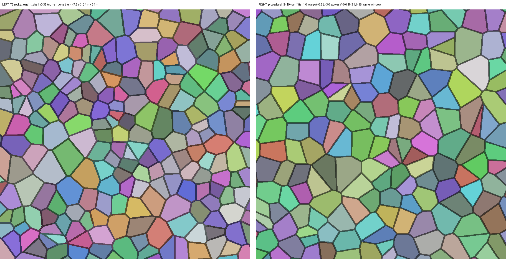
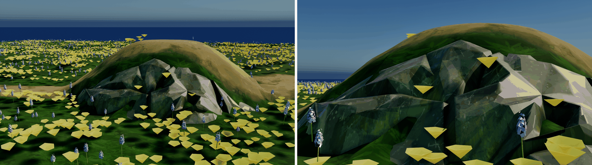
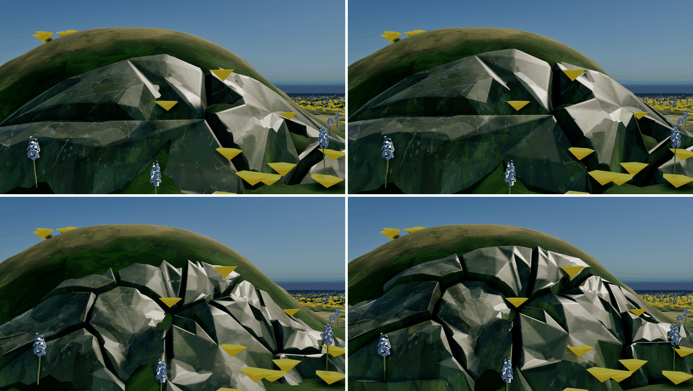
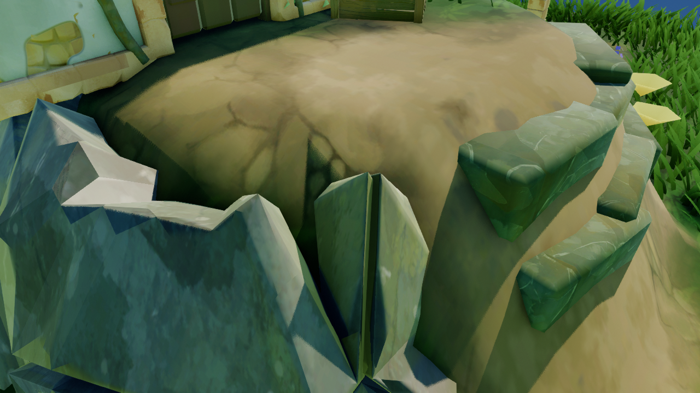
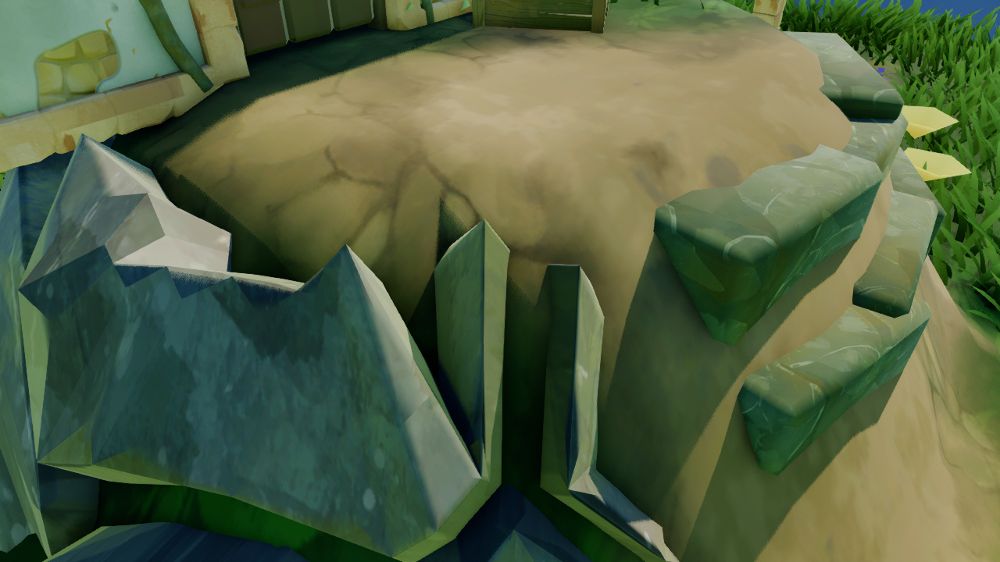

# 稀疏岩壳：世界变大之后的披挂岩壳

披挂岩壳的碎裂图案 2026-09-30 起是**世界锚定的程序化胞腔**：任意 XY 都能求值，只给「可能长石头」的胞腔分配定长槽位，
GPU 只跑作业表里的槽。开销 ∝ 石头面积，与世界大小无关。披挂数学沿用 TG 的 `displace_rocky_terrain.cs`；
同日对照反编译修正了 mask、噪声及位移公式（见「七」「八」）。**当前关卡的盖裙陡沟仍可见，视觉修复尚未完成。**

- **状态**：**P1 已落地**（2026-09-30，用户定「用程序化方案，M = 16」）。P2 增量 / P3 分页未做。构建与测试结果见「六」。
- **代码**：`Public/CSGroundRockShell.h`（参数、CPU 孪生、模板、激活）、`Private/CSGroundRockShell.cpp`（建池 + RDG 七趟）、
  `Shaders/Private/CSGroundRockShell.usf`；地面侧接线 `ACSGroundActor::RebuildRockShell` / `EnsureRockShellMesh`。
  属性的含义写在 `CSGroundActor.h` 声明处（分类 `CS Ground|Rock Shell|Pattern`），本文不重复。
- **证据**：带数字的离线结论由 `Scripts/PrototypeRockShellSparse.py` 产出（numpy / scipy / Pillow），可重跑；GPU 耗时一个都没量。
- **相关**：图案通道的历史契约 [`RockShell_Pattern.md`](RockShell_Pattern.md)（TG 原件，现为对照基准）、
  假倒角 [`RockShell_EdgeBevel.md`](RockShell_EdgeBevel.md)、设计裁决见计划 [D9「侧面碎石」](Plan_House.md)。

## 为什么换掉原件

| 项 | 旧做法（2026-09-30 之前） | 世界变大后的后果 |
| --- | --- | --- |
| 覆盖 | 一张 TG 原件，136.5 m × 0.35 = **47.8 m 见方**；tile 两侧边界点不一致，**不能平铺** | 512 m 地面只有一小块能长石头；靠手钉锚点（`bRockShellCustomPatternCentre`）追内容，内容一分散就没救 |
| 派发 | 每趟跑满 49,598 三角（披挂）+ 49,598（倒角载荷），不管活没活 | 演示土台只活 16%，其余全在写 NaN |
| 显存 | 定长 17.22 MiB（含 ~5 MiB aux 拓扑流） | 与内容无关的固定开销，却只覆盖 47.8 m |
| 高度场 / 路场 | 每个采样遍历全部塑形物；路场每趟糊整张地面格 | 塑形物数 × 三角数、世界面积，两个量都随世界变大（P2 处理） |

TG 没有这个问题是因为它的世界就是一张 tile —— **稀疏化是 TG 之外的扩展**。

## 目标与不变量

- 开销 ∝ **石头面积**（裙边环带），与世界大小无关；没有塑形物 = 零胞腔、零派发。
- 覆盖无上限、世界锚定、确定性（同种子同格 ⇒ 逐位相同）、不重复。
- 显存按内容分配，有上限、超限有确定的退化行为。

不变的：

- 显隐判据照 TG：三角任一顶点 `Rock > 0.1` 才活（`displace:202`），**没有 road 显隐**，路上是连续下沉（裁决五）。
- 每顶点用**自己的 XY** 采解析高度（裁决三），一个 NaN 写在第 0 个顶点就让整个三角出局。
- 材质契约：顶点色 R（盖 / 裙）与 B（逐石头相位）、UV0 世界平铺、UV1..UV6 由倒角载荷趟每趟重写、MID 标量 `RockShellPatternScale`。
- 计数 CPU 已知、零回读；哈希短路先于任何昂贵计算。

## 总览

```text
塑形物头表（CPU 孪生 CSGroundShaperField）
        │
        ▼
激活（CPU，CollectActiveCells）：胞腔外接圆 ∩ 某座塑形物的裙边环带 ──► 活跃胞腔 {(i,j)}
        │
        ▼
槽位差分（CPU，RebuildRockShell）：(i,j) → 槽；新增 / 失效 / 待披挂 三张表
        │
        ▼
GPU 一张 RDG 图（CSRockShell::Displace）：
  ① BuildRockShellCellsCS    新增槽：半平面裁剪 → 边界采样 → 内缩唇 → 写槽的胞腔几何
  ② WriteRockShellStaticCS   新增槽：UV0 与顶点色（只写一次）
  ③ KillRockShellSlotsCS     失效且没被复用的槽：第 0 个顶点写 NaN
  ④ 路场模糊（CSGroundRoadField）
  ⑤ DisplaceRockShellCS      待披挂槽：一线程一三角
  ⑥ AverageRockShellNormalsCS（可选）/ ⑦ RockShellBevelPayloadCS：拓扑查模板常量表
        │
        ▼
一张 UCSMesh 槽位池（P1）→ 每 64 m tile 一页（P3，未做）
```

## 一、图案：从一张 tile 换成一个函数

### 种子

世界锚定的抖动网格，格距 `S = RockShellCellSize`，格 (0,0) 的左下角在地面 actor 位置（地面平移时图案跟着走）。
格 `(i, j)` 恰好一粒种子，随机数全部走 `CSGSF_Hash01`（CPU 孪生在 `CSGroundShaperField.h`）：

```text
u, v   = Hash01(i, j, Seed·3 + 1), Hash01(i, j, Seed·3 + 2)
p      = (½ + J·(u − ½),  ½ + J·(v − ½))                                 // 相对本格左下角，单位 = 格；J = 抖动
p     += A · (ValueNoise(g / L, Seed·7 + 101), ValueNoise(g / L + (17.31, −9.77), Seed·7 + 103))   // g = (i, j) + p
w      = (V · S · Hash01(i, j, Seed·3 + 3))²                             // 功率权重，V = 0 即普通 Voronoi
```

- `A / L`（扭曲幅度 / 波长，单位 = 格）让密度**成片**疏密变化 —— TG 原件那种「一片小块、一片大块」；
- `V`（功率权重）让大小**逐粒**变化，但会出细条（见下面的统计）。

### 胞腔多边形

逐胞腔半平面裁剪：从 ±3S 的正方形起步，对 7×7 − 1 个邻居各裁一刀 `2x·d ≤ |d|² + w_p − w_q`。
**局部坐标求值**：`d = q − p` 由整数格差 + 局部偏移差算，世界坐标再大也不丢精度。CPU（激活要外接半径）与 GPU（几何）是同一份裁剪。

| 配置 | R = 1 | R = 2 | R = 3 | 真值 |
| --- | --- | --- | --- | --- |
| J=1 | 94 / 400 不一致 | 0 / 400 | 0 / 400 | scipy Voronoi |
| J=1 A=0.5 L=3 | 115 / 400 | 0 / 400；0 / 2500 | 0 / 400；0 / 2500 | scipy；大样本对 R = 5 |
| J=1 A=0.8 L=5 | 118 / 400 | 0 / 400 | 0 / 400 | scipy Voronoi |
| J=1 V=0.7 | 132 / 400 | 0 / 400；0 / 2500 | 0 / 400；0 / 2500 | R = 5 |
| J=1 A=0.5 L=3 V=0.6 | 125 / 400 | 0 / 400；**2 / 2500** | 0 / 400；0 / 2500 | R = 5 |
| J=1 A=0.8 L=5 V=0.7 | 146 / 400 | 0 / 400；**1 / 2500** | 0 / 400；0 / 2500 | R = 5 |

扭曲 + 功率权重一起开时 R = 2 在大样本里会漏（粗体），所以定 **R = 3**。极端档（A=1 L=3 V=1、A=0.8 L=5 V=0.7）对 R = 6 复核 1600 胞腔零不一致。

### 观感：对照 TG 原件



| 配置 | 面积 CV | 面积 / 均值 | 细条（空或内切半径 < 3 × 唇宽） | 最小内切半径 |
| --- | --- | --- | --- | --- |
| **TG 原件**（528 个不贴 tile 边的胞腔） | **0.431** | [0.16, 2.79] | — | — |
| J=1 | 0.241 | [0.32, 1.87] | 0 / 2500 | 26.8 cm |
| **J=1 A=0.5 L=3（默认，右图）** | **0.282** | [0.24, 2.27] | **0 / 2500** | **30.3 cm** |
| J=1 A=0.8 L=5 | 0.285 | [0.23, 2.22] | 0 / 2500 | 24.9 cm |
| J=1 A=0.5 L=3 V=0.4 | 0.310 | [0.00, 2.21] | 3 / 2500 | 0.6 cm |
| J=1 A=0.5 L=3 V=0.6 | 0.396 | [0.00, 2.37] | 38 / 2500 | 0.0 cm |
| J=1 V=0.7 | 0.443 | [0.00, 2.26] | 64 / 2500 | 0.0 cm |

- TG 那一行是旧脚本按三角第一个顶点归属统计的**盖 + 裙**面积，并去掉 tile 边界组；原件裙三角会跨 cell_id，
  因此 CV 0.431 只保留作历史统计，不能代表独立胞腔面积真值。`RockShell_Pattern.md` 的 CV 47.8% 只算盖、含贴边胞腔。
- 扭曲给出成片感，但 CV 只到 0.28；要到 TG 的 0.43 得靠功率权重，代价是细条与近零面积的胞腔（唇宽会被夹小）。
- 默认取「胖胞腔」那一档：唇宽 6.8 cm 在最细的胞腔里也放得下。

### 固定拓扑模板

每个胞腔恒 `5M` 个三角（`M = RockShellBoundaryPoints`，默认 16），拓扑与胞腔无关 ⇒ 槽位定长、拓扑表是常量：

```text
B[k]  底圈：Voronoi 边上的 M 个采样点。N 个角点必在其中，其余 M − N 个按边长最大余数法分到各边（N > M 时合最短边）
T[k]  顶圈：盖边界 = 逐边内缩 Lip（角点取相邻两条内缩边线的交点）；Lip = min(19.5 cm × PatternScale, 0.4 × 内切半径)
Rg[k] 内环：C + ½ (T[k] − C)
C     质心

k = 0..M−1, n = (k + 1) % M；俯视顺时针 ⇒ cross(P2−P0, P1−P0) 朝上（引擎正面，同 TG）
r0 (C,     Rg[n], Rg[k])   盖 · 中心扇
r1 (Rg[k], T[n],  T[k])    盖 · 内环带
r2 (Rg[k], Rg[n], T[n])    盖 · 内环带
r3 (T[k],  B[n],  B[k])    裙
r4 (T[k],  T[n],  B[n])    裙
```

- 当前模板是独立胞腔的盖与裙。**它与 TG 原件的接缝结构不同**：TG 裙三角会跨 cell_id 连接，
  同位置的位移输入一致，内部没有开口边（`RockShell_Pattern.md` §5 的 2026-09-30 订正）。
- `M = 16` ⇒ 80 三角 / 胞腔，与 TG 原件 81.4 同密度；胞腔最多 11 个角点（实测），`M ≥ 12` 都装得下。
- 模板里石头与石头之间一律是外轮廓（`Neighbours = −1`）。TG 原件抽出来的内部边里有 11.8% 跨胞腔、倒角 v3 会把法线混向邻石；
  不能再把去掉这些连接称为修正，原件的裙边本来就是连续网格。

### 与旧契约的映射

| 旧字段 | 旧来源（烘焙件，aux 槽） | 现来源 |
| --- | --- | --- |
| `RestXY` | 32 `RestDir.xy` | 槽的胞腔几何（aux 32 `CellGeom`）+ 模板顶点号 |
| `DirToCentroid` | 32 `RestDir.zw` | `normalize(C − RestXY)`，现算 |
| `CellId` | 33 低 24 位 | 胞腔键 `(i, j)` 进哈希 |
| `bIsTopRim` / `bIsCorner` / `bIsCapTri` | 33 bit 24 / 25 / 26 | 模板：`C` / `Rg` / `T` 是顶；`T[k]` / `B[k]` 且 k 是多边形角点；前 3 个三角是盖 |
| `IncidentRange` / `IncidentTris` / `Neighbours` | 35 / 36 / 37 | 模板常量表（`CSRockShell::FTemplate`），每趟上传，全局号 = `slot × 5M + 局部` |

槽的胞腔几何 `(2 + M)` 个 float4 / 槽（`M = 16` 时 288 B），只在槽被分配时由 ① 写一次；顶点色 G / A 已无消费者，写中性 1。

## 二、激活：哪些胞腔可能长石头

石头只在合成高度场有坡的地方出现。读 `GroundShaperComposite` 可得：

- 单座隆起在零等值线内是平台，在 `Sd ≥ Falloff` 处恰好返回 0 ⇒ 坡只在 `0 < Sd < Falloff` 的环带里；裙边噪声只减不加、只作用在环带内；
- 平滑合成 `CSGSF_SmoothMax` 的梯度是两座梯度的线性组合 ⇒ 两座都平的地方它也平；坑的坡同样在它自己的环带里；
- **例外：中心隆起**把平台变成山丘 ⇒ 坡度上界 `ρ (1 + Lift) |H| × 1.5 / (Falloff + 最深距离)`（mask 再 × √2）过 0.8 × 门槛时激活整盘。

`Sd` 是 Lipschitz 的，只需在种子处求一次：

```text
胞腔 (i,j) 活跃  ⇔  ∃ 塑形物 s： Sd_s(种子) − λ_s·r_c − m ≤ Falloff_s   且   Sd_s(种子) + λ_s·r_c + m ≥ 下界_s   且 外接圆 ⊕ m 碰到地面矩形
r_c    = 种子到本胞腔角点的最远距离（先用上界 (√2 + A + V)·S 粗筛，过了再裁剪求真值，按格键缓存）
λ_s    = 1（解析圆盘）；mask：种子在 SDF 网格内 √2，网格外 1 + √2
m      = 一个地面格（坡度差分跨距）+ (CellJitter + CellExpand + SkirtTilt) × PatternScale + 5 cm
下界_s = 0（平台）；中心隆起过阈 = −∞（整盘）
```

只许**过标**不许漏标：误激活只多付一个槽、被 kernel 写 NaN；漏掉就是一块缺石。`RockShell.ActivationConservative` 用 CPU 场暴力核对。
不在 GPU 上压缩的理由：CPU 手里本来就有解析的塑形物头；GPU 决定计数就得回读才能喂 VSM；稳定的槽位是 P2 增量的前提。

演示土台（半径 600 / 裙边 800 / 台高 700，与 `RockShell.DrapesOnSlopes` 同一档）的离线账：

| | 旧做法（整张 tile） | 稀疏 `M = 16` |
| --- | --- | --- |
| 胞腔 | 609（全部） | **214 激活**（活 ≥ 122） |
| 每趟派发的三角 | 49,598 | 17,120 |
| 常驻显存 | 17.22 MiB（固定） | **4.24 MiB**（随内容；池最小 256 槽） |
| 覆盖 | 47.8 m 见方 | 不限 |

激活里约 43% 是坡度不过阈的环带内外缘（见开放问题 1）。

## 三、槽位池与作业表

一张 `UCSMesh` 当定长槽位池：槽 `s` 占三角 `[s·5M, (s+1)·5M)`。CPU 侧（`ACSGroundActor` 私有状态）：
格键 → 槽的 `TMap`、槽 → 格键（空槽 = 哨兵 `(MAX_int32, MAX_int32)`）、空闲槽栈（降序存、从尾取 ⇒ 小号优先）。

每次重建：

1. 激活集合排好序（j 优先）；超过 `RockShellMaxCells` 告警并按格键截断。
2. 旧 − 新 = 失效（还槽）；新 − 旧 = 新增（取槽）；**失效且这一趟没被新胞腔领走**的槽才进 ③（领走的会被 ①② 整片重写）。
3. 待披挂 = 全部活跃（P1）。

容量：

- 建池 = `clamp(max(⌈1.5 × 需要⌉, 256), 64, MaxCells)` 槽（阻塞：声明流集 / 分配 / 上传各 flush 一次）。建池时全部三角停在包围盒底角、
  再跑一趟全池 ③ 标死 —— 不往快照里写 NaN，因为上传会拿位置累包围盒。
- 不够时重建池，**只在提交时扩**：拖动期（`bLastChangeCommitted == false`）超出的胞腔这一趟暂缺、置 `bRockShellGrowPending`，松手那一趟补齐。
- 绘制计数 = 容量 × `5M` × 3，CPU 已知；包围盒按地面矩形写死（NaN 会污染从顶点算的包围盒）。
- 迁移：`PostLoad` 把旧的 `RockShellPatternScale` 换算成 `RockShellCellSize = 旧值 × 553.13`（密度不变）；锚点两项已删。**石头的排布整体换了一套**，无法保留。

## 四、增量更新（P2，未做）

| 来源 | 脏区 | 现成入口 |
| --- | --- | --- |
| 塑形物刷新 | `union(旧足迹, 新足迹)` ⊕ `m` | `RefreshHeightsInRegion` 已算出 `ChangedBox` |
| 落笔 | 各笔 `RegionMin/Max` 之并 ⊕ `RockShellRoadBlurRadius` ⊕ `m` | `FlushPaintToGpu` 手里的 `PendingPaintDabs` |
| 岩壳参数 / 地面重建 / 加载 | 全部 | 现有哈希路径 |

- 脏区在 actor 上累积、重建时一次消费；激活只在脏区 ⊕ reach 里重判。CSSceneDirty3D 落地后换成订阅地形 / 路栅格的 dirty tile。
- **塑形物分箱**：8 × 8 胞腔一块，每块一张按登记顺序的塑形物下标表。`GroundShaperComposite` 对够不着的塑形物在更新 `Cap` / `K`
  之前 `continue` ⇒ 分箱合成与全量逐位相同（代码推导，未测）。收益：每个采样从全部塑形物降到 1～3 座。
- **路场开窗**：路场模糊只糊作业覆盖矩形 ⊕ 模糊半径；没落笔的那一趟直接跳过。

## 五、渲染（P3，未做）

- 每 64 m tile 一页（一张 `UCSMesh` + 组件），视锥剔除、BLAS 重建、VSM 失效都局部化；首次激活一个 tile 同样只在提交时分配。
- 显存超预算时按视点距离收掉远页；远处石头的替代表现另议。

## 六、分期与验收

| 期 | 内容 | 状态 |
| --- | --- | --- |
| **P1 核心稀疏** | 程序化图案 + CPU 激活 + 槽位池 + 活跃胞腔全量重披挂；删图案资产路与锚点两项；迁移 | ✅ 2026-09-30 |
| **P2 增量** | 脏区累积、塑形物分箱、路场开窗 | 未做 |
| **P3 大世界渲染** | 按 tile 分页、视点距离预算 | 未做 |

P1 的自动化测试（`Private/Tests/CSGroundRockShellTests.cpp`）：

| 测试 | 钉什么 |
| --- | --- |
| `RockShell.Contract` | 默认值间的不等式；M = 16；模板（M = 12 / 16 / 24）外轮廓恰 M 条且全是底圈边、邻接对称、入射表自洽、5M 个三角全部朝上 |
| `RockShell.DrapesOnSlopes` | 中性档（`CellSize = 553.13`）下陡坡长、平台 / 平地零活三角（按整个三角判）、到坡面垂距 ≤ 壳厚；隆起倍数与基准偏移真的抬高；删塑形物 ⇒ 零活三角、零活跃胞腔 |
| `RockShell.RoadSinksNotHides` | 画路活三角一个不少、连续下沉、路外纹丝不动、路缘缓坡、擦路逐位复位 |
| `RockShell.CapSkirtSurvivesBake` | 盖 / 裙 = 容量 × 3M / 2M，烘成 StaticMesh 后仍在 |
| `RockShell.CellPolygon` | 纯 CPU：3000 个随机点都落在功率图主人的胞腔里、不落在别人胞腔内部（三档配置）；外接半径粗上界成立 |
| `RockShell.SparseFarCorner` | 512 m 地面、塑形物在 (480 m, 480 m)：裙边活三角 > 100，远处零 |
| `RockShell.SparseScalesWithContent` | 零塑形物零胞腔；同一土台在 64 m / 512 m 地面上激活同一批格键、同键胞腔逐顶点相同 |
| `RockShell.ActivationConservative` | 两座相交土台 + 坑 + 中心隆起：25 cm 格点暴力扫，`Rock > 0.1` 的点所在胞腔全部激活 |

P1 当时实测（2026-09-30，Development Editor；**早于「八」的公式调整，不能作为调整后的测试结果**）：`RunTests PCGPlugins.ComputeShaderGenerator` **216 / 214**，失败只有既有的
`ShallowWater.Solver.Downhill` / `SourceSpread`；岩壳 8 条全过。演示回归 `TinyGladeDemoRegression.py` **228 / 26**，失败全在房子节
（拱 / 门框砖 / 柱屋 HeightOffset / 藤 GPU 计数 / 窗，与 09-29 同类），岩壳一节全过（活三角 1,220，全在裙边）。

| 测试 | 实测 |
| --- | --- |
| `DrapesOnSlopes`（中性档） | 活跃 42 胞腔、活三角 1,074，台顶 / 平地 0；到坡面最大垂距 60.5 cm（容差 99）；BaseLift 100 ⇒ 裙边均高 +77 cm；默认档最高点比台顶低 28.9 cm |
| `RoadSinksNotHides` | 路下平均沉 111.6 cm、最深 156.9 cm，路外漂移 0；路缘最陡 0.64（半径 0 对照 2.81）；擦路复位误差 0 |
| `CapSkirtSurvivesBake` | 盖 36,864 / 裙 24,576 个顶点（= 256 槽 × 48 / 32 三角 × 3）；烘出 7,124 三角 |
| `CellPolygon` | 三档配置各 3,000 点：全部落在主人胞腔、零越界 |
| `SparseFarCorner` | 512 m 地面、(480 m, 480 m)：216 胞腔、裙边活三角 6,952、远处 0 |
| `SparseScalesWithContent` | 64 m / 512 m 地面都激活同一批 211 个格键；7,124 个活三角逐位相同 |
| `ActivationConservative` | 7,806 个过阈采样点零漏激活；激活 475 / 地面约 1,093 胞腔 |

⚠️ `SparseScalesWithContent` 只比**活**三角：死三角的后两个顶点停在建池时的包围盒底角，包围盒 Z 半高随地面尺寸变（64 m 2000 / 512 m 12800 cm）。

## 七、石头之间的缝隙：对照 TG 反编译（2026-09-30）

用户对照 TG 截图：TG 里石头之间的缝很细，我们这边像沟壑。对照 `_rocky_terrain_displace_rocky_terrain.cs`（反编译 GLSL）查出两处偏差：

| # | TG | 修前 | 后果 | 现在 |
| --- | --- | --- | --- | --- |
| 1 | `:382` `_440 = clamp(smoothstep(0.1, 0.2, rock) + …)`，`Rock = 0.2` 就饱和；基准偏移 `:563` `mix(−0.4, +0.2, clamp(_440 − 10·road))` 与厚度 `:577` `× _440` 都乘它 | 乘原始 `Rock` | 裙边大半 `Rock` 在 0.1～0.5，基准偏移仍偏向 −BaseSink ⇒ 石头边缘压进地里，地面从缝里露出来 | 乘 `smoothstep(0.1, 0.2, Rock)` |
| 2 | `:618` / `:721` 起伏：单倍频、底频 1/13000 cm⁻¹ 量级、域偏移 `20 × rock`，幅度 ∝ 坡度 | 150 cm 波长的高频噪声 + 10 cm 加性磕碰 | 相邻石头边缘起伏相反时拉出深槽 | `0.25 + 0.5·vn01(RestXY·freq + 20·Rock)`；磕碰默认 0（留作可选） |

- 坡度与 `Rock` 在顶点**胀缩之后的静止位置**上求（TG 同），显隐判据不变。
- 不缩的：`RoadSink` / `RoadBlurRadius` / 「石头隆起」那组仍是世界 cm —— 它们对的是道路与塑形物的尺度，不是石头的尺度。
- 平面四项（唇宽、`CellJitter`、`CellExpand`、`SkirtTilt`，以及起伏噪声的底波长）= TG 口径 × PatternScale，跟多边形尺寸配套；
  竖向四项（`CellRelief`、`BaseLift`、`BaseSink`、`NoiseAmount`）是**世界 cm**，数字与含义都没变。
- ⚠️ **竖向别跟胞腔缩**：同一天曾以为「TG 常数按 553 cm 胞腔写、我们胞腔小 2.9 倍」也是沟壑的原因，把竖向四项一起 × PatternScale；
  结果默认档石头只剩 10.5 cm 厚、离地中位 0.3 cm，用户看图判「露出的部分变少」，当天改回。
  上表解释了当时的两处偏差，**“沟壑只来自这两条”的旧判断撤回**；补核见「八」。




- 只有修正后的图：修前那版图案与 kernel 已整体换掉，没有同机位的修前对照。出图脚本 `Scripts/TinyGladeShotRockShellGaps.py`。
- 关卡的实调覆盖里还有 35 cm 的 `RockShellChipAmount`（TG 之外的加项，见 `Ground_Tuning.md`）；同机位归 0 只改近景约 3% 的像素，不是缝隙的主因，要不要清掉待用户定。
- 换回 C++ 默认的坡度阈值（0.75 / 1.25）时，这座土台（台顶 z ≈ 411 cm、裙边 800 cm，按 1.5 × 台高 / 裙边估的最大坡度约 0.77）只剩零星几块 —— 关卡把阈值调低到 0.29 / 0.66 正是为了它。

### 露出：竖向改回世界 cm 前后



活顶点离地高度（只统计路权重 < 0.01 的顶点，磕碰 0；`Scripts` 外的一次性脚本量的，口径 = 顶点 Z − 该点地面）：

| 胞腔 | 竖向 × PatternScale | 竖向世界 cm（现行） |
| --- | --- | --- |
| 361 cm（`L_TerrainOpsDemo`） | 中位 −1.8 cm，p90 +37.5，最高 52.8 | 中位 +10.0 cm，p90 +56.7，最高 79.1 |
| 193.6 cm（默认） | 中位 +0.3 cm，p90 +17.4，最高 34.4 | 中位 +21.2 cm，p90 +51.4，最高 78.1 |

还想更露：先加 `RockShellBaseLift`（整片抬，缝不变深）；再加 `RockShellCellRelief`（石头更厚、高低差更大，但底圈也沉得更深，缝跟着变深）。

## 八、盖裙陡沟的补核与实施（2026-09-30）

### TG 的证据与当前差异

原件统计和 GLSL 公式统一保留在 [`RockShell_Pattern.md` §5–6](RockShell_Pattern.md)，这里记录实现及验证：

- TG 的裙边是连续过渡网格，53.894% 的裙三角跨 `cell_id`；当前仍为逐胞腔独立的固定模板。
- TG 的平面胀缩与盖浮高共用随机数。原件跨归属裙三角的披挂前平面宽度中位数从 19.5 变为 46.429 cm；
  这是原件复算，**不是当前场景的最终裙宽**，也不是最小宽度保证。
- TG 位移向量是两个单位切向量的叉积，未最终归一化。斜向陡坡上向量变短，会减弱厚度、起伏和道路下沉。
  没有发现逐三角分摊道路位移、最大裙边倾角或最大高度差约束。

### 已实施

`CSGroundRockShell.usf::DisplaceRockShellCS`：

```text
r = CellRandom(Cell, 2)                     // 平面胀缩与顶盖浮高共用
Amount = JitterWorld × lerp(-0.375, 1, r) × RadiusFade
Amount = min(Amount, 0.75 × 到质心的距离)
XY += DirToCentroid × Amount
TopRelief = r × CellRelief
N = (-G.x, -G.y, 1) / sqrt((1 + G.x²) × (1 + G.y²))
```

- `RockShellCellJitter` 源码默认从 0 改为 **52 原生 cm**；Actor 接线仍乘 `CellSize / 553.13`，
  默认胞腔下传入 GPU 为 18.2 cm。未乘半径淡入时范围为原生 −19.5..52 cm。
- 保留程序化半径淡入，并新增最多内收当前半径 75% 的保护，避免内部顶点穿过质心。
  这是本项目的保护；未声称与 TG 的哈希序列、拓扑和每个顶点位移完全一致。
- 厚度、起伏幅度、BaseLift / BaseSink 保持世界 cm；位移向量长度随坡向衰减，单轴坡向量长度仍为 1。
- 固定拓扑、原唇宽、CellExpand、SkirtTilt 保持原实现。扩大唇宽、公共裙底、盖边减薄等试验改变了体量或仍留尖片，均已撤回。

### 现场验证：L_HouseGroundDemo

修改前 GPU 原位回读：胞腔 193.6 cm、静态唇宽约 6.825 cm、厚度 30 cm、RoadSink 160、RoadBlurRadius 100、Jitter 0。
截图附近旧三角 2194 的整三角 Z 跨度为 138.0 cm，RoadSink 归零后为 141.27 cm，尖片仍存在。
**这两个数不是沟深。** 对应顶／底端点 Z 差约 46.45 cm、水平距离约 39.00 cm；
底点 Z 为 63.00 cm，该 XY 的 CPU 地面双线性采样约 108.76 cm。它们是采样诊断，不是像素可见截面的精确测量。
按厚度增量反推，两端的 TG 向量长度因子约为 0.804 / 0.811。

正式版本已在编辑器重编译 `CSGroundRockShell.usf`，将当前 `Ground_Demo` 的 Jitter 设为 52，
保留 CellExpand 12、SkirtTilt 20，其余场景参数还原。修改前后均回读到 **556 个可见三角**；
重建导致槽位重新分配，不能按相同三角编号直接配对比较坐标。





**结论：两项公式已对齐，但没有消除图中的深沟。** 当前独立裙圈缺少 TG 跨归属的过渡三角，
仍需核对连接关系、盖裙截面及地面遮挡；不能用“共同接缝”或“减弱位移”单独宣称视觉问题已解决。

验证边界：

- GPU Shader 在当前编辑器编译并生成了上述同机位对照；诊断数据位于项目 `Saved/TinyGladeShots/skirt_fix/`。
- Rider 选中 `UETest574_2`，没有活动子配置标记，按首项推定 `Development_Editor / x64`。
  使用该配置对 `CSGroundActor.cpp` / `CSGroundRockShell.cpp` 做 `-Files` 编译：UHT 通过，随后被正在运行的 Live Coding 拒绝，
  **C++ 编译与链接未完成**。源码新默认需后续正常重编译后生效；本次场景预览通过显式设置实例参数完成。
- 当前关卡参数只在打开的编辑器内更新，未保存整张地图。P1 自动化成绩见「六」，本次未重跑会创建新地图的测试。

## 裁决（2026-09-30）

1. **图案来源**：程序化胞腔（用户：「用程序化方案」）。改的是裁决一的后半句「静态资产 / 用 TG 原件」；前半句「2D 图案 + 三维 100% 披挂」不变。
2. **M = 16**（用户）。观感档按推荐落地：`A = 0.5, L = 3, V = 0`（胖胞腔，CV 0.28 对 TG 0.43）；要更像 TG 的大小离散度再开 `RockShellSizeVariance`（≈ 0.6 出 1.5% 细条）。
3. **容量**：按推荐落地 —— 拖动期不扩、松手补齐；`RockShellMaxCells = 8192`（≈ 162 MiB @ M = 16）。
4. **P3 页大小**：P3 未做，届时再定是否跟 CSSceneDirty3D 的 64 m tile 走。
5. **竖向不随胞腔缩**（用户看图：「露出的部分变少了」）：厚度 / 基准偏移 / 起伏幅度保持世界 cm，只有平面长度随胞腔缩放。

## 看到的 vs 推断的

| 说法 | 来源 |
| --- | --- |
| R 的精确性、面积统计、细条数、模板三角数、演示土台激活数、显存账 | **实测**：`Scripts/PrototypeRockShellSparse.py`（离线，GPU 未跑） |
| 旧做法 17.22 MiB、每趟派发量、路场整张糊 | **代码推导**：旧版 `CSGroundRockShell.{cpp,usf}` 的流声明与 kernel |
| 坡只在裙边环带 / 中心隆起盘内（激活的保守性） | **代码推导**：`GroundShaperComposite` / `GroundShaperProfileEx`；由 `ActivationConservative` 兜住 |
| 缝隙两处偏差 | **反编译对照**：`displace_rocky_terrain.cs` `:382` / `:563` / `:577` / `:618` / `:721`；修正后的引擎出图见「七」（没有修前对照） |
| 竖向缩放让露出变少 | **实测**：同机位出图 + 离地高度统计（「七 · 露出」） |
| 分箱合成逐位精确 | **代码推导**：跳过点在更新 `Cap` / `K` 之前；未测 |
| 去掉跨胞腔邻接是修正 | **撤回**：原件确有连续的跨 cell_id 裙边，见 `RockShell_Pattern.md` §5 |
| GPU 耗时 | **未测** |

## 开放问题

1. 激活里约 43% 的胞腔坡度不过阈（环带内外缘）。可按剖面的解析坡度把环带缩到 `[t₀, t₁] × Falloff`，前提是噪声梯度上界写得出封闭形式；不收紧也正确，只是多付显存。
2. 优先核对接缝连续性及裙边过渡三角划分。TG 的 8.4 个底点是按顶点 cell_id 归属统计，不能解释为
   各自独立的底圈；当前 1:1 模板、逐胞腔扩张与底圈外推并未复现共同接缝。
3. 远处石头：P3 按视点收页之后，远处由什么表现（地面材质的岩石色？低 `M` 的远档？）。
4. 地面本体、远处草、`GroundMask` 同样 ∝ 世界面积；激活 / 分箱 / 脏区三件可以给它们复用，不在本文范围。
5. `RockShell_Pattern.md`、`Scripts/TinyGladeImportRockShell.py`、`Scripts/VerifyRockShellGlb.py`、`Scripts/BakeRockShellPattern.py` 已退为参考资料；
   原件的实测（CV、角点、唇宽 19.5 cm）仍是调观感的对照基准。
