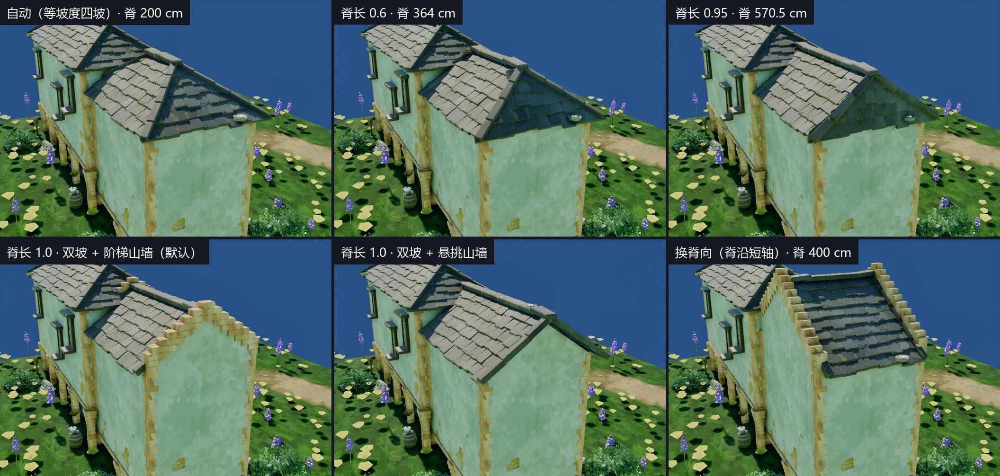
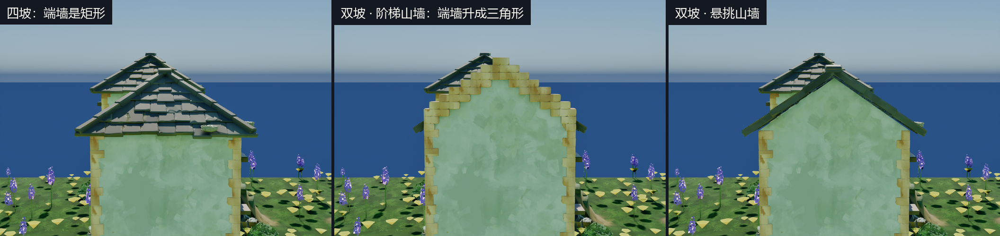
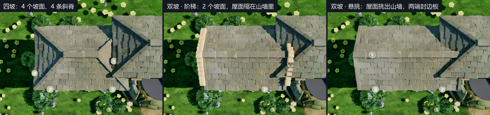
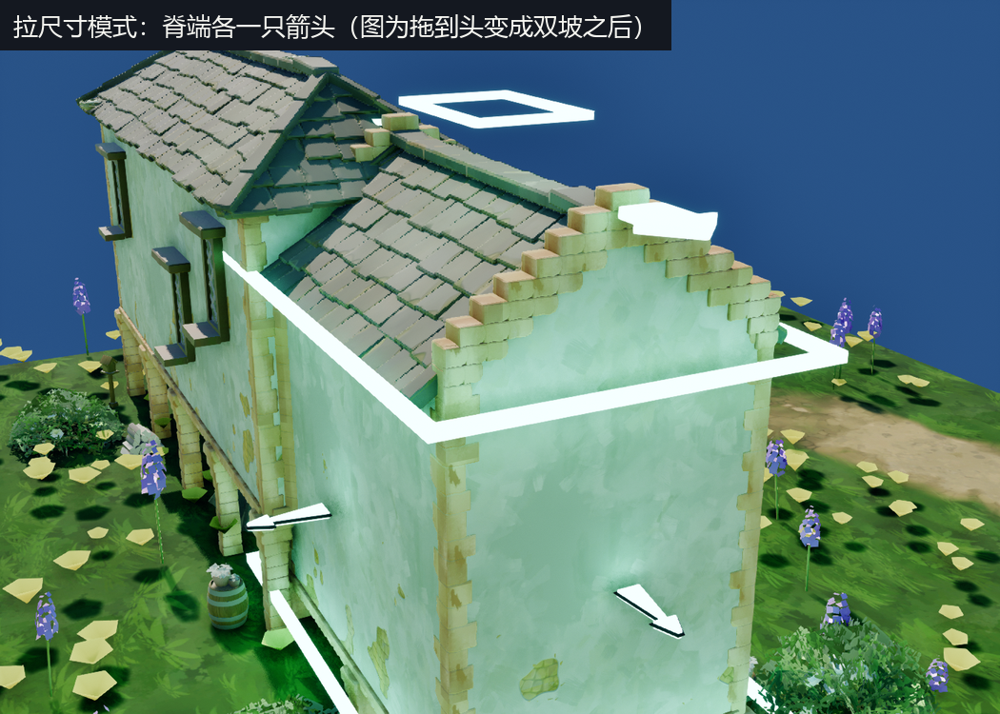
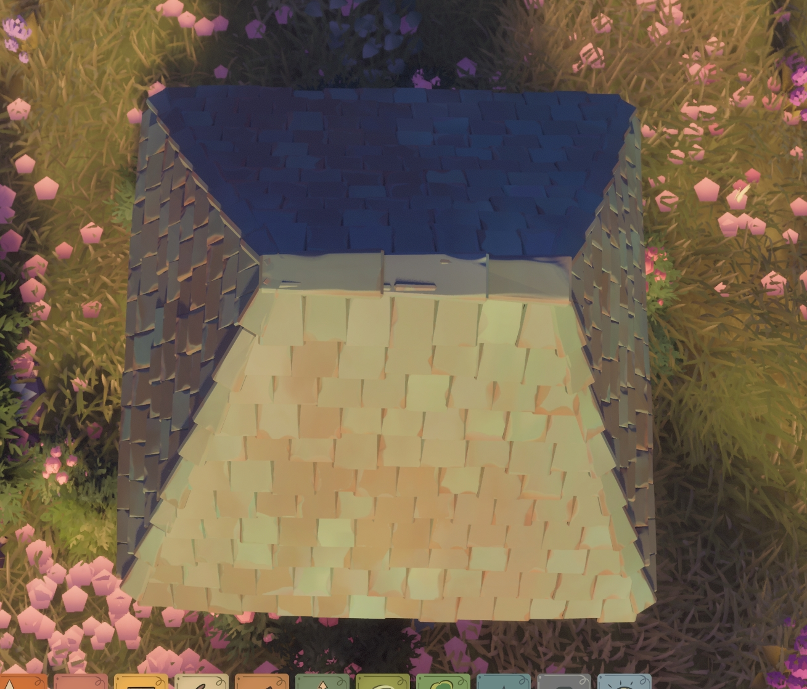
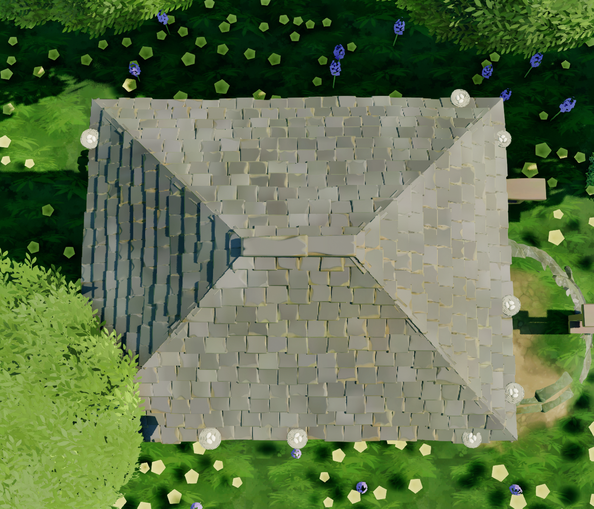
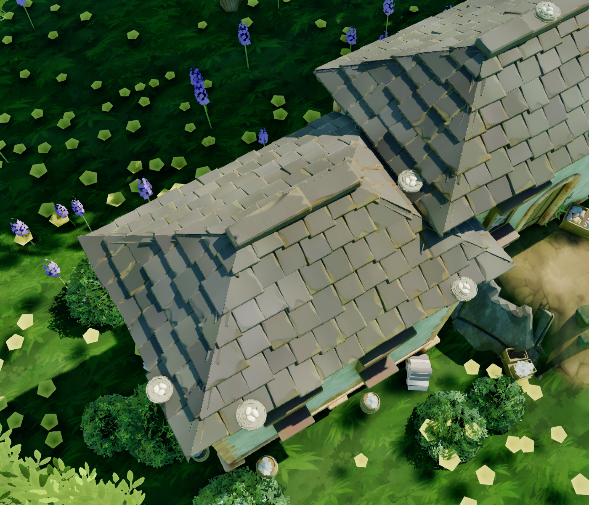
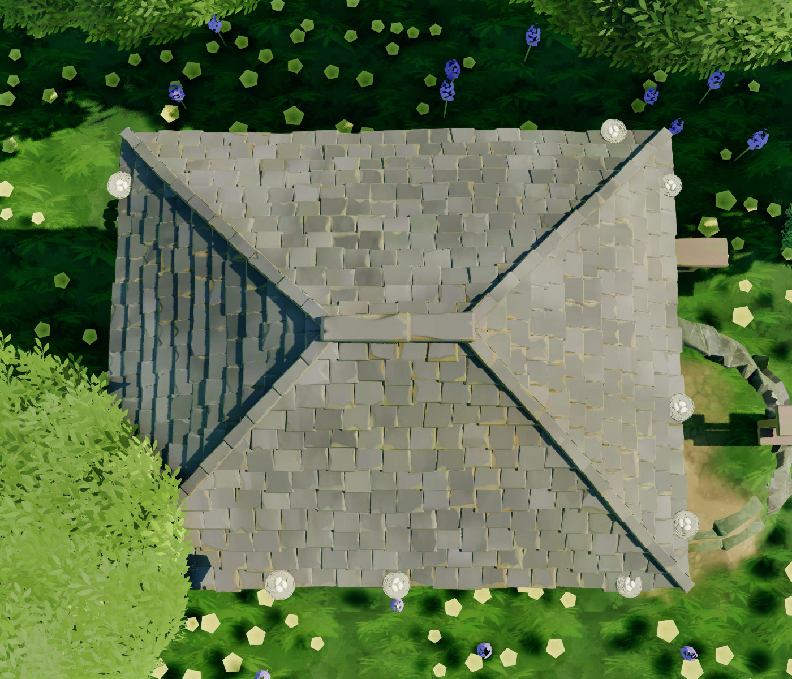
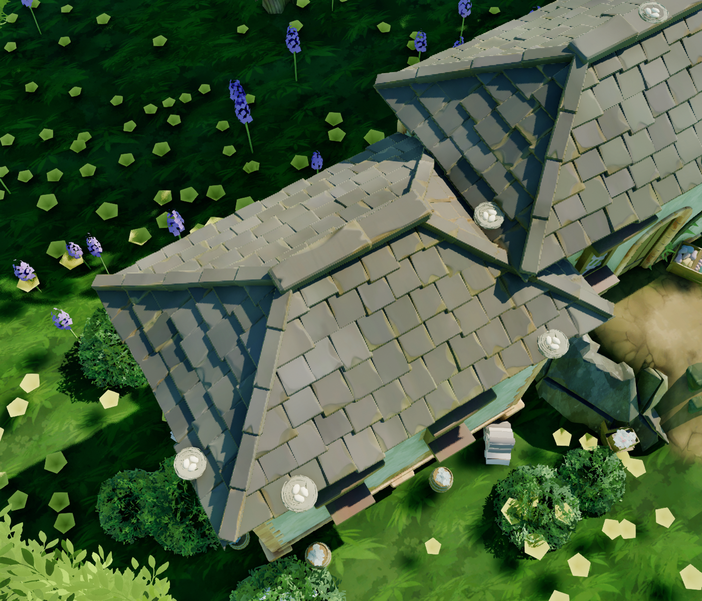

# 屋顶：脊长与山墙、瓦片资产、错排、高度框、露台、屋脊收口与 VSM

2026-10-02 脊长可调、双坡 + 山墙，见[「脊长可调与双坡山墙」](#脊长可调与双坡山墙2026-10-02)。2026-09-20 两轮屋顶改动的实现记录；2026-09-29 按用户确认的 TG 实拍与逆向把屋面瓦资产和排布改成 TG 真值，见[「屋面瓦资产」](#屋面瓦资产按-tg-真值重做2026-09-29)。同期的玩家楼梯（栏杆、拱墙、露台接合、宽度把手）见 [`Stairs_PlayerStairs.md`](Stairs_PlayerStairs.md)。
09-12 的屋顶材质移植、陶瓦参考图和旧烘焙的来历见[合卷「四坡屋顶 + 屋面瓦」](Progress_ModuleComparison.md#四坡屋顶--屋面瓦2026-08-31另一会话的重构--本轮资产收尾)。

**当前状态（09-30 斜脊遮挡修正）**：以本文 09-29 的原版俯视图为准，已补逐瓦裁剪、窄斜脊、按厚度保形的瓦片变形及 Grey 配色。第二轮误用的斜脊下沉量已撤回，改为盖在坡面翘端上方；见下文遮挡修正记录。

## 脊长可调与双坡山墙（2026-10-02）

用户 2026-10-02：「屋顶梁距离是可以调整的；当梁距离等于房子长度时 4 瓣屋顶变成 2 瓣，侧面变成三角形；参考反编译文件。」三件事在 TG 里都有确凿对位（`ridge_length_01`、`Roof::is_gable`、`RecalculateGableRoofWallHeights`），证据、常量与有意偏离见 [附录 F](RE_RoofRidgeGable.md)。09-13「脊长是推论、不是参数」那条作废。



### 怎么用

- **拖**：选房子执行 `Enter Resize Mode`，屋脊两端各多一只躺平的箭头（TG 的 `brush_arrow_flat_single_foward`）。顺着脊拖任一只：这一头走 δ，脊居中，另一头镜像走，脊长 + 2δ。拖到脊与房子一样长就是双坡 + 山墙，往回拖又是四坡。异形房子与露台上箭头不出现。
- **填**：细节面板 `CS House|Roof`。逐字段口径在 `CSHouseActor.h` 的属性注释里。

```cpp
float RoofRidgeLength01 = -1.0f;                          // < 0 自动（等坡度四坡，旧存档）；0..1 = TG 的 ridge_length_01；1 = 双坡 + 山墙
ECSRoofRidgeAxis RoofRidgeAxis = ECSRoofRidgeAxis::X;     // 脊平行于局部 X / Y，只在显式脊长时读
ECSGableRoofStyle GableRoofStyle = ECSGableRoofStyle::Stepped;   // Stepped = TG 砖石墙；Overhang = TG 半木构墙
bool bTrimGable = true;                                   // CS House|Trim：阶梯山墙上沿的露砖台阶
```

- **按钮**：`Switch Roof Ridge Direction` 把脊转 90°（比例原样沿用）；`Reset Roof Ridge To Tiny Glade Default` 取 TG 新建房子的默认值（600 × 400 是 0.898；长边 ≥ 750 且长宽比 ≥ 1.5 直接是双坡）。回到本项目原来的等坡度四坡：把 `RoofRidgeLength01` 填回 −1。

### 形态

| `RoofRidgeLength01` | 屋面 | 两端的墙 |
| --- | --- | --- |
| `< 0`（自动，默认） | 等坡度四坡，脊长 = 长边 − 短边、沿长轴；与 10-02 之前逐位相同 | 矩形，墙顶平在檐口 |
| `0` | 四个坡面收成一个尖 | 矩形 |
| `0..1` | 四坡；脊长 = 10 + r·(顺脊边长 − 10)，两端坡面有自己的坡度（脊越长越陡） | 矩形 |
| `1` | **双坡**：两端不铺瓦，两侧坡面是矩形；骨架的四条角线退化成两端的封边板 | **三角形山墙** |

存的是比例不是厘米：拉房子尺寸时脊跟着伸缩，山墙拉长了还是山墙。屋脊高度始终只由垂直于脊的那条边决定（换脊向后 600 × 400 的起伏从 140 变 210）。

两种山墙：

| | `Stepped`（默认） | `Overhang` |
| --- | --- | --- |
| TG 里谁用 | 砖石 / 灰泥墙 | 半木构墙（本项目没有，留作可选观感） |
| 屋面两头 | 缩进山墙外皮 26.5 cm | 挑出山墙 26.5 cm + 檐口出挑（外挑 25 时共 48.5） |
| 墙顶线 | 比屋面线高 46 cm，像女儿墙立在屋面两头 | 贴着屋面线，藏在瓦底下 |
| 上沿 | 灰泥只做到屋面线，上面 46 cm 是露着的砖，逐层收成台阶；角石跟到抬高的角点 | 直斜边，两端是封边板 |
| 水平脊盖板 | 随屋面两头收在山墙里 | 随屋面两头挑出山墙 |







### 实现

- **求值器**（`CSHouseRoof.{h,cpp}`）：屋面仍是一条闭式，只多一个逐边坡度倍率 `FCSRoofDesc::EdgeSteep`。倍率 ≤ 0 的边是山墙边：不进 min，屋面被竖直面收在墙外皮外 `GableOverhang` 处。骨架、坡面排区间、法线、覆盖谓词都吃同一组倍率。TG 的参数口径只在 `CSHouseRoof_ApplyRidge` 一处换算，且只对矩形生效。

```text
Z(p) = 檐口外沿高 + tan(pitch) · min_k( w_k · (内距_k(p) + Overhang) )
两侧坡面 w = 1；两端坡面 w = (半跨 + Overhang) / (半长 + Overhang − 脊长 / 2)；r = 1 ⇒ 两端是山墙边
```

- **瓦**（`CSHouseTile.cpp`）：倍率不是 1 的面按自己的坡长分排，裁剪面取「两面等高」的线；山墙面不铺；山墙侧斜边（`FCSRoofSkeletonArc::bVerge`）照铺斜脊窄板当封边板。
- **墙**（`CSHouseActor.cpp`）：`BuildGableWalls` 沿墙线向同一个求值器取上沿 ⇒ 山墙逐点贴着屋面。房体三角汤在墙顶之上追加一片实心棱柱（墙材质、贴图坐标连着铺上去）；角石柱高跟到角点；开了砖层时砖逐层续摞并按 TG `trim_rows` 的规则收成台阶，没开砖层时只出露在灰泥外的那一圈（`CSHouseBrickWall::BuildGableCourses`）。山墙上不开洞（窗的谓词卡在檐口以下）。
- **抓手**（`CSHouseRidgeHandleActor.{h,cpp}`）：只把沿脊向的位移喂给 `ACSHouseActor::PushRidgeLength`，换算照抄 TG 的 `inverse_ridge_01_param`；记账、回位、宿主纪律与推墙箭头同一套。拉尺寸模式的抓手数从 N + 3 变 N + 5。
- **尖顶与摆件**：双坡不立尖顶（TG 有脊就没有塔尖）；山墙边没有檐口，檐口鸟窝不上那两条边。
- **容量**：阶梯山墙的露砖与角石 / 包边共用 `FrameReserveCapacity`（默认 512）；600 × 400 两面山墙 96 块，换脊向后 138 块。撞上限时先截断的是它，日志有警告。

**等坡度屋面逐位不变**是硬承诺，也是这轮踩的坑：引擎开着 `/fp:fast`，`CosPitch()` 与 `SinPitch()` 紧挨着取时编译器把它们并成一次 sincos，结果与分开取差 1 ulp；演示房短边面的排宽恰好落在 `RoundToInt` 的 .5 边界上（337.5 / 45），差这 1 ulp 就从 210 片瓦变成 206 片。所以 `BuildPlan` 里倍率为 1 的坡面保留了改动之前的写法，`House.TileEqualPitchMatchesLegacy` 把提交 `3307d60` 的实现原样冻下来，对 10 种屋面 × 3 套瓦参数 × 2 个世界变换逐片逐字段比。

### 验证

- 构建：`Development_Editor / x64`，只涉及项目插件；日志 `Saved/Logs/RoofRidgeGable_Build*.log`。改过与新增的 9 个 `.cpp` 另用 UBT `-SingleFile` 逐个独立编译通过（unity 构建会掩盖缺的头文件，这轮就查出一处）。
- 自动化（真 RHI，`PCGPlugins` 全量）：**235 过 / 4 红**，日志 `Saved/Logs/RoofRidgeGable_TestsFinal.log`、报告 `Saved/RoofRidgeGable_20261002/AutomationFinal`。4 条红与屋顶无关：`ShallowWater.Solver.{Downhill,SourceSpread}`（求解器漂移，既存）与 `TinyGladeHouse.Vine.{StrandMatchesRecords,TubePath}`（藤蔓管子打包的纯函数，藤蔓代码相对 `3307d60` 只有注释改动）。
- 新增 7 条：

| 测试 | 钉住什么 |
| --- | --- |
| `House.RoofRidgeParams` | TG 的三条换算式与山墙悬挑量 |
| `House.RoofRidgeEval` | 带倍率的高度场对照独立的逐面平面方程；骨架、法线、覆盖谓词 |
| `House.TileRidgeLength` | 调过脊长的四坡 / 双坡上瓦贴着屋面、铺满、装得进容量；封边板 |
| `House.GableWallSoup` | 山墙进三角汤：三角数、朝向、贴图坐标、通道字典；砖层的台阶 |
| `House.GableCoping` | 阶梯山墙的露砖：只丢整块埋在灰泥下的砖、台阶形状不变；墙板停在屋面线；四种配置各归各 |
| `House.RidgeHandle` | 拖 50 cm 脊长 + 100；钳成恰好的 1 即山墙；换脊向；露台上无效 |
| `House.TileEqualPitchMatchesLegacy` | 等坡度屋面的骨架、排区间、容量、每片瓦与冻结的旧实现逐位相同 |

- 实景：`Scripts/TinyGladeRoofRidgeQA.py` 离屏跑 `L_HouseGroundDemo` 的 `House_Pillar`（600 × 400），逐档出斜视 / 正视 / 俯视，最后一档进拉尺寸模式真的拖一次脊端箭头（挪 actor → `ConsumeDragToHost`）。什么都不存盘。产物 `Saved/RoofRidgeGable_20261002/`，日志 `RoofRidgeGable_QA4.log`。

| 档 | 脊长 cm | 双坡 | 起伏 cm | 瓦 | 山墙露砖 |
| --- | --- | --- | --- | --- | --- |
| 自动 | 200 | 否 | 140.0 | 210 | 0 |
| 0 | 0 | 否 | 140.0 | 204 | 0 |
| 0.6 | 364 | 否 | 140.0 | 219 | 0 |
| 0.95 | 570.5 | 否 | 140.0 | 232 | 0 |
| 1，阶梯 | 600 | 是 | 140.0 | 170 | 96 |
| 1，悬挑 | 600 | 是 | 140.0 | 208 | 0 |
| 1，阶梯，脊沿 Y | 400 | 是 | 210.1 | 177 | 138 |
| 抓手：0.6 起拖 50 cm，再拖到头 | 364 → 464 → 600 | 是 | 140.0 | 170 | 96 |

自动档的 210 片与 09-30 存档时一致。

### 没做的

- 屋面剖面只有直线（TG 的 `profile` 可以让坡面鼓起或凹下，计划 D4 的开放项 `ProfileCurvature`）。
- 默认仍是自动档：新放的房子不会像 TG 那样按长宽比自己变成双坡，要按一下重置按钮。
- 抓手没有 TG 的悬停放大与音效；换脊向是面板按钮，不是脊中点的可点抓手。
- 山墙上不能开窗。

## 屋面瓦资产：按 TG 真值重做（2026-09-29）



用户 2026-09-29 贴出这张 TG 游戏内俯视图，并确认**这是正确的 TG 屋顶，工程当前用的屋顶资产有问题**。图为一座四坡（庑殿）屋顶：

- 每个坡面约 11–12 排矩形木瓦，相邻两排错开约半块。
- 瓦边、瓦角的缺损是着色，不是几何。
- 每排下沿压住下一排，露出明显的瓦厚；同排相邻两片之间有上宽下窄的楔形缝。
- 四条斜脊处两坡瓦端相接，只有一条不显眼的窄带；短正脊上盖着几块又厚又扁的大块脊瓦。
- 檐口瓦略伸出墙外。
- 亮面暖米黄带橙边、阴面蓝灰，这是暖光下的配色档，见下文「有意没改」。

### TG 的瓦有多大（逆向）

瓦的尺寸与排布不在资产里：`system_roof::utils::assemble_rectangular_roof` 逐片算好写进 `RoofShingle.scale_t`，VS 再把同一块 `roof_tile` 按它变形。以下是 `tiny-glade.exe` + PDB 的反汇编结果，地址与读法见 [evidence/roof-tiles-assemble-20260929.asm](evidence/roof-tiles-assemble-20260929.asm) 文件头：

| 项 | TG | 修前（09-12 烘焙 + 08-31 密度） |
| --- | --- | --- |
| 排 | 坡长按 0.4375 m 向上取整得 N，排线在 i/(N−1)，共 N−1 排 ⇒ 排距约 44–47 cm | 16.9 cm，排数约为 TG 的 2.6 倍 |
| 瓦宽 | 每排 max(ceil(2 × 排长 m), 3) 片，**同排等宽**（`random_splits` 的抖动传 0）⇒ ≤ 50 cm，常见约 45 | 列距 27.75 × 1.06 |
| 瓦长 | 排距 / 0.7 × (0.8 + 0.4·rand) ⇒ 约 52–78 cm；瓦以排线为中心，所以同排下沿参差 | 排距 × 1.6 ≈ 27 cm，±5% |
| 板厚 | `scale_t.z` = 0.1 m，字面常数 | 3 cm（包围盒 6 cm，含 3 cm 抬升） |
| 倒角 / 宽端外扩 | VS 的 `common` = min(最大半轴, 3.7037 × 半厚) = 18.5 cm ⇒ 顶面倒角 2.2 cm、宽端每侧外扩 3.2 cm；同排之间的楔形缝就是它 | 0.66 cm / 1.0 cm |
| 瓦端抬升 | 模板 y > 0.1 那一半抬 6 cm（10% 的瓦抬 2 cm） | 相同（烘焙 3 cm + WPO 补差），未改 |
| 水平屋脊 | 分点 max(round(L / 0.625 m), 2) 个，中间分点随机 ±6.25 cm；每段一块平躺厚板：长 = 段长 × 1.4、宽 0.4–0.55 m、厚 0.15 m | 两片斜贴的瓦成对骑脊 |
| 角斜脊 | 同样分段；0.25 m 宽 × 0.18 m 厚的窄板顺斜脊铺；坡面瓦带逐瓦裁剪面（`clipping_plane_`，按 u > 0.5 选左 / 右斜脊），齐齐切在斜脊上 | 两片斜贴的瓦成对骑脊 |

**哪里错了**：`SM_TinyGladeRoofTile` 是 09-12 按「适配 16.9 cm 排距」烘的（`TinyGladeMakeRoofMesh.py` 里 half = 14 × 13.52 × 1.5 cm）。而 16.9 / 27.75 又是 08-31 用 118.8 × 100 × 100 的原件单位块试出来的密度。TG 的倒角和宽端外扩都跟**板厚**走，于是整块瓦被压成 28 × 27 × 3 cm 的薄片：

- 板厚只有 TG 的三成，倒角 0.66 cm，外扩 1 cm；
- 楔形缝和瓦厚都看不出来，屋面读成一张铺满小方格的平板；
- 配套的 `bRoofTileSwapAxes = true` 只对那块宽大于长的旧烘焙成立。

### 改了什么

- **资产（已存盘）**：
  - `/PCGPlugins/HouseTest/SM_TinyGladeRoofTile` 按 TG 名义 `scale_t` = 45 × 64 × 10 cm 重烘（`TinyGladeMakeRoofMesh.py` 的 `SCALE_T_CM`）。
  - 包围盒 29.9 × 27 × 6 → **49.7 × 64 × 13 cm**，倒角 2.2 cm，宽端外扩 3.2 cm。
  - 拓扑、模板 UV、顶点色、Nanite、`M_TinyGladeRoof` 都不变。
- **蓝图默认值（已存盘）**：`BP_TinyGladeHouse` 只改屋顶 7 项：
  - `bRoofTileSwapAxes` = false；
  - `RoofTileThickness` = 13；
  - `RoofTileRowPitch` / `ColumnPitch` = 45 / 45；
  - `RoofTileRowOverlap` = 1.43，`RoofTileColumnOverlap` = 1.10；
  - `RoofTileScaleJitter` = 0。
- **C++（09-30 已确认编译生效）**：
  - `CSHouseActor.h`：同 7 项的 C++ 默认值与出处注释；新增 `RoofTileLengthJitter`，默认 0.2，只乘瓦长。
  - `CSHouseTile.{h,cpp}`：`FParams::LengthJitter`。**水平屋脊改成 TG 的分段平躺厚板**：宽 = 40 cm × `RoofRidgeCapScale`（默认 46 cm），厚 = 坡面瓦的 1.5 倍，长 = 段长 × 1.4；翘端朝脊线起点，后一块搭在前一块上。`MaxTilesBound` 同步。
  - `CSHouseActor.cpp`：新参数接入 `MakeRoofTileParams`、重建哈希与剔除盒。
  - 单测 `House.TileRidgeCaps`：把斜脊成对片与屋脊平板分开检查，并补平板断言（两块、沿脊、骑脊、首尾相压盖满）。
- **脚本**：`TinyGladeSetupRoofTiles.py` 改写上述值，不会再写回旧的 6 cm 与 swap。

**09-29 当时未改的部分**（斜脊和颜色已在 09-30 第二轮更新，见下文）：

- **角斜脊仍是成对斜片。** TG 的 25 cm 窄板要配逐瓦裁剪面。本项目实例路没有裁剪面，排末那片会越过斜脊约 18 cm（平面投影），窄板盖不住。要照抄得先给实例路加逐实例裁剪面和材质 discard。
- **排的起止。** TG 首排排线压在檐口线上，顶排停在屋脊下一个排距，空出的那一条由脊板盖住。这里仍是首排中心离檐口外沿半个排距、顶排截到屋脊，檐口外观沿用 09-15 / 09-20 的裁决。
- **起伏与檐口起翘**仍按 09-15 的裁决不移植。
- **颜色。** 参考图亮面平均 (180, 155, 106)、阴面偏蓝，与 TG 11 档调色板里 7 号 grey 在暖光下一致。TG 默认是 0 号 red，`M_TinyGladeRoof` 用的正是它。配色是 TG 里逐屋顶可选的档位，不是资产错误，所以没改；要换成 grey，在 `TinyGladeMakeRoofMaterial.py` 的 `PALETTES` 里加一档即可。

### 离线复算与引擎验证

离线移植 `CSHouseTile::BuildPlan` 后，新默认值与水平屋脊代码的预期为 House_Pillar 254 片、House_Road 397 片；每坡 6 排。09-30 已在编辑器和重新加载的关卡中核对，结果如下。

### 09-30：关卡旧覆盖值已修复并存盘

重新对照 TG 截图、`roof_tile-source.json`、VS 变形与 `assemble_rectangular_roof` 后，实查 `L_HouseGroundDemo`：两栋都已选择新版 `SM_TinyGladeRoofTile`（49.7064 × 64 × 13 cm）和 `M_TinyGladeRoof`，轴交换关闭；水平屋脊与瓦长抖动的 C++ 也已编译生效。问题留在 **House_Pillar 的逐实例覆盖值**：`RoofTileRowPitch` / `RoofTileColumnPitch` 仍是 16.897207 / 27.750711，把新版厚瓦压成一层小厚砖。

- 已将这两个旧值恢复为蓝图默认的 **45 / 45 cm**，保存 `L_HouseGroundDemo`。House_Pillar **906 → 254 片**；House_Road 保持 **397 片**。其余房屋属性与资产引用不变。
- `TinyGladeSetupRoofTiles.repair_legacy_overrides(save_map=True)` 提供窄范围迁移：先校验新版网格尺寸与默认值，只改使用该网格且精确匹配旧排距 / 列距的实例；保留其他自定义参数。重复执行返回空改动。
- 当前 Development Editor 二进制的 `PCGPlugins.ComputeShaderGenerator.House.Tile*` **9 / 9 通过**，报告 `Saved/RoofAssetFix_20260930/Automation/index.json`。本轮未修改或重编 C++。
- 另启编辑器重新加载已存关卡，确认两栋仍为 254 / 397 片、排距与列距均为 45、可绘制原因空串；日志 `Saved/Logs/RoofAssetReload_20260930.log` 中有 `ROOF RELOAD VERIFIED`。
- 原关卡与脚本备份：`Saved/RoofAssetFix_20260930/Backup`；迁移明细 `applied.json`。最新结果见文末重新加载关卡后的截图。

第一轮完成时，角斜脊仍是成对盖瓦，只修复了新版瓦片与旧关卡密度的错配。用户随后要求找到正确截图继续修改，第二轮如下。

### 09-30 第二轮：按正确截图修改收口与材质

唯一的主对照是 `img/tiny-glade-ref-roof-top-20260929.png`，即本文开头用户已确认的 TG 游戏截图。工程旧截图不作为原版目标。原始 `roof_tile` / `roof_tile_lod1` / `roof_tile_backface` 是可见模板、LOD 和背面，不是供随机选择的三种瓦片。

- **选用资产**：`SM_TinyGladeRoofTile` 仍由原始可见模板生成；蓝图、两栋关卡房屋及网格默认槽统一使用新增 `MI_TinyGladeRoof_Grey`。Grey 为原版调色板 7 号，是依据截图的灰米色明面与蓝灰暗面选择；未改关卡光照。
- **斜脊**：去掉每段两片宽盖瓦，改成沿脊线的一片窄板，目标宽 25 cm、板厚比坡面瓦为 1.8、段长加 5 cm。当时直接加入反汇编的约 5 cm 法线下沉项（`1421AF8DD`、`1421AFB24`），造成盖瓦被坡面覆盖，已在后续修正中撤回。水平正脊保留分段厚扁板。
- **坡面收边**：每片瓦记录最近坡面等距线，使用已有的两个实例自定义浮点数传递世界平面角度和常数，经 Masked 材质裁剪穿过交线的部分。端瓦扩到自身下沿处的坡面边界，保留内侧搭接，再裁切外侧；不再靠宽盖瓦掩盖半瓦旁的三角缺口。裁剪方程随房屋平移、yaw 变换。
- **瓦片变形**：材质从模板 UV / 顶点色恢复原始坐标，按实例尺寸重算 TG 的 sign 变形，补偿烘焙网格的非均匀缩放。半瓦和窄板的倒角、宽端外扩继续跟板厚变化。斜脊与正脊中间片不再抬瓦端，坡面与正脊首尾片保留 6 / 2 cm 抬端。剔除球和材质 WPO 上限均为 32 cm。
- **投影裁剪**：本工程的 Nanite / VSM 实测中，像素阶段从 WorldPosition 重算平面距离会出现「可见面已裁切、投影仍有越界三角形」。最终改为在位移后的顶点位置计算有符号距离，通过 VertexInterpolator 传到 Mask。对比关闭缓存、强制 VSM、关闭 WPO / 太阳投影、纯色裁剪材质的诊断后，最终图中这些多余三角阴影已消失；正式关卡未保存任何诊断开关。
- **已保存**：房屋蓝图、屋顶材质 / 配色实例、网格材质槽、`L_HouseGroundDemo`。原关卡 House_Pillar 仍为 600 × 400，House_Road 仍为 1134 × 357，排距 / 列距均为 45；改成单片窄脊后实例数分别为 210 / 357。

`TinyGladeRoofReferenceQA.py` 先拍原关卡，再临时扩大 House_Pillar 为 1000 × 800 以观察约 12 排瓦片，拍俯视与斜视。临时尺寸、相机和隐藏状态不保存。`-RoofReferenceReload` 只读已存资产并重新出图。实现保留项目现有的等分排线 / 半片错缝策略，也保留用户 09-15 拒绝整体屋面起伏与檐口起翘的决定；未声称复刻原版的光照或整套屋面参数。





验证记录位于 `Saved/RoofReference_20260930`：修改前源码 / 资产在 `Backup`，保存与重载属性分别在 `installed.json` / `reloaded.json`，自动化报告在 `Automation/index.json`。构建遵循 Rider 首个 Development_Editor / x64 配置，先对改动文件编译，再完成仅含项目插件的增量链接；未重建引擎。

最终 `PCGPlugins.ComputeShaderGenerator.House.Tile*` **10 / 10 通过**，含新增平面裁剪变换测试和更新后的单片窄斜脊断言；日志 `Saved/Logs/RoofReference_AutomationVerified.log`。最终增量构建成功，日志 `RoofReference_BuildFinal.log`。项目原有的另一个描边后处理材质缺失函数警告不属于屋顶材质，本轮未改该后处理。

另启编辑器重新加载后，`installed.json` 与 `reloaded.json` 完全一致，两栋仍走 Nanite 且可绘制；`RoofReference_ReloadVerified.log` 记录 `ROOF REFERENCE QA COMPLETE RELOAD`。本文修后截图均取自这次重载出图。

### 09-30 后续修正：斜脊盖瓦被坡面遮挡

用户在工程俯视图中圈出右下斜脊：盖瓦大部分藏在相邻瓦片下面，只剩断续细边。这不是裁剪阴影问题，而是上一轮把原版变换中的 -5 cm 直接套到本项目的烘焙资产。资产包围盒中心 Z=1.5 cm 的补偿仍会下移盖瓦，材质又移除了盖瓦烘焙翘端，而坡面瓦保留 6 / 2 cm 抬端，最终盖瓦顶面过低。

`CSHouseTile::BuildPlan` 将斜脊偏移改为沿两坡角平分法线抬起 `StandOff + 0.5 × Thickness + max(LiftJitter, 0)`；正脊使用 `0.75 × Thickness`，保持正脊盖住斜脊端头的顺序，避免端头穿出交叉条纹。25 cm 窄板尺寸、分段与两侧裁剪保持原有实现。这里的高度是对当前烘焙网格和材质的适配，不能再把原版的单个平移项解释成工程中的下沉量。

`House.TileRidgeCaps` 新增真实资产包围盒 49.7064 × 64 × 13 cm、中心 Z=1.5 cm 的回归检查；按材质最终 10 cm 基础板厚和 6 cm 最大抬端，在 20°、35°、55° 下断言斜脊顶面高于坡面瓦最高点，盖瓦底面仍与瓦层相交，正脊顶面盖过斜脊端头。

验证：Rider 首个 Development_Editor / x64 配置，5 个项目插件增量动作完成；`Saved/Logs/RoofHipClearance_BuildFinal.log` 构建成功。最终重载同时出图与运行 `House.Tile*`，**10 / 10 通过**，报告 `Saved/RoofHipClearance_20260930/AutomationFinal/index.json`，日志 `RoofHipClearance_FinalQA.log`。原关卡尺寸和 210 / 357 实例计数一致。备份和同视角截图在 `Saved/RoofHipClearance_20260930`。





## 09-20 的用户参考

用户参考：低屋顶呈石铺露台，边缘有连续矮墙与间隔垛口。


屋顶保持平直坡面，沿用「不加屋面起伏和檐口起翘」的裁决。

## 瓦片

- 坡面瓦相邻排错开半片，错开排的两端用半片收齐，避免整排平移造成漏空；保留瓦片搭接与脊瓦。
- 水平正脊采用分段厚扁板；角斜脊采用单片窄板，坡面瓦通过实例裁剪平面收边。当前细节见上文 09-30 第二轮记录。


## 高度框

`EnterResizeMode` 生成每条边的水平把手，房底、墙顶、屋顶三个高度框，以及脊端的两只脊长箭头（2026-10-02，见上文）。屋顶框是脊线上方的小框，只改屋顶起伏，墙高、房底高度不变。

屋顶起伏以厘米拖动，反算回 `RoofPitch`（0–70°）。压到下限后反向拖动立即升起，不累计越界位移。

## 露台形态

- 起伏 `maxInset × tan(pitch)` 不超过 `FlatRoofThreshold`（默认 20 cm，本项目默认值、不是逆向结论）时进入露台：移除坡面瓦、脊瓦、尖饰和屋顶鸟窝，生成石铺顶面、矮墙和垛口。抬过阈值恢复瓦屋顶。`Flat Roof Parapet Height` 调围边总高。
- 露台轮廓用房子的凸 footprint，支持非矩形；边缘砖复用 `FrameBrickMesh` / `FrameMaterial`。铺地用独立 `FlatRoofMaterial`，由 `TinyGladeSetupRoofTerrace.py` 构建并装到房屋蓝图及当前关卡实例。
- 围边转角补整砖封口，避免两条围边只在中心线相接而留下外角缺口。
- 楼梯端点可自动接入露台并在围边开入口，见 [楼梯文档「露台接合」](Stairs_PlayerStairs.md#露台接合)。

操作：打开 `/PCGPlugins/HouseTest/L_RoofTerraceStairsDemo`，选房子执行 `Enter Resize Mode`，选屋脊上方的小框沿 Z 拖。`TinyGladeRoofStairsVisualQA.py` 会重新生成这张专用关卡，别在里面保存手工创作后再跑。

## 瓦片 VSM

瓦片组件改用 `SetBaseMesh`，保留静态网格的 Nanite 数据，沿用已有 GPU Scene 实例通路参与 VSM。原来 `SetBaseMeshFromGpuData` 的快照通路会丢掉 Nanite 资产身份。资产启用 Nanite，材质加 Nanite 用途；顶点色 A 清零，保持逐实例随机数正确。

## 验证

构建约定同 [楼梯文档「验证」](Stairs_PlayerStairs.md#验证)：`Development_Editor / x64`、只涉及项目插件、无引擎重建。

- **瓦片错排 / 高度框 / 露台**（与楼梯栏杆同轮）：新增 `House.RoofTerraceGeometry`、`House.RoofHeightHandle`、`Stairs.RailsAndLadder`，同步更新已有把手数量断言；最终增量构建 17 个 action，自动化 **22 / 22**，断言覆盖露台外角封口、护栏落点和走道贴地高度。实景脚本检查露台 → 瓦屋顶 → 露台往返与栏杆 / 木梯实例数，另启编辑器重载后材质、瓦片、护栏、木梯均恢复，无露台材质编译错误。日志 `Saved/Logs/RoofStairs_20260920_{BuildFinal,AutomationFinal}.log`、报告 `Saved/RoofStairs_20260920_Automation/index.json`，改动前源文件与房屋蓝图备份在 `Saved/RoofStairs_20260920_Backup`。
- **屋脊 / VSM**（与楼梯拱墙同轮，31 / 31）：用临时 `r.Shadow.Virtual.ForceOnlyVirtualShadowMaps=1`、`r.Shadow.Virtual.Cache=0`，确认屋瓦组件及其 Nanite 静态网格子组件都开动态投影，同步开关两者后同机位屋瓦自阴影和地面投影明确变化；对照后恢复投影，存盘地图始终开投影、项目渲染配置未改。日志 `Saved/Logs/RoofStairsArch_20260920_VSM.log`（含 `ROOF VSM PATH OK`、`ROOF ARCH QA PASSED`）。启动加了临时 `-ini:Engine:[Zen.AutoLaunch]:DesiredPort=8561` 避开默认端口监听失败，未改项目缓存配置。

## 截图

最新屋顶截图见上文 09-30 第二轮记录：俯视检查与原关卡近景均来自重新加载后的资产。

露台功能的最新专项截图（2026-09-20，补光用于检查几何）：


