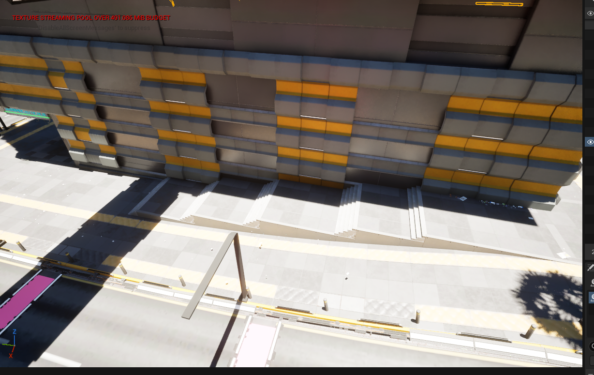
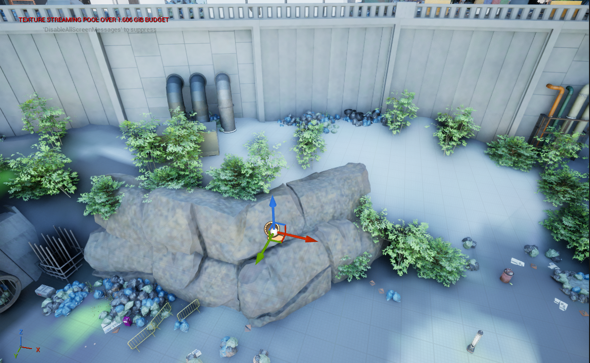
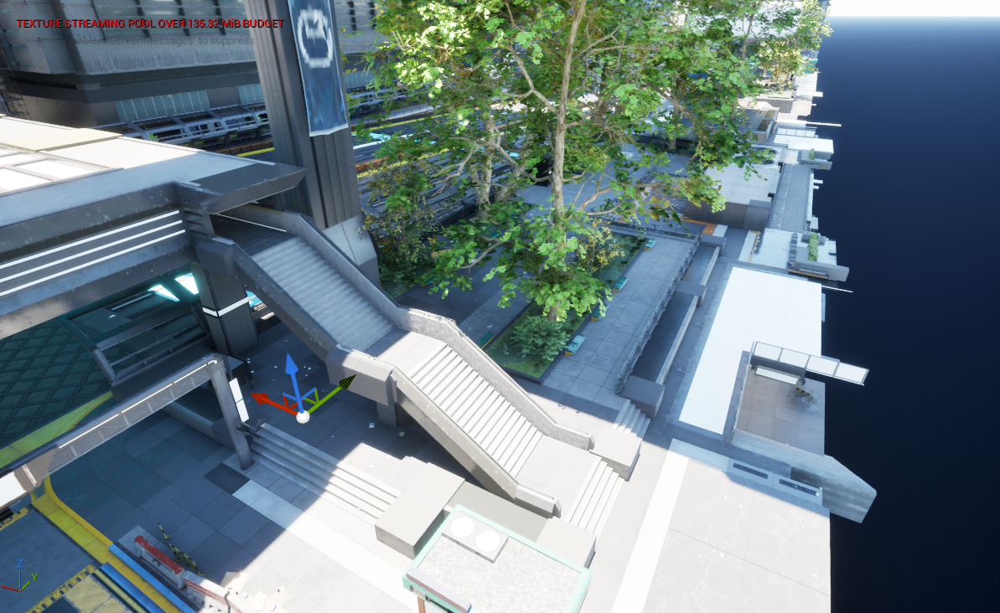
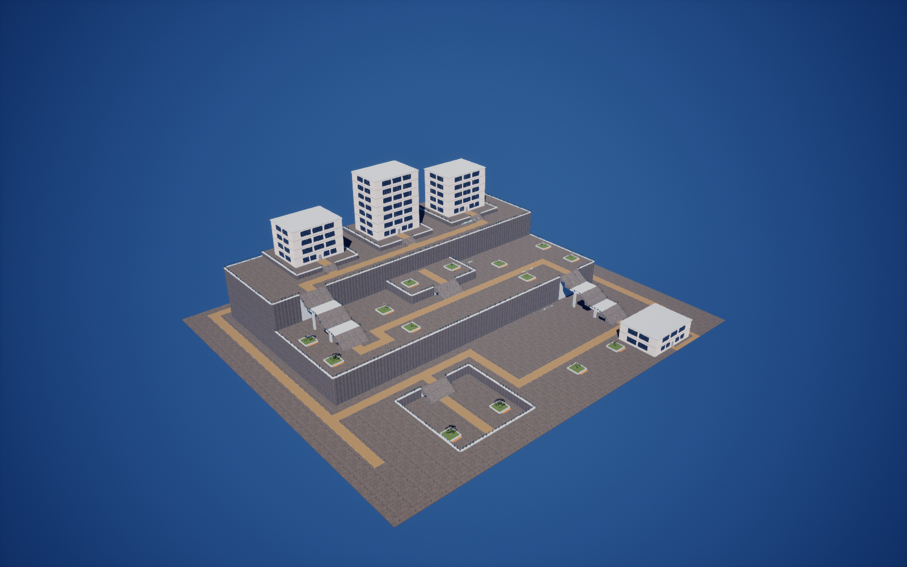
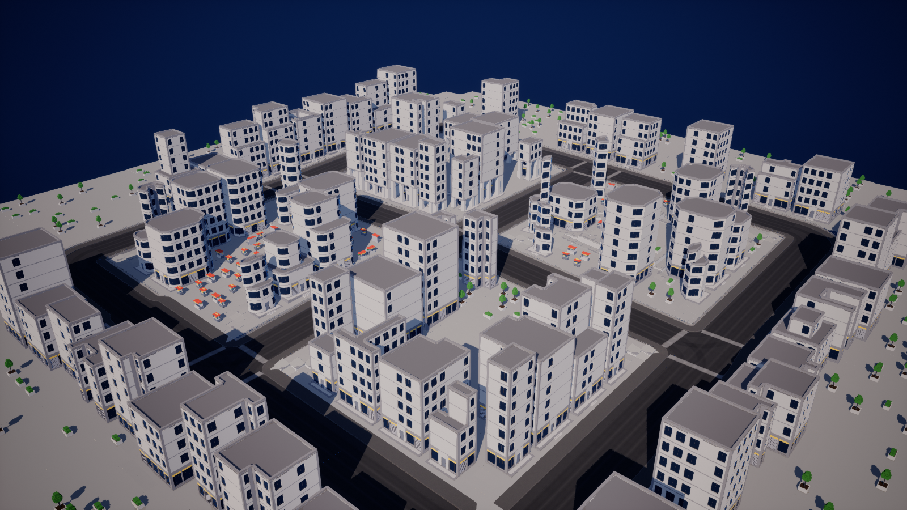

# 通用地面与房屋生态衔接方案

整理日期：2026-11-04

状态：第 5.1 节的高度函数和第 6 节的通用地面已按 GPU 方案实现第一版，见第 13 节；整平区、挖空区、自带区和地面类型 buffer 还没做。本文只讨论通用地面怎样接上房屋周围有形状的生态；文中的类型名与组件名均为建议名称，不代表现有 API。所依据的现有代码和 CS2 原版做法在第 7 节逐条列出，落地顺序在第 10 节，夜之城的实测在第 11 节。

## 1. 目标与范围

- **通用地面**：城市里不属于路面、也不属于任何房屋生态的地面，由它铺满其余部分。
- **房屋生态**：一栋房子加上它周围由它自己负责的东西，例如自带的铺装、台阶、花坛、下沉庭院。形状任意，可以镂空，也可以完全没有地面。
- 目标：通用地面和任意形状的生态在平面上严丝合缝、在高度上连续，所有形状共用一套规则。
- **解耦**：通用地面是砖地、水泥地还是草地，只由绘制决定。房屋既不声明、也不读取通用地面的类型，二者的衔接只涉及几何。
- 通用地面尽量用实例拼成，不生成网格。
- 不考虑 Landscape。

本文不展开以下内容，只给出与衔接相关的约定：

- 地面类型的绘制工具，以及两种类型交界处怎么做；
- 路缘石、排水沟等路边构件（路与通用地面在高度上怎么接，见第 5.1 节第 3 步）；
- 生态与生态之间的衔接；
- 车库等通行接入，见 `LocalUpdateSystem_Plan.md` 第 6.5 节。

## 2. 术语

| 术语 | 含义 |
| --- | --- |
| 通用地面 | 本文的主体，按 tile 用实例铺成，类型来自绘制 |
| 生态 | 房屋与它负责的周边内容，对通用地面只暴露第 4 节的约定 |
| 生态地面 | 生态自己画的地面（铺装、平台等），属于生态，不属于通用地面 |
| 底高 | 生态希望通用地面在它脚下所处的高度（世界 cm） |
| 路缘高度 | 路外边界处的路面高度，通用地面在路边要接到它；带人行道的路就是人行道面，定义见第 5.1 节 |
| tile | 与路面、批量房子相同的 `TileSize` 方格，是通用地面生成和更新的单位 |

## 3. 原则

1. **通用地面永远在最底层。** 生态地面、路面、房子都盖在它上面，它可以一直伸到它们下面。平面上的契合靠覆盖实现，不靠裁切。
2. **通用地面只认生态给出的区域和高度，不认房子本身。** 房子换模型、换模块、换材质，通用地面不受影响。
3. **类型与衔接无关。** 绘制只改变通用地面的外观；衔接所需的形状和高度只来自生态的约定和路。
4. **只有「这里必须是空的」需要显式声明。** 其余情况都由覆盖关系自然成立。

## 4. 生态对通用地面的约定

每个生态向通用地面交出三种区域和一个高度。区域都是带洞的多边形（世界空间俯视平面），可以有多块。

```cpp
// 示例：生态交给通用地面的约定（建议名称）
struct FCSGroundContract
{
	TArray<FCSRegion> Pad;     // 整平区：通用地面在此压平到 PadHeight
	float PadHeight = 0.0f;    // 底高，世界 cm
	float PadBlend = -1.0f;    // 整平区外沿的过渡宽度 cm；负数取 max(800, 对角线 / 12)
	TArray<FCSRegion> Own;     // 自带区：生态自己画地面，通用地面在此下沉 OwnSink
	TArray<FCSRegion> Void;    // 挖空区：通用地面在此不出实例
};
```

区域的来源，按优先级从高到低：

1. **手画**：生态 actor 上的闭合样条组件，每个组件标明自己是哪种区域。
2. **自动**：把生态里标为「地面」的组件俯视投影成轮廓多边形，作为自带区。
3. **默认**：
   - `ACSCityBuildingActor`：整平区取轮廓凸包（`Footprint()`），底高取 actor 高度，没有自带区和挖空区。底高不贴向路缘：与路缘的高差由路肩过渡（第 5.1 节第 3 步），高出路缘的台阶由生态自己做，夜之城的楼也是这样（第 11 节）；
   - 批量房子：整平区取地块 `FLot::Corners`，底高取地块所对那一侧的路缘高度，没有自带区和挖空区。`LayoutLots` 调 `Place` 之前设的 `FLot::Base` 是锚定路中线的高度（`CSCityLayout.cpp` 的 `Lot.Base = Position.Z`），带人行道的路它就等于路缘高度；不带人行道的路还要加这一侧的 `m_EdgeHeights`（Alley 是 −0.2 m）。底高不能从高度函数取，因为高度函数本身要用底高做整平，会形成循环。

### 4.1 各种形状怎么套

| 生态的形状 | 整平区 | 自带区 | 挖空区 |
| --- | --- | --- | --- |
| 规则形状，自带地面 | 占地 | 占地 | 无 |
| 不规则形状，自带地面 | 任意多边形 | 同整平区 | 无 |
| 镂空，洞里露出通用地面（花坛、草地） | 占地 | 占地减去洞 | 无 |
| 镂空，洞是真的空（下沉庭院、坡道口） | 占地 | 占地减去洞 | 洞 |
| 没有地面，房子直接立在通用地面上 | 占地 | 无 | 无 |

最后一种就是通用地面接到房子墙根：通用地面伸到房子下面，墙把它挡住。

## 5. 衔接规则

### 5.1 高度

通用地面的高度来自一个高度函数，按下面的顺序叠加：

1. **基准高度**：平地，或网络快照的地形。
2. **整平**：整平区内高度恒为 `PadHeight`；外沿在 `PadBlend` 宽度内平滑过渡回基准高度。
3. **压路**：按到路外边界的距离分三段。
   - 路面以下：压到中线高度加 `TerrainHeightOffset`（−30 cm），被路网格盖住；
   - 出路边 `TerrainMargin`（1 m）以内：取路缘高度减 `EdgeSink`（建议 2–3 cm），略低于人行道外沿，接缝由路网格盖住；
   - 再往外 `TerrainShoulder`（8 m）以内：从上一段的高度平滑回第 2 步的结果。整平区内部不走这段过渡，保持第 2 步的结果。

   前两段是硬约束，排在整平之后，路说了算，CS2 原版也是先画建筑、后画路。多条路重叠时，硬约束取最低，过渡段取覆盖最多的那条，与现有 `CSRoadTerrain.usf` 相同。
4. **自带区下沉**：自带区内在第 3 步结果上再下沉 `OwnSink`（建议 3–5 cm），保证生态地面永远盖在上面、不闪烁。下沉在自带区边界处直接断开，不做过渡。

路缘高度是路外边界曲线（GPU 几何的 `m_Left` / `m_Right`）的高度，加上 composition 的 `m_EdgeHeights`：左侧沿路从 `.x` 过渡到 `.z`，右侧从 `.y` 到 `.w`，与 `CSRoadNodeGeometry.ush` 里 `CNG_OffsetCurveHeight` 的用法相同。`m_EdgeHeights` 来自 Side 件的 `m_SurfaceHeights`：

- 人行道的 Side 件是 0，所以带人行道的路，路缘高度就是中线高度，也就是人行道面；行车道件是 −0.2 m，比它低 20 cm。
- Alley 的路肩 Side 件是 −0.2 m，路缘比中线低 20 cm。

因此路边不能沿用「中线高度减 30 cm」：带人行道的路会在人行道外留下一条 1 m 宽、30 cm 深的沟，再用 8 m 爬回来，正好落在批量房子门前（地块离路边 0.5–3 m）。

生态这边要负的责任：

- 生态地面在边界处的厚度或裙边，至少要等于 `OwnSink`，用来盖住下沉造成的台阶；建议不小于 10 cm，夜之城楼边收边件的裙边是 11.5 cm。
- 生态地面高于底高时（台基、平台），侧面和台阶由生态自己做。
- 生态地面低于底高时（下沉），要配合挖空区，侧壁由生态自己做。

### 5.2 平面形状

- 通用地面不按形状裁切，可以伸到自带区、房子和路面下面。只有挖空区会真正去掉实例。
- 格子完全落在自带区或路面下的，可以不出实例。这只是为了减少数量，不影响画面。
- 跨在路外边界上的格子取路外一侧的高度（第 5.1 节第 3 步第二段），伸进路面的部分藏在人行道下面，所以人行道要比最小格宽。不带人行道的路，路缘就是路面外沿，这样的格子本来就低于路面。
- 挖空区的边按最小格出台阶状边缘，由生态的侧壁或沿口盖住。最小格建议 0.5 m，沿口至少要有一个最小格宽。

## 6. 通用地面的生成

### 6.1 格子与模块

- 每个 tile 先用大格（建议 16 m），从高度函数取样。高度落在同一平面内（误差小于阈值，建议 1–2 cm）的区域，合成一块大实例；否则细分，直到最小格（0.5 m，与第 5.2 节相同）。地块整平过的地方大多是平的，实例数量主要花在路肩和整平区外沿的过渡带上。
- 路外边界 `TerrainMargin` 以内的格子，平面误差要小于 `EdgeSink`，否则跨在路边的板会顶到人行道面。
- 范围：整网的 tile 都铺。细分只发生在路和整平区的影响范围以内；范围以外只有基准高度，平地上按大格铺。
- 模块是一块带侧面的板（与房子用的方块同类的通用 SM），顶面以下至少 20 cm 厚，按格子所在平面旋转、缩放，相邻的板略有重叠。侧面盖住坡上相邻板之间的错台和挖空区的台阶边；夜之城的人行道板也是 20 cm 厚的盒子（第 11 节）。
- 贴图按世界坐标取，缩放过的板不拉伸。
- 实例变换只用平移、旋转、缩放，不用剪切。引擎由实例矩阵反推 WorldToLocal 和法线时，假定各轴互相正交（`Engine/Shaders/Private/SceneData.ush` 约 1109 行）；碰撞体也只接受这种变换。代价是有坡的地方，相邻板顶面之间会有很小的错台，由侧面盖住、不露缝。

### 6.2 由谁生成、谁来画

建议在 CPU 上生成，用引擎的 `UInstancedStaticMeshComponent` 来画，每个 tile、每种模块一个组件：

- 高度函数的全部输入都在 CPU 上：基准地形、路的占地（`CSRoad::FTerrainFootprint` 本来就是 CPU 数据，路缘高度在第 10 节第 1 步补上）、生态约定。
- 引擎 ISM 自带碰撞、Lumen、光追和点选，更新实例时也不等渲染线程。

不建议用 `UCSGpuInstancedMeshComponent` 加 GPU 实例源（地被 `CSGroundCover` 的做法）。那类纯 GPU 实例必须关掉 Lumen card 和距离场，否则会触发 `check` 崩溃，结果地面只遮挡、不反弹光，这对地面影响很大；它也没有碰撞。只有实例数量大到 CPU 撑不住时，才考虑改走这条路。

2026-11-06 用户定：房子的逻辑尽量放 GPU，与路一致，地面也一样。所以实际走的是 GPU 实例源这条路（第 13 节），上面说的代价都在：没有碰撞，没有 Lumen card。

### 6.3 类型从哪接入

- 类型来自绘制出的地面类型 buffer。地面材质逐像素读它，选择对应的贴图组。
- 格子和实例都与类型无关，所以改绘制只更新贴图，不重新生成实例。
- 以后如果某种类型要有真几何（例如 Nanite 的砖块、石板），就按类型换模块，第 5 节的衔接规则不变。

### 6.4 更新

- 每个 tile 记录输入指纹：影响范围内各生态的约定、路的占地（含路缘高度）、基准高度。影响范围：路取路面外 `TerrainMargin` 加 `TerrainShoulder`，生态取整平区外 `PadBlend`。
- 指纹变了就标脏这个 tile，只重新生成脏 tile 的实例，与批量房子共用 `MaxTilesPerBatch` 那套分批。
- 绘制类型不进指纹。

## 7. 与现有代码的关系

| 现有内容 | 现状 | 本方案里怎么用 |
| --- | --- | --- |
| `Shaders/Private/CSRoad/CSRoadTerrain.usf`、`CSRoadTerrainLayer.h` | 把压路写进 Landscape 编辑层（`bShapeTerrain`，默认关）；路边 `TerrainMargin` 以内也压到中线高度减 30 cm | 路的占地分块（`CSRoad::FTerrainFootprint`）沿用，补上路缘高度；公式按第 5.1 节第 3 步改，在 CPU 上算。Landscape 层只留给旧关卡 |
| `CSRoadComposition.cpp`、`CSRoadNodeGeometry.ush` 的 `CNG_OffsetCurveHeight` | `m_EdgeHeights` 已按 Side 件填好；GPU 几何只在小径接到路边（侧接）时临时加到边界曲线上，读回的 `Edges` 不含它 | 第 5.1 节路缘高度的来源，CPU 按同一约定加上 |
| `ACSRoadNetworkActor::BuildBatchBuildings` 的 `Place` | 房子底高往下埋 0.5 m：有快照地形时从四角最低处算，没有时从路中线高度算 | 底高改为所对一侧的路缘高度（第 4 节），再由高度函数按它整平，房子和地面因此一致；不再下埋。「离路高差超过 3 m 不放房子」的判断仍看基准地形 |
| `CSRoadDeform.ush` 第 398–400 行 | 路网格裙边按快照地形取最小或最大值 | 改为读同一个高度函数，否则路边会悬空或埋土；路的几何阶段仍读快照地形（第 10 节第 5 步） |
| `ACSCityBuildingActor::Reservation()` | 轮廓外扩 `Setback` 作为预留位，供小路和批量房子避让 | 保持不变。地面约定是另一份数据，整平区默认取轮廓本身，不含外扩部分 |
| `UCSGroundCollisionComponent` | Tiny Glade 地面用来补碰撞 | 走 CPU 加引擎 ISM 时不需要；只有改走 GPU 实例时才照它的做法单独烘碰撞 |

CS2 原版的做法可作参考：地面是一张高度图，建筑占地先压平，路后压。占地外沿的平滑宽度取 max(8 m, 对角线 / 12)（`ObjectUtils.GetTerrainSmoothingWidth`）。占地四边的高度取相邻路缘高度作为约束（`Game.Buildings/LotHeightSystem.cs`）。

夜之城（Cyberpunk 2077）的城区没有地形：路网格自带人行道，其余地面是 20 cm 厚的人行道板实例，接在路的人行道外沿，比它高 0–7 cm；楼直接站在人行道面上，高差由楼自己的台阶和收边承担。本方案是路盖在通用地面上，所以反过来让地面比路缘低 `EdgeSink`。实测见第 11 节。

## 8. 验收场景

1. 规则形状、自带地面的生态：边界处看不到通用地面，也没有闪烁。
2. L 形、自带地面的生态：拐角内外都贴合。
3. 镂空的花坛：洞里露出的是通用地面，高度与底高相同。
4. 下沉庭院（挖空）：洞里没有通用地面，边缘被生态的沿口盖住。
5. 没有地面的房子：通用地面一直接到墙根。
6. 两个相邻的生态：中间的通用地面在两个底高之间平滑过渡。
7. 生态紧挨路：路外沿到整平区之间没有沟也没有坡，房子底高与地面一致。
8. 有坡的基准地形：相邻板之间的错台被侧面盖住、不露缝，近景下可以接受。
9. 改绘制的地面类型：不重新生成任何实例。
10. 挪动一个生态：只重新生成它影响范围内的 tile。
11. 路边量化：在 `L_RoadTierMini` 和 `L_RoadTierTest` 上，路外边界往外 `TerrainMargin` 以内的通用地面比路缘高度低 `EdgeSink`，误差不超过 1 cm，任何一点都不高过路缘；批量房子的底高与所对一侧的路缘高度相差不超过 1 cm。

## 9. 待定问题

- 相邻生态的整平区重叠或过渡带交叠时谁说了算。结果要与放置顺序无关，候选做法：取较高的、按面积小的优先、按稳定 id 定序。
- 挖空区的最小格大小，以及对生态沿口宽度的要求。
- `EdgeSink` 取 2 cm 还是 3 cm，和路边格子的平面误差怎么配，待原型实测。
- 引擎 ISM 的 Lumen 和光追开销，待原型实测。按夜之城的密度折算，每个 256 m 的 tile 约 1100 块板。
- 坡上相邻板的错台线在近景下是否显眼，待原型实测。
- 整网 tile 以外的远处地面由谁来出。

## 10. 落地步骤

按依赖排序。第 1、2 步不改画面，可以先合；第 3、4 步一起合，从这里开始出画面；第 5 步解决坡上路边悬空或埋土。

1. **占地带上路缘高度**
   - `CSRoad::FTerrainFootprint` 每段补四个路缘高度：起点左右、终点左右。路段取 `FRoadInstance::EdgeComposition`，两端路口段取 `StartComposition` / `EndComposition`，按第 5.1 节的约定加 `m_EdgeHeights`。
   - 占地按路缓存，键用 `FTileRoad::Output`。现在 `MakeTerrainFootprint` 只在整网预览里调（`CSRoadNetworkPreview.cpp` 的 `UpdateTerrain`），局部更新拿不到它。
   - 测试：带人行道的路，路缘高度等于中线高度；Alley 等于中线高度减 0.2 m。
2. **CPU 高度函数**
   - 新建 `CSCityGround.h/.cpp`，写成纯函数：基准高度（快照地形 `FSavedTerrain::Sample`，或平地）→ 整平 → 压路 → 自带区下沉；挖空区单独查询。
   - 测试：路外边界 `TerrainMargin` 以内没有沟（不低于路缘高度减 `EdgeSink` 再减 1 cm）；整平区内高度恒等于 `PadHeight`；结果与生态的登记顺序无关。
3. **生态交出约定**
   - 加 `FCSGroundContract`。`ACSCityBuildingActor` 默认整平区取 `Footprint()`、底高取 actor 高度；批量房子从 `FLot` 生成。
   - 改 `BuildBatchBuildings` 的 `Place`：去掉下埋 0.5 m，底高取路缘高度（第 4 节）；「离路高差超过 3 m 不放房子」仍看基准地形。
   - 每份约定带指纹和它覆盖的 tile 范围，做法照 `LotState`。
   - 和第 4 步一起合：没有通用地面时，坡上的批量房子会悬空。
4. **地面板 tile**
   - 每个 tile、每种模块一个 `UInstancedStaticMeshComponent`，挂在 `ACSRoadNetworkContent` 下。
   - 按第 6.1 节从 16 m 细分到 0.5 m；整格在路面下或自带区内的跳过，挖空区去掉。
   - 标脏和分批照搬 `BuildBatchBuildings`：`TileBefore` 排序、`MaxTilesPerBatch`、`VideoMemoryShort`。
5. **路网格裙边读同一份地面**
   - CPU 把高度函数按 tile 栅格成高度贴图，`CSRoadDeform.ush` 第 398–400 行的取最小、取最大改为采样它。路外边界两侧高度有跳变，栅格时按路外一侧取值，或多留 1–2 cm 余量。
   - 路的几何阶段（`CSRoadNodeGeometry.ush` 等调用 `TerrainUtils_SampleHeight` 的地方）继续读快照地形，否则会成环：路几何 → 路缘高度 → 地面 → 路几何。

## 11. 参考：夜之城的地面与路边

2026-11-03 在 CityAtlas 工程导入的夜之城数据上实测（`SourceAssets/Cyberpunk2077/world.sqlite` 的摆放与 `BakedRoads/*.glb`）。区域是从编辑器日志推出的 `NightCity_WP` 已加载部分：x −2432…−1013 m、y −1112…630 m（REDengine 米）。路网格按原始几何量，其余物件按包围盒量；人行道板和路缘本身就是盒子，量得准，楼和杂物只是近似。

- **城区没有地形。** 已加载的 466 段路网格里有 444 段下面没有地形，其余 22 段是离地 81–96 m 的轻轨高架；地形 tile（128 m、2 m 格）到城边就被裁掉。
- **路网格自带人行道。** 行车道在 0，人行道 +20 cm。
- **其余地面是实例拼的人行道板**（`street_a_sidewalk_blank_a_w{100,300,600}_l{300…2400}`）：20 cm 厚的盒子，3 m / 6 m 模数，侧面就是裙边。小街周围 90 m 见方里约 140 块板、42 根路缘，折合每个 256 m tile 约 1100 块板。
- **路缘件** `street_a_curb_blank_w20_l300` 从 −20 cm 到 +20 cm，往路面下多伸 20 cm 盖缝。
- **楼站在人行道面上**，楼下没有地面。比路沿高的楼板自带台阶和收边件（裙边 11.5 cm）；花坛自带土面；井口板自带 −60 cm 的坑壁，相当于挖空区加生态侧壁。

| 样本路段 | 路外沿（相对行车道） | 人行道板 − 路外沿（p10 / p50 / p90） | 其他邻接物 − 路外沿 |
| --- | --- | --- | --- |
| `rt_1x1_with_sidewalks_12m_hw` | +20 cm | 0 / +7 / +10 cm | 楼边收边件 +23 cm |
| `rt_1way_2lanes_with_sidewalks_width60m` | +21 cm | 0 / 0 / +2 cm | 楼板 +30 cm，花坛 +103 cm |
| `rt_2x2_with_sidewalks_12m_cc_high` | +131 cm（抬高的广场） | +1 cm | — |

没有一处地面低于路外沿，高差只由生态自己的台阶和收边承担。CS2 的约定相同：`Data/CS2Road/Prefabs/raw-prefabs.json` 里行车道件的 `m_SurfaceHeights` 是 −0.2 m，人行道件和人行道的 Side 件是 0，Alley 的路肩 Side 件是 −0.2 m。

### 11.1 地形抬升时的解决方案：楼前平台、台阶与收边

2026-11-05 补充，用户提供的场景参考。参考位置（UE 坐标）：

```text
(X=-184180.000000,Y=-40400.000000,Z=2210.000000)
```



这张截图记录应对地形抬升时建筑周边高差的解决方案：沿建筑立面布置楼前平台，用分段台阶连接外侧人行道，并由平台侧面收边封住高差。图中各段台阶的外露高度随沿街地面高差变化。

应用到本方案时，楼前平台、台阶和侧面收边属于房屋生态，由它们承担建筑与周围地面的高差过渡；通用地面接到其外沿。

2026-11-06 状态：批量房子和沿街楼带的底高、底座、楼前平台、台阶和收边已在 GPU 立面 kit 里实现，kit 有 `Plinth` 时不再下埋，见 [`NightCity_BuildingKit.md`](NightCity_BuildingKit.md) 第 8 节。第 6 节的通用地面 11-06 已在 GPU 上实现第一版（第 13 节）；第 10 节的整平还没做，Alley 的 `m_EdgeHeights` 也没加。

### 11.2 地形落差很大时的解决方案：高墙阻截

2026-11-05 补充，用户提供的场景参考。参考位置（UE 坐标）：

```text
(X=-176190.000000,Y=21110.000000,Z=440.000000)
```



用户明确的处理原则：**当地形落差非常大时，应使用这样的高墙阻截。** 沿高低区域的交界布置连续墙体，封住高差，形成明确的空间边界。图中高墙以立柱和墙板分段，上沿设置栏杆，低处墙脚与地面相接。

应用到本方案时，高低两侧地面分别保持各自的标高，由高墙承担交界处的大落差封边与阻隔；第 11.1 节的平台、台阶方案用于需要通行衔接的局部高差。

### 11.3 公园周边的通用设计：局部升降与通用阶梯

2026-11-05 补充，用户提供的场景参考。参考位置（UE 坐标）：

```text
(X=-202620.000000,Y=11080.000000,Z=1050.000000)
```



公园附近的一类通用设计可参考此处构造：步道、绿化和平台分层组织，按布局需要偶尔抬升或降低局部地面，并在通行连接处布置阶梯。图中阶梯通过中间平台分段衔接不同高度的空间，两侧有墙体收边。

用户明确的约束：**阶梯 Mesh 需要通用复用，地面抬升或降低的幅度由阶梯的高度规格决定。** 规划时先选定可复用的阶梯模块及组合，再据其上下端连接面的实际高差确定地面标高。

- 如果模块支持按单级重复拼接，设单级高度为 `h`、级数为正整数 `N`，则相对基准地面的高差为 `ΔZ = ±N × h`：正号表示抬升，负号表示降低。
- 如果使用固定整段阶梯 Mesh，则采用该整段或合法组合能够提供的总高差；可用高度受现有模块规格约束。
- 阶梯上下端的平台与对应地面标高对齐，中间平台保持水平；踏步高度与比例保持一致，以保证同一套 Mesh 可在不同位置复用。

应用到本方案时，将这种按阶梯规格确定的局部升降作为公园周边布局的一部分，先确定各平台高度和阶梯连接，再让通用地面与平台外沿衔接；不通行的高差边界用侧壁收边，大落差阻隔参考第 11.2 节。

## 12. 大落差实例化测试关卡（2026-11-05）

关卡：`/Game/BuildingGenerator/Cyberpunk2077/Tests/GroundTerraces/L_GroundTerraces_28m`。



近景：[长阶梯与公园](Docs/NightCity/GroundTerraces/park_stairs.png)、[24 m 高墙](Docs/NightCity/GroundTerraces/high_wall.png)、[下沉庭院](Docs/NightCity/GroundTerraces/sunken_court.png)、[建筑转角与入口](Docs/NightCity/GroundTerraces/building_corners.png)。

本关卡将第 11.1–11.3 节的参考组合为可打开、可行走检查的静态测试布局，用来验证模块尺度、实例化铺地、阶梯连接和高墙封边。第 4–6 节的通用地面约定、高度函数及局部自动更新仍是设计方案。

- **低层广场 0 m → 公园 +12 m → 上层平台 +24 m**：两组长阶梯，每组由 6 个总高 2 m 的通用阶梯段串联，宽度方向并排 4 个模块，并设两处水平休息平台。
- **下沉庭院 −4 m**：上层广场的地面实例留出真实缺口，庭院在低处独立铺地，侧墙封边，2 段阶梯回到广场。庭院到上层主平台的总高差为 28 m。
- **公园内抬升平台 +16 m**：比公园高 4 m，以 2 段阶梯连接。配有实例化树池、树、长椅和栏杆。
- **建筑台基 +26 m**：比上层主平台高 2 m，以单段阶梯连接；包含 3 栋不同高度的建筑。若计入建筑台基，最高步行面与庭院的总高差为 30 m。
- **24 m 连续高墙**：上层平台外侧用 8 m 高墙模块分层封边，下方保留 0 m 标高的侧向步道，便于从低处检查完整落差。阶梯末端另有封边，中间平台有支撑。

### 12.1 实例和模块

截至 2026-11-06，共 **8,746 个实例、163 个原生 `UInstancedStaticMeshComponent`**。地面与阶梯休息平台共 877 个实例，按区域和 24 m 分块分组；阶梯本体共 70 个实例。高墙、建筑立面、树、树池、栏杆、长椅与支撑同样使用实例。建筑采用每栋一个 Actor、内部多个 ISM 组件，其余实例组由现有 `ACSInstanceContainer` 承载。

- 地面：`street_a_sidewalk_blank_a_w600_l600`，6×6 m、20 cm 厚，顶面按平台标高对齐。
- 阶梯：`stairs_b_straight_w300_l300_h200_aa`，宽 3 m、水平进深 3 m、总高 2 m，10 级、每级 20 cm。全部使用单位缩放；源模型顶级踏面约为局部 Z=−1 cm，放置时补偿 +1 cm，使其与平台接齐。
- 高墙：`retaining_wall_a_middle_ab`，宽 6 m、高 8 m；完整高墙分层复用，4 m / 2 m 等收边段调整墙板高度。
- 地面、阶梯和高墙使用测试目录中的副本配置碰撞；原始夜之城源资产不改写。其余模型引用已有资产。

### 12.2 重建与检查

生成脚本：[MakeGroundTerracesTest.py](Scripts/NightCity/MakeGroundTerracesTest.py)。在独立 Unreal Python commandlet 中运行；重跑会重建本测试关卡内带 `GT_` 前缀的生成 Actor，因此手工修改生成布局后应先另存关卡。

检查脚本：[CheckGroundTerracesTest.py](Scripts/NightCity/CheckGroundTerracesTest.py)。在独立真实编辑器中加载测试关卡后运行，重读实例数量、单位缩放和高度量化，检查地面、踏步、休息平台及高墙碰撞，以及道路连通性和建筑整体移动，并输出总览、长阶梯、高墙、庭院和建筑转角截图。脚本结束时退出该独立编辑器，不在工作的编辑器中运行。结果位于工程 `Saved/CodexGroundTerraces/manifest.json`、`validation.json` 和同目录 PNG。

关卡配置了第三人称 GameMode 和低层广场 PlayerStart，可从出生点步行前往两组长阶梯，逐层检查连接。

2026-11-06 独立编辑器重载后的 **27 项检查全部通过**：实例数量、阶梯单位缩放、20 cm 高度量化、6 处地面标高、首末踏步与休息平台碰撞、高墙三个高度的阻挡、4 栋独立建筑的组件归属与整体移动，以及道路连通、路面抽样和中心线阻挡检查。踏步碰撞面与目标标高的误差约 1.1 cm，在 2 cm 检查容差内。

归档结果：[实例清单](Docs/NightCity/GroundTerraces/manifest.json)、[检查记录](Docs/NightCity/GroundTerraces/validation.json)。五个机位的实际渲染截图已检查；尚未进行角色全路线行走测试。

### 12.3 简易道路、角墙与整栋 Actor（2026-11-06）

- **简易道路连接**：新增 28 段棕色铺装步道，主路宽 4 m，低层建筑入口支路宽 2 m；连接外围步道、低层广场、公园、上层建筑、抬升花园与下沉庭院。平层路段通过现有 7 处阶梯连接高差，形成连续步行网络。
- **道路实例化**：路面按 1 m 网格合并覆盖范围，交叉口不叠铺，边缘单独收边。路面与收边共 5,640 个实例，仅使用 2 个 ISM 组件；原有通用地面和阶梯继续复用。
- **建筑角墙**：4 栋建筑共使用 72 个 `SM_NC_CornerWrap_H400` L 形转角模块，每层四角连续拼接；立面为角墙两侧各预留 350 cm，修正墙面朝向并在首层加入入口。
- **一栋楼一个 Actor**：`GT_Building_01` 至 `GT_Building_04` 各自承载墙体、角墙、门、底板和屋顶，内部各有 6 个 ISM 组件，统一附着到该建筑根组件。逐栋平移验证中，全部实例同步移动，最大位置误差为 0 cm。

本次使用 [UpdateGroundTerracesConnections.py](Scripts/NightCity/UpdateGroundTerracesConnections.py) 在已打开且已保存的测试关卡中定向更新；其余 148 个 Actor 及原有 ISM 实例的变换保持一致。原关卡文件与实例清单备份在工程 `Saved/CodexGroundTerraces/2026-11-06-paths-corners/`，本次测试关卡已保存。

连通检查覆盖全部 3,696 个路面格、7 处阶梯连接，以及 4 栋楼入口、抬升花园和下沉庭院；道路中心线与每隔 2 m 的路面碰撞抽样均通过。

## 13. GPU 地面、空地与花坛、推车（2026-11-06）

用户 11-06 定：房子的逻辑尽量放 GPU，与路一致。地面跟着走，没有用第 6.2 节建议的 CPU + ISM。代码在 `Source/CSRoadNet/Private/CSCityGround.*`、`Shaders/Private/CSRoad/CSCityGround.usf`，kit 是 `Public/CSCityGroundKit.h`。



俯视：[四个区块](Docs/NightCity/BlocksHill/top.png)；夜市区块的推车：[market_top](Docs/NightCity/BlocksHill/market_top.png)。

### 13.1 怎么生成

- 开关：路网的 `bBuildGround`（要先开 `bBatchBuildings`），kit 是 `GroundKit`（`UCSCityGroundKit`）；不填时用 `DA_NCSimple_Ground`。
- tile：世界坐标对齐的正方形，边长取最接近 `TileSize` 的 12 m 整数倍（64 m 取 60 m）。与路网自己的 tile 无关，所以路网怎么摆，板都在同一套格子上对齐。
- 格子：每 12 m 一个线程，按 12、6、3 m 三级四叉细分。角点和中点不共面（差 2 cm 以上）就细分，路缘可能穿过的格也细分；完全在路面下的格不出；离路超过 `Reach`（60 m）的格不出。
- 高度函数（第 5.1 节）：
  1. 周围几条路的高度，按到路边距离的 4 次方反比加权；再加场的高度通道，离路 `RoadMargin` 以内不加，到 `RoadMargin + RoadShoulder` 时加满。
  2. 批量房子的地块（kit 有底座时）内，取地块下的地面平面 `Base − (Drop + DropX·x + DropY·y)`；外沿 `PlotBlend`（4 m）内过渡。
  3. 路最后定：路面下取中线 −30 cm；路边 1 m 内取中线 − `EdgeSink`；再往外 8 m 过渡，地块内不过渡。路缘高度暂按中线取：带人行道的路是对的，Alley 的 `m_EdgeHeights` 还没接。
- 板：只平移、旋转、缩放，不剪切。坡度超过 `MaxSlope`（25%）时板保持水平，高差交给挡墙。两个方向都有坡时，板的 Y 轴会偏离世界 Y，X 方向按偏离量多伸出一些盖住。
- 挡墙：格边外侧比这一格低 `WallMinStep`（40 cm）以上时立一段，向下伸到外侧地面以下 30 cm。地块内和路边不立。
- 空地：每 6 m 一个候选点，带 ±1 m 抖动，随机数按世界格子取，tile 怎么分结果都一样。离建筑至少 `BuildingClearance`（3 m）、离路边至少 2 m、坡度不超过 15% 才算空地。然后看场的空地风格：
  - 花坛：概率 `PlanterChance`；
  - 夜市：放推车，正面朝最近的路，概率 `CartChance`；
  - 留空：什么都不放；
  - 自动：按 `AutoPlanterChance`（25%）放花坛。

  每种两个件，各占一半。
- `Lots.Vacancy`：按地块 id 抽一部分地块空着，空出来的就是街边的空地。
- 写入：与立面相同（`CSCityGpuWrite.h`），先计数，异步读回，再按数量写实例。件数为 0 的槽不建组件。

### 13.2 局部更新

- 每个地面 tile 有一个指纹，包括 kit、碰到它的各条路的曲线指纹之和、地块指纹之和，以及场里盖住它（向外扩 10 m）的页。指纹变了才重写，CPU 不看内容。
- 地面等所有建筑 tile 写完才写，和建筑共用 `MaxTilesPerBatch` 与显存门限。
- 场里画一块 8 m 见方的格子：`City.GroundNetwork` 的 24 个地面 tile 只重写了 9 个。

### 13.3 测试与关卡

| 测试 | 测什么 |
| --- | --- |
| `City.Ground` | 平地上路外无洞、高度一致，远处是 12 m 板、路边是 3 m 板，没有整块在路面下的板，`Reach` 外没有板；缓坡上路边高度跟着路走、板都转到坡面、没有挡墙；陡坡上板水平、有挡墙、没有低于最小高差的墙；地块内取地块高度，离开后回到路的高度；60 m 宽的空地有花坛，离建筑和路都够远，落在地面上；2 m 的楼缝什么都没有；同一位置分成半个 tile 写，结果相同 |
| `City.GroundField` | 没画、概率为 0 时什么都不放；花坛风格只有花坛、两种都有；夜市只有推车、长边顺着路；同样多的位置；留空什么都没有；一半一半时各在各的一边；抬高 3 m 后中间高 3 m、四周有挡墙、路边仍是路的高度；清空后没有挡墙 |
| `City.GroundNetwork` | 路网上的地面 tile 和板；不变的重建不重写；画一块只重写附近的 tile；空置地块让楼变少；关掉后组件全部清掉 |

| 关卡 | 内容 |
| --- | --- |
| `/PCGPlugins/CSRoadNet/Houses/NCSimple/L_NCBlocksHill`（`MakeNCSimpleModules.py`，看图 `NCSlopeShots.py`） | 6 条 Medium Road 围成 4 个 100 m 的区块，路口高 0–12 m；批量房子用 `DA_NCSimple_Styles`，空置 25%。场：西南区块画花坛；东南区块画夜市和圆角；西北区块一半花坛、一半夜市，画斜角，院子中间抬高 3 m；东北区块留空、正面外挑 |

11-06/08 结果：`City.*`、`Tiles.NoWait`、`PCGEditorProcess.City` 共 32 项通过，只在小关卡测试。`L_NCBlocksHill` 的总览、俯视和各区块都看过：地面铺满区块和外围，花坛、推车和留空都和场一致。

### 13.4 已知问题和没做的

- 地面是纯 GPU 实例：没有碰撞，编辑器点选和角色都会穿过；没有 Lumen card，只遮挡、不反弹光（第 6.2 节说的代价）。
- 花坛和推车是方块简模。夜之城资产在本机是哈希名，`world.sqlite` 也不在，按名字找不到原件；kit 的槽位可以直接换。
- 截图里路的 +X、+Y 一侧，路缘外有一道约 30 cm 宽的暗线。它只出现在背光一侧，像是路缘比地面高投下的影子。但按第 5.1 节，带人行道的路路缘就是中线高度，2.5 cm 的下沉投不出这么宽的影子。11-08 想补拍近景时，本机图形环境异常（D3D12 建设备挂起，新进程报 `0xC0000142`），没有拍成，原因还没查清。
- 坡上大小不同的板之间偶尔能看到细缝，板的侧面没有完全盖住。
- 有路的地方才有地面。Landscape 关卡里会和 Landscape 叠在一起，所以默认关闭。
- 桥和高架下面，高度函数会把地面拉到桥面高度。有桥的大关卡没有测。
- 每个 tile 的 GPU 耗时没测。每次重建 CPU 要把全部路曲线和地块分桶一遍：`L_NCBlocksHill` 是 0.1 ms，大城市没量过。
- 整平（第 10 节）、挖空区、自带区、地面类型 buffer 都还没做。地块整平目前用的是批量房子自己的底座面。
