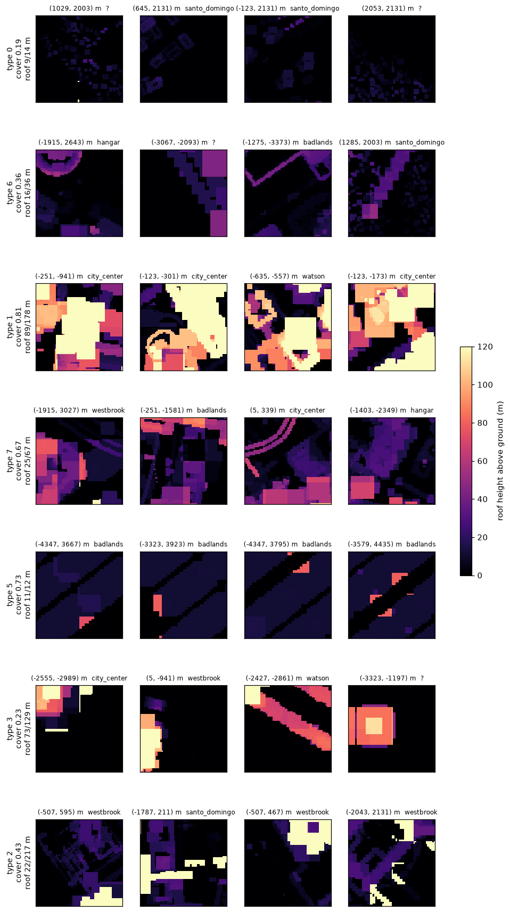

# 夜之城房屋群落、通用分件与 GPU 立面生成

整理日期：2026-11-05

状态：第 1–3 节是对 `Content/BuildingGenerator/Cyberpunk2077` 里夜之城数据的调研结论；第 4 节是据此做的 GPU 立面生成，已经替代了 `CSCity::AssembleBlock`（一层一个通用 SM），实现状态见 4.5；第 5 节是第二轮调研（哪些模块用得最多、怎么摆成楼），据此给生成器加了体量（L、U、T、天井、退台、裙房塔楼）、按列定窗、底层和内角，并在插件里做了简化模块；第 6 节是沿样条排楼的沿街楼带 `ACSCityStreetActor`，可以单独摆在关卡里，也可以挂在路下面接管一段路，层数和地块按第 2 节的群落取预设。调研脚本在 `Scripts/NightCity/`，第 1 节和第 5 节写明顺序。

本文只管一个矩形盒子的外皮怎么拼。体量怎么组合（裙房 + 塔楼、退台、凹角）以及生成、渲染、加载怎么分块，见 [`Docs/NightCity_ProceduralBuildings_Partitioning.md`](Docs/NightCity_ProceduralBuildings_Partitioning.md)。

## 1. 数据与方法

| 数据 | 数量 | 说明 |
| --- | --- | --- |
| `Meshes/<两位>/SM_<16 位哈希>` | 52,596 个 | 名字只有哈希；包里留着 `SourceDepotPath`（REDengine 的 `.mesh` 原路径），23,120 个有，其余 28,000 多个标着 `cityatlas_baked:<id>`，是导入时烘出来的合并件 |
| `__ExternalActors__/.../NightCity_WP` | 29,270 个 actor | 16,366 个单网格 HISM actor（实例在世界空间）；12,904 个 `BP_CityAtlasRegionChunk`，摆在 256 m 网格上，实例相对 actor |
| 实例 | 1,871 万 | 外立面建筑件（去掉室内和路桥、管线、吊车等基础设施）251.5 万个，用到 5,751 种网格 |

做法：

1. `nc_catalog.py`：扫全部网格包，取 `SourceDepotPath` 和材质引用，得到哈希 → 原名。
2. `nc_sizes.py`：取包里资产注册表标签 `ApproxSize`（包围盒尺寸，cm）。
3. `nc_instances.py`、`nc_chunks.py`：直接读 actor 包。实例矩阵存成 16 个 double、步长 128 字节，前面是 int32 个数；区块 actor 按名字表和导入表找到每个组件的 `StaticMesh`，再加上根组件的 `RelativeLocation`。
4. `nc_parts.py`：按原名归纳成套的楼体（kit）和部位词汇。
5. `nc_fabric.py`、`nc_thumbs.py`：把外立面件按 2 m 格画成屋顶高度图，按 128 m 一格统计覆盖率、屋顶高度和件的构成，用 k-means 分出肌理类型，再出俯视图。

局限：只知道包围盒尺寸、不知道轴心偏移，所以屋顶图里每件按「以轴心为中心、边长取大边」的方块算，房子轮廓是粗的。夜之城的街区里楼贴着楼，几何连通分不出单栋楼（连通分析会把整片城连成一块），所以「群落」按肌理统计，不按单栋。区名取的是这一格里比全城比例高得最多的那个区，因为各区的 kit 大量互相借用。

## 2. 常用房屋群落



每行一种肌理，每格 128 m 见方，颜色是屋顶离地高度。坐标是 `NightCity_WP` 里的 UE 世界坐标（m），在编辑器里乘 100 就是位置框里的 cm。

| 类型 | 格数 | 覆盖率 | 屋顶高 中位 / 九成（层数按 4 m） | 样子 | 主要 kit | 样例坐标 (m) |
| --- | --- | --- | --- | --- | --- | --- |
| A 城边低层散布 | 321 | 0.19 | 9 / 14 m（2–3 层） | 独栋小楼、棚屋，间距大，坡屋顶件占三成 | `std_rcr_house_a`、`bls_ina_building_a` | (645, 2131)、(-123, 2131) |
| B 中低层混合 | 302 | 0.36 | 16 / 36 m（4 / 9 层） | 中低层楼夹空地、厂棚，形状杂 | `wbr_cha_building_a`、`bls_ina_building_a`、`common\backwall` | (1285, 2003)、(-1275, -3373) |
| C 中层街墙街区 | 280 | 0.67 | 25 / 67 m（6 / 17 层） | 沿街连续的中层楼，间或一两栋高层 | `wbr_cha_building_a/b`、`common\backwall`、`cct_cpz_building_a` | (-1915, 3027)、(5, 339) |
| D 高层核心 | 298 | 0.81 | 89 / 178 m（22 / 45 层） | 裙房上起塔楼，几乎铺满 | `cct_cpz_building_a`、`wbr_cha_building_b`、`wat_lch_building_c`、`wat_kab_building_c` | (-251, -941)、(-635, -557) |
| E 点式塔楼、板楼 | 147 | 0.23 | 73 / 129 m（18 / 32 层） | 一两栋高楼立在空地或广场上 | `cct_cpz_building_a`、`wbr_cha_building_a` | (-2555, -2989)、(-2427, -2861) |
| F 低层夹地标 | 72 | 0.43 | 22 / 217 m | 中低层街区里冒出一栋超高层 | `wbr_cha_building_a`、`common\tech_canopy`、`westbrook\japan_town` | (-507, 595)、(-2043, 2131) |
| G 城外工业大棚 | 233 | 0.73 | 11 / 12 m | 恶土的大跨度厂棚，柱子件占三成，不是住房 | `badlands\common` | (-4347, 3667) |

另有 4 格是超高的单体（荒坂塔一类），不成类型。

对生成的意义：A、B、C、D 四类覆盖了城区八成以上，可以作为批量房子的四档默认群落；它们之间的差别主要在覆盖率（地块填满多少）和层数分布，立面用的分件是同一套语法（第 3 节）。E、F 适合作为特殊建筑放置。

## 3. 通用房屋分件

### 3.1 命名语法

原名大多按这个格式：

```text
<区>_<片区>_building_<款>_<层段>_<部位>_<修饰>_<尺寸>_<变体>
wat_kab_building_f_wall_door_aa          # 歌舞伎町 f 款，墙，带门
wat_lch_building_e_uf_a90_cornice_convex_corner  # 上层段，90° 外转角檐口
cct_cpz_building_a_shield_c_12m_right    # 企业广场 a 款，12 m 遮板
```

- **款（kit）**：同一区的一套楼体，例如 `wat_kab_building_a`…`f`。按名字能认出 45 套，共 2,334 个网格；最常用的件来自 `cct_cpz_building_a`、`wbr_cha_building_a/b`、`common\backwall`，它们在各区都被借用。
- **层段**：`gf` 底层（店面、门），`mf`/`bm` 中段，`uf` 上层，`top`/`roof` 顶。
- **转角**：`convex` 外角、`concave` 内角，角度有 `a45`、`a60`、`a90`、`a135`、`c90`。
- **尺寸**：名字里的 `l`/`w`/`h` 加数字（cm），或 `3m`、`6m`、`12m`。

### 3.2 部位与模数

按部位统计（权重是摆放次数），每行是用得最多的几种尺寸（宽 × 厚 × 高，cm）：

| 部位 | 网格数 | 摆放数 | 常见尺寸 |
| --- | --- | --- | --- |
| 墙、立面板 | 1,111 | 72.2 万 | 600×50×400、300×50×400、300×25×400、300×20×400 |
| 屋顶、檐口、女儿墙 | 603 | 38.3 万 | 300×300×20、600×600×20（屋面）、600×52×60（檐口）、600×40×110（女儿墙） |
| 柱、梁、支撑 | 325 | 27.0 万 | 50×50×400、100×100×400 |
| 转角 | 935 | 26.1 万 | 350×350×400、102×104×401、30×30×400 |
| 窗 | 641 | 18.9 万 | 600×20×400、300×61×800、900×20×400 |
| 雨棚、遮板 | 401 | 16.7 万 | 600×108×400、1200×108×140 |
| 楼板、天花 | 319 | 14.7 万 | 300×300×22、600×600×22 |
| 阳台、栏杆 | 205 | 5.7 万 | 300×70×399、栏杆高 111 |
| 门、入口 | 273 | 2.5 万 | 300×23×422、600×40×400 |
| 楼梯 | 83 | 2.0 万 | 300×300×200 |

归纳出来的模数：

- 开间 300 cm 或 600 cm（少量 900、1200）。
- 层高 400 cm；双层高的件 800 cm，半层 200 cm。
- 墙厚 20–50 cm。
- 屋面和楼板是 300×300 或 600×600 的方片。
- 女儿墙高 110 cm，檐口高 60 cm。
- 转角件单独成件，宽度从 30 cm 到 350 cm，按外角、内角和角度区分。

### 3.3 生成器用到的槽位

| 槽位 | 放在哪 | 对应的夜之城部位 |
| --- | --- | --- |
| `Wall` | 立面的普通开间 | `wall`、`panel`、`facade` |
| `Window` | 立面开间，按概率替换墙 | `window`、`windows` |
| `Door` | 底层正面的一个开间 | `wall_door`、`entrance` |
| `Corner` | 四角，每层一段 | `wall_corner_convex` |
| `Parapet` | 屋顶一圈，每个开间一段 | `parapet`、`cornice`、`roof_ledge` |
| `Roof` | 屋面，按开间铺方片 | `roof`、`floor` 方片 |
| `CornerInner` | 内角（L、U、T 的凹角、天井四角），在凹角外侧的空地里 | `corner_concave` |
| `GroundWall` | 底层的实墙开间 | `wall_gf`、`gf_*` |
| `GroundWindow` | 底层的店面开间，按 `GroundWindowChance` 替换 `GroundWall` | `wall_gf`（玻璃）、`shop` |

后三个是 11-05 第二轮按第 5 节的摆放统计加的，都可以留空。阳台、雨棚、斜角留给下一版。

## 4. GPU 立面生成

### 4.1 输入

- **楼的盒子**：批量房子取 `CSCity::LotBlock`（地块前沿的宽 × 深矩形，`CSCity::LotBuilding` 连种子一起给），特殊建筑取 `CSCity::HullBlock`；高度按 kit 的层高取整层。
- **Kit**：`UCSCityFacadeKit`（数据资产），给出上表九个槽位的网格、开间宽 `BayWidth`、层高 `StoreyHeight`、底层层高 `GroundStoreyHeight`、窗列的概率 `WindowChance` 与成组列数 `ColumnGroup`、店面概率 `GroundWindowChance`，以及体量的权重（`BoxWeight` 等）和概率（`SetbackChance`、`PodiumChance`、`MinSetbackStoreys`）。
- **种子**：地块的 `Id`（高低 32 位异或），特殊建筑取自身路径名的哈希；同一栋楼每次生成一样。
- **体量**：`ECSCityMassShape`（`Auto`、`Box`、`L`、`U`、`T`、`Courtyard`）和 `ECSCityMassStack`（`Auto`、`None`、`Setback`、`PodiumTower`）。批量房子都是 `Auto`；特殊建筑有 `MassShape`、`MassStack` 两个属性可以手选。
- 路网的 `BuildingKit`、特殊建筑的 `Kit` 留空时用 `UCSCityFacadeKit::Default()`，即插件的简模 kit（4.4）。

### 4.2 拼法（第二版）

- **开间网格**：盒子切成 `GridX` × `GridY` 个开间（宽、深各取最接近 `BayWidth` 的整数，最多 64），开间在长度方向上略微拉伸。第 `GridY - 1` 行是正面（临街）。
- **体量**（`CSCity::MassFacade`）：从种子抽一种平面，都从背面切，正面那一行始终完整：
  - `L`：切掉一个后角；`U`：背面中间切一个凹口；`T`：切掉两个后角；`Courtyard`：中间挖一个天井（宽深都 ≥ 7 间时环宽两间）。网格放不下就退回 `Box`。
  - 再抽叠法：`Setback` 在 40%–75% 的高度从正面退一到两行（有时三面都退一行，高楼再退一次）；`PodiumTower` 是 1–3 层的裙房上起一座约占 45%–70% 宽深的塔楼，只给 `Box` 平面、6 层以上。
  - 结果是一到三层「段」（tier），每段是一段楼层加一张开间掩码，上一段总在下一段里面。
- **外皮**：每段沿掩码的轮廓走一圈，同一面上连续的边合成一条「列」（run）：
  - 每条外露边每层一格立面。窗按「列」定：同一面同一列从下到上都是窗或都是墙，按 `ColumnGroup` 成组抽，列号取网格上的号，所以退台上下的窗列对齐。
  - 底层用 `GroundWall` / `GroundWindow`（没有就用墙和窗），层高 `GroundStoreyHeight`；正面那一行底层放门。
  - 外角（三面空）每层一段 `Corner`，相邻两格让出它的宽度；内角（三面实）每层一段 `CornerInner`，放在凹角外的空地里、不让格子。角在这一段顶上停下时，再加一段女儿墙高的。
  - 女儿墙放在这一段的轮廓上、上一段不再往上长的地方，也就是每个屋顶和露台的边；屋面方片铺在这一段有、上一段没有的开间上，所以每个开间正好铺一次。
- 件按包围盒对进格子：先按槽位的 `QuarterTurns` 绕 Z 转（从上往下看逆时针，每次 90°），转完以后 +Y 朝外（朝街）、+X 沿立面，与 `BuildingMeshFrontYaw` 的默认值 90° 是同一个约定；再沿立面方向和高度拉伸，厚度保持原样，外表面贴着楼的轮廓。轴心在哪都行。内角件的盒子从角点往 +X、+Y（空地一侧）伸。
- 外表面贴轮廓意味着凸出立面的件（如 `wbr_cha_building_b` 的凸窗，厚 101 cm）整个缩进楼里，没有「外挑量」这一项。

### 4.3 在 GPU 上做什么

- **CPU（游戏线程）**：每栋楼算出网格、段和「列」（`CSCity::LayoutFacade`；一个盒子约 13 条：四面立面、四个角、四段女儿墙、一块屋面），排出每条列在线程表里的起点，算出每个槽位最多要放多少件（容量；墙和窗各按全部立面格子算，底层的两个槽位按底层格子算）。每个 tile 上传楼的原点、朝向、种子和列表。
- **GPU（两次派发）**：一个线程一件。线程按起点二分找到自己的列，算出是哪一层、哪一格、选哪个槽位、实例矩阵，用槽位计数器的原子加写进那个槽位的实例缓冲（`FCSGpuInstanceSourceGPU` 的 5 个 float4 一行）。九个槽位的行缓冲加计数器是 18 个 UAV，超过着色器的上限 16，所以分两次派发，各写五个和四个槽位，件不属于本次的线程直接跳过。随机只取楼的种子、列和格子编号，不取线程号。
- **画**：每个 tile 每个槽位一个 `UCSGpuInstancedMeshComponent`，用 GPU 实例源，Nanite 路进 GPU-Scene，房子不生成网格。
- **不等渲染线程**：容量够时原地重写，交接用 `SetInstanceSourceGPU`（不阻塞）。容量不够时，在同一条渲染命令里分配新的池化缓冲，落地后回到游戏线程换上，期间旧的照常画；这与路面网格的异步写同一套落地机制（`CSRoadMeshWrite`），`Tiles.NoWait` 仍要求零阻塞。

### 4.4 测试

插件里的简模 kit 由 `Scripts/CS2Road/MakeFacadeKit.py` 生成，放在 `/PCGPlugins/CSRoadNet/Houses/Facade/`：盒子拼的墙、窗、门、转角、女儿墙、屋面，一种颜色一个材质实例，全部开 Nanite。11-05 用 `Scripts/CS2Road/CityDemoShots.py` 在 `L_CityDemo` 上看过（`Saved/CS2CityShots/`）：144 栋批量房子和两栋特殊建筑都按套件拼出窗、门、女儿墙和屋面。

| 测试 | 测什么 |
| --- | --- |
| `City.FacadeLayout` | 一栋 12.4 m × 6.8 m × 13 m 的方盒子楼（kit 尺寸写在测试里，不读资产）的网格、层数、各槽位件数、端格让出转角宽、门在哪一间、线程数；没有转角、没有女儿墙、不到一层、比转角还窄、空盒子；底层 450 时各层的底高 |
| `City.FacadeMassing` | 18 m × 12 m 六层的五种平面各 24 个种子：正面一行完整，外角 / 内角数（L 5/1，U、T 6/2，天井 4/4），立面格 = 轮廓边 × 层数、角 = 角数 × (层数 + 1)、女儿墙 = 轮廓边、屋面 = 开间数；退台与塔楼各 24 个种子：段一层套一层、楼层不断不重、退台不含正面一行、塔楼是矩形且裙房不超过 3 层、每个开间只铺一次屋面，高楼有时退两次；网格太小退回盒子；`Auto` 抽得到全部五种平面和三种叠法，同一种子两次结果相同 |
| `InstancedTile` | 每个 tile 每个有网格的槽位一个组件，走 GPU 实例源和 Nanite；回读 GPU 写出的实例，逐槽位件数与 CPU 排的一致（各地块的体量按种子抽，和路网抽的一样），每件都在自己的地块里 |
| `City.Actor` | 特殊建筑画出了件 |
| `Tiles.NoWait` | 拖路、加路、挪特殊建筑都不阻塞，挪过的特殊建筑画在新位置 |

夜之城的 kit 和测试关卡由 `Scripts/NightCity/MakeFacadeKitNC.py` 生成，放在 `/Game/BuildingGenerator/Cyberpunk2077/Tests/FacadeKit/`，只引用夜之城的原网格，不改它们（没开 Nanite 的件复制一份开 Nanite 的到 `Meshes/`）：

| Kit | 墙 | 窗 | 门 | 转角 | 女儿墙 | 屋面 |
| --- | --- | --- | --- | --- | --- | --- |
| `DA_FacadeKit_CharterHillA` | `a_wall_w300_h400_aa` | `a_wall_window_w300_h400_ac` | `b_wall_w200_h400_door_ac` | `a_wall_pillar_aa` | `a_roof_cornice_w300_aa` | `a_roof_w300_aa` |
| `DA_FacadeKit_CharterHillB` | `b_wall_w300_h400_ac` | 同 A | 同 A | 同 A | `b_wall_cornice_w_300_aa` | 同 A |

表里省掉了前缀 `wbr_cha_building_`。关卡 `L_FacadeKit_CharterHill` 每个 kit 摆三栋：9 m × 6 m 两层、15 m × 12 m 五层、12 m × 12 m 十层转 30°。

朝向来自夜之城自己的摆法（`Scripts/NightCity/nc_orient.py`）：每个摆放的件，旁边同一套楼体的楼板、天花在楼里面，看它们落在件本地 +Y 的哪一侧。结论：

| 件 | 楼板说 +Y 朝里 / 朝外 | `QuarterTurns` |
| --- | --- | --- |
| `a_wall_window_w300_h400_ac` | 549 / 150 | 2 |
| `a_roof_cornice_w300_aa` | 383 / 52 | 2 |
| `b_wall_w600_h400_double_door_ac` | 19 / 2（只数墙脚的楼板） | 0 |
| `b_wall_w300_h400_ac` | 97 / 188（同上） | 0 |
| `a_wall_w300_h400_aa`、`a_wall_pillar_aa` | 各半 | 墙随同款的窗取 2，柱子对称取 0 |

普通墙板两种朝向都大量出现（也当内墙用），投不出结果，按同一款窗的约定取。`b_wall_w200_h400_door_ac` 只摆了 34 次，`b_wall_cornice_w_300_aa` 两种口径结论相反，这两件的朝向以关卡里看到的为准。

11-05 实跑结果：

- CSRoadNet 自动化测试 41/41 通过（含上表四项）。
- `Scripts/NightCity/FacadeKitShots.py` 在完整编辑器里给 `L_FacadeKit_CharterHill` 拍六个机位，输出在 `Saved/NCFacadeKitShots/`。两套 kit 的墙、窗、门、转角、女儿墙、屋面都是外表面朝街，上表的取值不用改：A 的墙板螺栓面朝外，`a_roof_cornice_w300_aa` 转 2 后在屋顶围成一圈压顶，屋面方片在圈里。
- 回读的件数与 `LayoutFacade` 一致，例如 9 m × 6 m 两层的楼：正面 3 间、侧面 2 间，墙 + 窗 + 门 20 件，转角 12 段，女儿墙 10 段，屋面 3 × 2。
- 门洞是透的：`b_wall_w200_h400_door_ac` 只是带门洞的墙板，夜之城的门扇是另放的可交互物件（`environment/decoration/doors/` 下的 `door_sliding_*`、`door_swinging_*` 等，约 150 × 250 cm），楼是空壳，所以从门洞能看穿到楼里的地面。见第 5 节。

### 4.5 实现状态

| 部分 | 位置 |
| --- | --- |
| Kit 数据资产 | `Source/CSRoadNet/Public/CSCityFacadeKit.h` |
| 布局、写入与落地 | `Source/CSRoadNet/Private/CSCityFacade.h/.cpp` |
| 着色器 | `Shaders/Private/CSRoad/CSCityFacade.usf` |
| 接入 | `ACSRoadNetworkActor::WriteBuildingTile`（批量房子）、`ACSCityBuildingActor::Rebuild`（特殊建筑）、`ACSCityStreetActor::Relayout`（沿街楼带，第 6 节） |

11-05 全量构建、两份 kit 脚本和 CSRoadNet 测试（41/41）都已跑通，夜之城测试关卡已看图；未提交。

`CSCity::AssembleBlock` 和 `BlockPiece` 已删除，`LotBlock`、`HullBlock` 保留。旧的 `SM_CityBlock` 和生成它的 `MakeCityBlock.py` 已不被代码引用。

## 5. 模块用量与摆放规律（11-05 第二轮）

脚本按顺序：`nc_rank.py`（摆放次数与原型）→ `nc_bounds_dump.py`（编辑器里取各网格的本地包围盒，资产注册表只有尺寸、没有轴心位置）→ `nc_masses_prep.py` → `nc_shapes.py`（体量）→ `nc_rhythm.py`（立面节奏）。数据文件（第 1 节的 CSV 与中间结果）不进仓库，脚本的第一个参数是它们所在的文件夹。

### 5.1 用得最多的模块

外立面建筑件共摆了 176 万次，用到 2,644 种网格。按部位：墙 60.3 万、窗 18.2 万、楼板 15.5 万、屋面 15.3 万、外角 14.2 万、檐口与女儿墙 13.3 万、柱 11.3 万、遮板 5.9 万、阳台 3.7 万、内角 2.0 万、门 1.0 万。去掉款名和变体后的原型，前几位与插件里对应的简化件：

| 原型 | 摆放 | 常见尺寸（cm） | 主要来自 | 简化件 `SM_NC_*` |
| --- | --- | --- | --- | --- |
| `wall_w600_h400` | 53,397 | 600×50×400 | `wbr_cha_building_b` | `Wall_W600_H400` |
| `wall_w300_h400` | 47,779 | 300×50×400 | `wbr_cha_building_a` | `Wall_W300_H400` |
| `wall_pillar` | 31,822 | 51×50×400 | `wbr_cha_building_a` | `Pillar_H400` |
| `roof_l300_w300`、`roof_w300` | 37,373 | 300×300×17–20 | `bls_ina_building_a` | `Roof_W300` |
| `roof_w600` | 24,769 | 600×600×15–20 | `wbr_cha_building_a` | `Roof_W600` |
| `wall_w600_h200` | 22,890 | 600×90×200 | `wbr_cha_building_b` | `Band_W600_H200` |
| `roof_cornice_w_600` | 15,940 | 600×52×60 | `wbr_cha_building_b` | `Cornice_W600` |
| `wall_gf_w600_h400` | 15,749 | 600×50×450 | `wbr_cha_building_b` | `GroundShop_W600_H450`、`GroundWall_W600_H450` |
| `balcony_w300` | 14,385 | 300×70×399 | `wat_kab_building_f` | `Balcony_W300` |
| `wall_w300_h400_corner_convex` | 14,130 | 350×350×400 | `wbr_cha_building_b` | `CornerWrap_H400` |
| `wall_window_w600_h400` | 11,696 | 600×50×400 | `wbr_cha_building_a` | `Window_W600_H400` |
| `corner_concave` | 9,759 | 102×104×401 | `hey_rey_building_b` | `CornerInner_H400` |
| `facade_top_w600` | 9,300 | 600×40×110 | `wat_lch_building_c` | `Parapet_W600_H110` |
| `shield_a_6m` | 7,227 | 600×108×400 | `cct_cpz_building_a` | `Fin_W600` |
| `window_w300_h400`、`wall_window_w300_h400` | 7,593 | 300×20–50×400 | `wat_kab_building_e`、`wbr_cha_building_a` | `Window_W300_H400` |
| `wall_w200_h400_door` 等门 | 10,200（门部位合计） | 200–300 宽，门扇另放 | 各款 | `Door_W300_H400`（带关着的门扇） |

楼板（`floor_w300` / `w600`，4.8 万）是楼里的楼层，楼是空壳，不进 kit。

### 5.2 体量

每片连在一起、同一高度的屋面方片（上面 2 m 内没有墙）算一块体量的顶。把它的方片按自己的朝向画到 3 m 一格的网格上，数内角，把网格里的洞分成天井（洞上方没有墙）和塔楼（墙高出屋面 3.5 m 以上）。4,753 块（另有 22 块长过 150 m，是几栋同高的楼连成的街墙，不计）：

| 平面 | 块数占比 | 屋面面积占比 | 层数中位 / 九成 |
| --- | --- | --- | --- |
| 矩形 | 58.2% | 45.1% | 4 / 21 |
| 复杂（3 个内角以上） | 16.1% | 27.7% | 6 / 25 |
| L | 14.5% | 11.6% | 4 / 20 |
| U、T、Z | 9.7% | 10.3% | 5 / 20 |
| 天井 | 1.5% | 5.3% | 3 / 33 |

- 59% 的体量有一段边上紧挨着更高的墙（至少六分之一的边）。这包括街墙里旁边更高的楼，所以是退台的上限。屋面中间立着塔楼的只有 0.8%：塔楼多半贴着裙房的一边，算进了前一类。
- 矩形体量的常见尺寸是 3 m 的倍数：6 × 12（205 块）、6 × 6（173）、12 × 12（136）、9 × 18（134）、6 × 18（129）、12 × 24（98）。
- 顶层体量的层数：1–5 层分别有 328、246、242、188、149 块，往上一路递减，30 层以上 132 块。
- 各款大同小异：矩形 50–70%、L 11–17%、U/T/Z 6–14%。城边低层的 `bls_ina_building_a` 只有 29% 挨着更高的墙，`wbr_cha_building_a/c` 约 70%。
- 局限：同一高度的相邻楼会连成一块，所以「复杂」里有不少是两三栋楼；轴心按包围盒算，旋转过的方片落到 3 m 格上有一格的误差。

### 5.3 立面节奏

在同一立面（同一朝向、同一外表面、同一水平位置）上从下往上数件，63,362 列有三层以上：

- 84.4% 的列从下到上是同一种件（墙或窗）；去掉首尾两层，91.5% 一致，其中底层不同的占 6.3%，顶层不同的占 2.5%。底层不同时，多半是「下面实墙、上面窗」（1,337 列）、底层专用墙上接普通墙（984）或接窗（334），门上接墙或窗（266）。
- 同一层沿立面多是成片的：一行全墙（`----` 2,546 行，`-----` 1,510 行）或全窗（`WWWW` 512 行），`W---`、`--W-` 这样的混排只有几十行。
- 格子高度：400 最多（底层 3.8 万、上面 21.6 万），800 的双层件其次（0.8 万 / 5.5 万），200 的半层件（0.7 万 / 4.0 万），450 的底层件（0.2 万 / 0.7 万）。
- 开间宽：3 m（3.4 万）、6 m（2.4 万），1 m、2 m、4 m 的补条各约 0.5–0.6 万，12 m、9 m 各约 0.3 万。

### 5.4 对生成器的改动

第二轮（4.2）按上面三节改了：

- 平面权重默认取 5.2 的比例（矩形 0.58、L 0.15、U 0.06、T 0.04、天井 0.02，「复杂」归给矩形）；退台概率 0.35、塔楼 0.15。
- 窗按列抽（5.3 的 84%），`ColumnGroup` 让窗列成对出现，接近成片的行。
- 底层有自己的件和层高（450）。
- 内角有自己的件。

没做：800 的双层件、200 的半层带、补条宽度（现在开间一律拉伸）、阳台、遮板。它们的简化件已经在插件里（5.5），kit 里还没有槽位。

### 5.5 插件里的简化模块

`Scripts/NightCity/MakeNCSimpleModules.py` 生成到 `/PCGPlugins/CSRoadNet/Houses/NCSimple/`：5.1 表里的 17 个简化件（全是盒子拼的，尺寸取夜之城原型，不拷原网格），9 个材质实例（`M_FacadeKit` 的子级），两套 kit 和一个关卡。约定与插件的简模 kit 相同：外表面在 Y = 0、厚度朝 -Y，外角件的盒子从角点往楼里伸，内角件从角点往空地里伸，`QuarterTurns` 都是 0。

| Kit | 开间 | 墙 / 窗 | 门 | 外角 / 内角 | 女儿墙 | 底层 | 窗 |
| --- | --- | --- | --- | --- | --- | --- | --- |
| `DA_NCSimple_Concrete` | 3 m | `Wall_W300_H400` / `Window_W300_H400` | `Door_W300_H400` | `Pillar_H400` / `CornerInner_H400` | `Cornice_W600` | 450，`GroundWall`、`GroundShop`，店面 0.7 | 0.55，单列 |
| `DA_NCSimple_Glass` | 6 m | `Wall_W600_H400` / `Window_W600_H400` | 同上 | `CornerWrap_H400` / 同上 | `Parapet_W600_H110` | 同上，店面 0.8 | 0.7，两列一组 |

关卡 `L_NCSimpleShapes`：每套 kit 一块，五列平面（Box、L、U、T、Courtyard）× 三行叠法（None 16 m、Setback 36 m、PodiumTower 44 m），每栋 24 m × 18 m，用特殊建筑的 `MassShape`、`MassStack` 指定。看图用 `Scripts/NightCity/NCSimpleShapesShots.py`（完整编辑器，输出 `Saved/NCSimpleShapesShots/`）。

## 6. 沿街楼带（`ACSCityStreetActor`）

一条样条的一侧或两侧排一串楼：地块用批量房子同一套排法（`CSCity::LayoutLots`，填满模式），楼用第 4 节的 GPU 立面拼，不生成网格。它可以单独摆在关卡里试 kit 和群落，也可以挂在路下面接管一段路。各属性的含义写在 `Source/CSRoadNet/Public/CSCityStreetActor.h` 的声明注释里，这里只讲用法。

### 6.1 单独使用

- 拖进关卡就能用，不需要路网。`Street` 样条是街道中线，`StreetWidth` 是路宽，`Sides` 选哪一侧出楼（顺着样条方向看，UE 里 +Y 在 +X 的右手边）。
- `Fabric` 选 A–D 中的一档，会把下表的值填进地块和层数参数，之后哪项都还能单独改；`Custom` 什么都不填。
- 层数在中位数 `MedianStoreys` 和九成分位 `P90Storeys` 之间按对数正态抽，限制在 `MinStoreys..MaxStoreys`。用自身样条时，样条点缩放的 Z 分量乘在该点附近楼的层数上。
- `Vacancy` 按地块 id 抽出空地。空地仍算街占的地，路网的批量房子不会补进去。
- `bOverrideStacking` 打开后，塔楼和退台的概率用本 actor 的 `PodiumChance`、`SetbackChance`，不用 kit 的。
- 局部调整有两种：
  - `Plots` 列出每块地的名字、层数、尺寸和体量。名字是侧别加槽位号：`R3` 是右侧第 3 块，`L0` 是左侧第 0 块，槽位从样条起点数起。`Overrides` 按这个侧别和槽位把某块地设成空地，或者指定层数、平面、叠法。
  - 在街上放一个特殊建筑 `ACSCityBuildingActor`，街上的地块会给它的预留地让开。
- `bOnGround` 打开后，每块地在角点和中心向下打射线，楼底取最低命中点再往下 50 cm，地面是 Landscape 还是普通网格都行。

| 档 | 开间 / 间距 / 退线 (m) | 进深 (m) | 空地 | 层数：中位 / 九成 / 范围 | 塔楼 / 退台 |
| --- | --- | --- | --- | --- | --- |
| A 城边低层散布 | 14 / 6 / 4 | 8–12 | 0.35 | 2.25 / 3.5 / 1–4 | 0 / 0.1 |
| B 中低层混合 | 18 / 3 / 3 | 10–18 | 0.2 | 4 / 9 / 1–14 | 0.1 / 0.35 |
| C 中层街墙 | 15 / 0 / 2 | 14–22 | 0.03 | 6.25 / 16.75 / 3–30 | 0.1 / 0.45 |
| D 高层核心 | 30 / 0 / 3 | 24–36 | 0 | 22.25 / 44.5 / 6–80 | 0.6 / 0.3 |

层数是第 2 节的屋顶高度按每层 4 m 换算的。间距为 0 就是连续的街墙。第 2 节的覆盖率没有逐格校准过，这里只靠间距和空地比例粗略对上。

### 6.2 与路网结合

- 把街挂到某条路 `ACSRoadSplineActor` 下面，有两种做法：在代码或大纲里 `AttachToActor`；或者点 Details 里的 `FollowNearestRoad`，它会挂到离自身样条起点最近的那条路。挂上后，只要 `bFollowRoad` 开着，街就沿那条路从 `FollowFrom` 到 `FollowTo` 排楼（单位 m，`FollowTo` 为 0 表示到路尾），路宽取那条路的 prefab，自身样条不再参与。
- 街归哪个路网由 `NetworkOf` 决定：先找自己挂在其下的路网，找不到就用关卡里唯一的那个路网。路网每次建完路、排批量房子之前，会调一次 `UpdateStreets`：
  - 按名字顺序处理每条街，把街附近建好的路交给它重排。每条路给出世界空间的曲线、半宽和退线。
  - 地块和每条路至少隔开半宽加半个退线，规则和批量房子一样。
  - 排出来的结果没变就不重写，重写了几条记在路网的 `StreetsRebuilt` 里。
- 街会把自己占的地交出去：每一侧一条带，从路边一直到「退线 + 最大进深 + 间距」处，切成约 8 m 一段的凸四边形，再加上每块地本身。
  - 路网的批量房子和小巷区域 `ACSCityAlleyRegion` 都把这些当预留地。所以街接管的那段路两侧不再出批量房子，路的其余部分照常出。
  - 几条街之间，名字靠后的让名字靠前的。
- 关卡里没有路网时，街或特殊建筑一改，就由 `ACSCityStreetActor::RelayoutStreets` 让同一关卡的街按顺序重排。
- 路网收集样条路时会跳过街和特殊建筑的样条，所以挂在路网或路下面的街不会被当成一条路。

```text
路样条、挂在路下的街
  → ACSRoadNetworkActor::RunBuild：建路网
  → UpdateStreets：每条街 UpdateFromNetwork → LayoutLots → WriteFacade
  → BuildBatchBuildings：街的带和地块作为预留地
```

### 6.3 测试与关卡

| 测试 | 测什么 |
| --- | --- |
| `City.Street` | 不带路网：C 档只出右侧，地块都在路边加退线以外、互不重叠，层数在档内范围；`R0` 设成空地、`R1` 指定 12 层都生效；中段放一个特殊建筑后地块让开；换成 D 档后层数中位变高；没变化时不重写 |
| `City.StreetOnRoad` | 挂在 200 m 的 Medium Road 下、只接管 50–150 m：路网只收 1 条样条路（街的样条不算路），地块不压路、不出这一段，批量房子不进街占的地、路的其余部分仍有批量房子；加一条横穿的小路后街重排、地块给它让开；再建一次时街不重写 |

示例关卡是 `/PCGPlugins/CSRoadNet/Streets/L_CityStreets`，由 `Scripts/CS2Road/MakeCityStreetDemo.py` 生成：

- A–D 四档各一条单独的街，120 m 长、两侧出楼，用 `DA_NCSimple_Concrete`。
- E 是一条右侧出楼的弯街墙，中间那个样条点的缩放 Z 设成 2.5。
- F 是一个路网，路网里一条 200 m 的路，路下挂着一条接管中间 100 m 的街。

拍图用 `Scripts/CS2Road/CityStreetShots.py`（完整编辑器，输出到 `Saved/CityStreetShots/`）。编辑器在后台时不 Tick 路网，所以脚本开头会先调一次 `rebuild()`。

11-05 实跑结果：

- 构建通过，CSRoadNet 测试 44/44 通过（含上表两项）。
- 示例关卡里，A–D 四档分别出 12、10、16、8 栋楼，E 出 7 栋，F 出 14 栋；路网在路的其余部分出了 12 栋批量房子。
- 从图上看：A 到 D 是由散到密、由低到高；E 中间那段起了塔楼；F 那段路两侧是街的楼，两头是路网默认 kit 的批量房子。

### 6.4 实现位置

| 部分 | 位置 |
| --- | --- |
| Actor 与样条 | `Source/CSRoadNet/Public/CSCityStreetActor.h`、`Private/CSCityStreetActor.cpp` |
| 只出一侧的地块、槽位 id | `CSCity::FRoadLine::Sides`、`CSCity::LotId`（`CSCityLayout.h`） |
| 路网侧 | `ACSRoadNetworkActor::UpdateStreets`；`BuildBatchBuildings` 里把街占的地当预留地；`GatherSplines` 跳过街和特殊建筑的样条 |
| 小巷 | `ACSCityAlleyRegion::Generate` 把街占的地当预留地 |
| 测试 | `Private/Tests/CSCityStreetTests.cpp` |

## 7. 待定问题

- 夜之城原件的轴心和朝外方向不统一：kit 每个槽位有 `QuarterTurns`，Charter Hill 两套的取值见 4.4；换别的楼体时同样先跑 `nc_orient.py`，投不出的再看关卡。
- 门扇：夜之城的门槽件只有门洞，Charter Hill 测试关卡的门仍然透光。插件的简化门件自带关着的门扇；要给夜之城原件堵上，可以加一个「门扇」槽位，与门共用同一个拟合变换，或者给楼加一层内衬，都未做。
- 双层件、半层带、补条宽度、阳台、遮板和斜角（5.4）；非矩形轮廓（多边形逐边分开间）。
- 群落 A–D 作为默认档：沿街楼带的 `Fabric` 已经按这四档取值（6.1），批量房子的 `Lots` 还没有；各档的覆盖率没有逐格校准，体量权重仍用 kit 的。
- 沿街楼带：
  - 街上的楼还不算车库连路时要绕开的障碍，`AddGarageRoads` 只看特殊建筑。
  - 间距为 0 的街墙里，相邻两栋楼互相挡住的侧墙仍然出窗、仍然画，可以给被挡的侧面加一个「盲墙」标记。
  - 关卡里只有一个路网时，所有街都归它管，单独的街也不例外。
