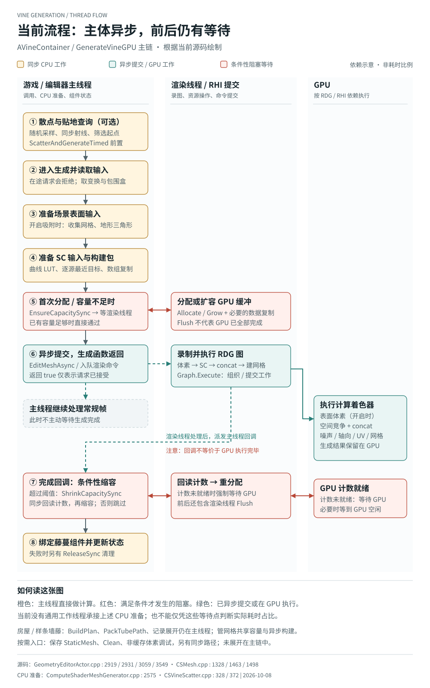
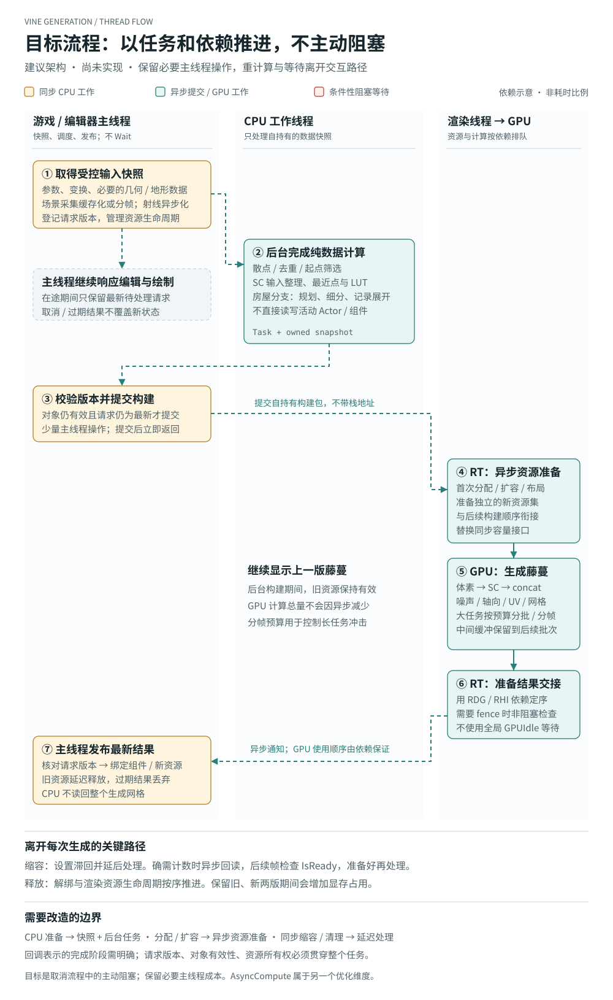

# 藤蔓生成异步改造方案

> **状态：待定。** 本文记录 2026-10-08 讨论的目标架构，不表示方案已采纳或代码已实现。
> 适用范围：现有 `AVineContainer` 生成主链，以及房屋 / 样条墙藤蔓共用的 CPU 准备、管网格构建和资源管理。
> 独立运行时 Actor 方案另见 [VineRuntimeSkill_Plan.md](VineRuntimeSkill_Plan.md)：直接遍历 Nanite 层级并解码三角形，由 `AVineRuntimeActor` 管理生成与生命周期，G 键仅为外部调用示例。两份方案分别讨论，不以本方案全面落地为运行时原型的前提。

## 1. 要解决的问题

目标是让主线程发起生成后继续处理编辑与绘制，避免在生成关键路径中主动等待渲染线程或 GPU。必要的 Actor / 组件状态采集与结果发布仍留在主线程；纯数据计算可交给工作线程；渲染资源操作和 GPU 计算按队列依赖推进。

这不等于把当前 `GenerateVineGPU()` 整个放进线程池。`UCSMesh::EnsureCapacitySync()`、`EditMeshAsync()` 等现有接口要求从游戏线程调用，后台也不能直接遍历或改写正在使用的 Actor / 组件状态。

异步不会减少 GPU 总计算量。渲染线程建图或 GPU 长任务仍可能拖慢帧率，需要单独测量，并视结果引入工作量限制和跨帧调度。

## 2. 当前实现：静态代码检查结论

### 2.1 已异步的主体

`BuildVineGeometryIntoMeshAsync()` 调用 `UCSMesh::EditMeshAsync()`，将表面体素、空间竞争 SC、逐源计数与 concat、噪声 / 轴向 / UV / 网格构建记录到同一张 RDG 图。生成结果保留在 GPU，正常主体不需要把整张网格回读到 CPU。

`GenerateVineGPU()` 返回成功只表示本次构建请求已接受。渲染线程处理图后会向游戏线程派发回调；**此回调不等价于 GPU 已执行完毕**，GPU 后续使用顺序仍依赖 RDG / RHI 的资源与命令依赖。

### 2.2 主线程仍执行的计算

- 可选散点入口：静态网格三角形收集、面积加权采样、去重、逐点地面查询、最远点抽稀和 ISM 写入。
- 生成入口：读取 source / target 变换，整理包围盒和参考点。
- 开启吸附时：`PrepareSurfaceVoxelPassInputs()` 枚举场景网格、展开实例请求、提取 Landscape 三角形、解析网格资源。
- `PrepareVineFusedSCInputs()`：曲线 LUT、目标缩放和每源最近目标 / 起始缩放数组。当前存在每个 source 再遍历 targets 的工作，以及构建包的数组复制。
- 房屋 / 样条墙分支：墙面采样、`BuildPlan()`、生长相位回填、`PackTubePath()` 细分与记录展开；首次使用或资产变化时还要生成基础网格快照。

### 2.3 条件性阻塞

1. **首次分配 / 容量增长：** 异步建网格前仍调用 `EnsureCapacitySync()`。容量足够时直接返回；首次创建或扩容会排入渲染命令，再调用阻塞 Flush。
2. **缩容：** 完成回调仅在超过滞回阈值时调用 `ShrinkCapacitySync()`。实际计数未知时会同步回读；回读未就绪会调用 `SubmitAndBlockUntilGPUIdle()`，再进行缩容重分配。
3. **房屋实例缓冲：** `CSShaperSteps::ReserveCapacity()` 在需要分配 / 增长时仍有阻塞刷新。管网格采用容量台阶预留，可减少增长频率，但不是异步分配。
4. **按需操作：** 保存 StaticMesh、`Clean()` 中的 `ReleaseSync()`、失败清理和非缓存体素调试仍可能走同步路径。

`FlushRenderingCommands()` 等待渲染线程处理队列，不能笼统称为“等待 GPU 完成”。显式 GPU idle / readback 等待应单独统计。以上为代码检查，没有本次实测耗时，不能据此认定哪一项占主要卡顿。

## 3. 目标流程（待定）

```text
主线程：取得受控输入快照，登记请求编号
    ↓ 提交任务后立即返回
工作线程：纯数据计算，产出自持有构建包
    ↓ 回调
主线程：检查对象与请求编号，只提交仍有效的最新请求
    ↓ 入队后立即返回
渲染线程：异步准备资源，记录构建与资源依赖
    ↓ 必要时按预算分批 / 分帧提交
GPU：体素 → SC → concat → 网格
    ↓ 渲染侧建立可用性与使用顺序
主线程：再次校验请求编号，发布 / 绑定最新结果
    ↓
渲染侧：延迟回收不再使用的旧资源
```

### 3.1 输入快照

主线程只取得必要的参数、变换及资源引用，不把任意 UObject 指针交给工作线程解引用。曲线烘焙可先采样成数组，或复制适合离线求值的曲线数据后再计算。

场景枚举和几何采集不能只改名为“快照”就算完成异步化：需要限制区域、缓存不变输入、对大批采集分帧；碰撞查询需采用受支持的异步查询或预算化分帧。资源引用必须在任务结束前保持有效。

### 3.2 后台 CPU 任务

把采样、去重、最近点、数组整理、规划和曲线细分拆成处理独立数据的函数。减少重复构造目标位置 / 缩放数组，尽量移动构建包，避免大型深拷贝。

不在任务内部访问正在变化的组件、世界对象或材质状态；需要访问的内容应在快照阶段准备。

### 3.3 异步资源准备

为首次创建、容量增长和流布局变化建立异步准备接口，接到构建任务之前。不能简单删除当前 Flush：现有函数依赖 Flush 后才能安全访问资源状态，调用约定与资源所有权必须一起调整。

可评估独立的新资源集：新藤蔓构建时继续显示旧藤蔓，完成交接后再回收旧资源。其代价是短时保留两份资源，需要明确显存预算。容量足够时是否允许安全复用已有资源，也需在具体实现中决定。

### 3.4 缩容与释放

缩容移出每次生成完成回调的阻塞路径，采用滞回、延迟处理和预算约束。确需实际 GPU 计数时异步入队回读，后续帧检查 `IsReady()`；未就绪时继续等待未来帧，不触发全局 GPU idle。

释放必须遵守组件解绑、代理引用、在途任务和渲染资源的生命周期顺序。现有 `ReleaseDeferred()` 有“不能有在途编辑”的约束，不能无条件替换所有 `ReleaseSync()` 调用。

### 3.5 请求编号与取消

“版本”指生成请求编号，不是引擎或代码版本。参数更新时递增编号，后台结果与该编号一起返回。在提交构建前、发布结果前均检查对象有效性和编号。

只保留最新待处理请求，避免拖动后排队重放过时结果。已经提交的 GPU 工作不假定能立即取消：可以禁止发布过期结果，并在其不再被使用后回收资源。

### 3.6 跨帧 GPU 预算

如果测量发现单次建图或 GPU 计算过重，按 source / SC 迭代批次拆分工作，保留必要中间缓冲直到后续批次结束。原先一张图内的瞬态资源需改为适当的跨图 / 跨帧持有方式，并保持算法依赖和最终结果一致。

线程异步、GPU 分帧和 `AsyncCompute` 是不同问题；本方案不把开启 `AsyncCompute` 作为消除主线程等待的前提。

## 4. 建议实施顺序（未执行）

1. 给 CPU 准备、资源等待、渲染建图、GPU 执行和结果发布分别加可关联的请求编号 / 性能事件，确认实际瓶颈。
2. 打通异步分配 / 扩容到异步构建的衔接，移出同步缩容；保持原生成外观与参数语义。
3. 拆快照和后台纯计算，处理请求合并、对象销毁、取消与资源持有。
4. 根据测量决定是否进一步缓存场景采集，以及是否拆 GPU 批次。

## 5. 验收边界

- 分别检查首次生成、稳态重建、扩容、缩容、连续改参、删除 Actor 和结束 PIE。
- 生成关键路径不再主动使用阻塞 Flush、线程 Wait / Future Get 或全局 GPU idle；不能把等待转移到每帧固定调用的另一个函数。
- 旧结果不能覆盖最新请求，资源必须在最后一次使用结束后释放。
- 比对固定输入 / 随机种子的藤蔓结果，确认异步拆分没有改变算法结果。
- 主线程快照、每帧提交和 GPU 批次仍有成本；验收应看帧时间分布，不能只看生成函数返回速度。
- 代码编译验证遵循项目 AGENTS 中的 Rider 当前配置规则；本轮只有方案文档，不启动引擎编译。

## 6. 当前证据入口

- [GeometryEditorActor.cpp](Source/ComputeShaderGenerator/Private/GeometryEditorActor.cpp)：`BuildVineGeometryIntoMeshAsync`、`GenerateVineGPU`、`PrepareVineFusedSCInputs`、`CSVineTube::BuildTubeIntoMesh`。
- [CSMesh.cpp](Source/ComputeShaderGenerator/Private/CSMesh.cpp)：`EditMeshAsync`、`EnsureCapacitySync`、`ShrinkCapacitySync`、`ReadCountersSync`、`ReleaseDeferred`。
- [ComputeShaderMeshGenerator.cpp](Source/ComputeShaderGenerator/Private/ComputeShaderMeshGenerator.cpp)：`PrepareSurfaceVoxelPassInputs` 和场景几何输入准备。
- [CSVineScatter.cpp](Source/ComputeShaderGenerator/Private/CSVineScatter.cpp)：同步散点与贴地查询。
- [CSWallBase.cpp](Source/ComputeShaderGenerator/Private/CSWallBase.cpp)：`PackVine`、`SubmitVineTube`、在途请求合并。
- [CSGroundShaperSteps.cpp](Source/ComputeShaderGenerator/Private/CSGroundShaperSteps.cpp)：实例缓冲容量管理。

## 7. 尚待决定

是否采纳整体改造、异步资源接口的具体形式、容量预留 / 双资源显存预算、跨帧粒度和性能指标均待后续决定。本文不把讨论中的接口或调度器视为现有能力。

## 8. 配套流程图

图中位置表示依赖关系，不代表实测耗时；目标图仅描述待定架构。

### 当前流程



### 目标流程（待定）


